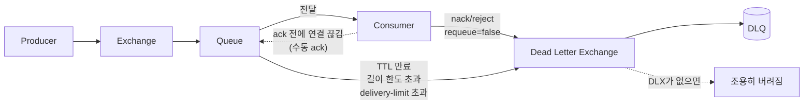

## 원본 메모
dlq 란 ?? dead letter que 
처리가 안된 메세지 큐 
운영상 문제 발생할 시나리오

## 답
DLQ(Dead Letter Queue)는 별도 종류의 큐가 아니라, 처리되지 못한 메시지가 **DLX(Dead Letter Exchange)를 거쳐 모이는 일반 큐**다. 큐에 DLX를 지정해 두면 특정 사건이 생긴 메시지가 그 교환기로 다시 발행되고, 교환기에 바인딩된 큐가 DLQ 역할을 한다.
> "these messages are republished to an exchange when any of the following four events occur." ([RabbitMQ: Dead Letter Exchanges](https://rabbitmq.com/docs/dlx))

### 메시지가 DLQ로 가는 4가지 경우
1. 소비자가 `basic.reject`/`basic.nack`(negative acknowledgement, 처리 실패 응답)을 `requeue=false`로 보냈을 때. DLX가 없으면 그냥 버려진다.
   > "the message will be routed to a Dead Letter Exchange if it is configured, otherwise it will be discarded." ([RabbitMQ: Consumer Acknowledgements](https://www.rabbitmq.com/docs/confirms))
2. 메시지 TTL(Time-To-Live)이 만료됐을 때
3. 큐 길이 한도를 넘었을 때
4. quorum 큐에서 재전달 횟수 한도(delivery-limit)를 넘었을 때. RabbitMQ 4.0부터 기본값이 20이다.
   > "Starting with RabbitMQ 4.0, the delivery limit for quorum queues defaults to 20." ([RabbitMQ: Quorum Queues](https://www.rabbitmq.com/docs/4.0/quorum-queues))

### 설정할 때 알아둘 것
- DLX는 큐 인자(`x-dead-letter-exchange`)보다 **정책(policy)**으로 지정하는 것이 권장된다. 둘 다 있으면 큐 인자가 이긴다.
  > "Hardcoded `x-arguments` are strongly recommended against" ([RabbitMQ: Dead Letter Exchanges](https://rabbitmq.com/docs/dlx))
- dead-letter 라우팅 키를 지정하지 않으면 메시지의 원래 라우팅 키를 그대로 쓴다.
  > "If the routing key is not set, the message's own routing keys are used." ([RabbitMQ: Dead Letter Exchanges](https://rabbitmq.com/docs/dlx))
- dead-letter된 메시지에는 `x-death` 헤더가 붙는다. 어디서, 왜 dead-letter됐는지가 최신 순 배열로 남는다.
  > "An AMQP 0.9.1 message will contain an `x-death` header with the value being an array." ([RabbitMQ: Dead Letter Exchanges](https://rabbitmq.com/docs/dlx))

### 운영상 문제가 생기는 시나리오
원본 메모가 물은 부분이다.

| 시나리오 | 무슨 일이 생기나 | 근거 |
| --- | --- | --- |
| DLX 이름 오타, DLX 삭제 | dead-letter 대상 메시지가 오류 없이 사라진다 | "If it is missing then, the messages are silently dropped." ([DLX](https://rabbitmq.com/docs/dlx)) |
| DLX 없이 `requeue=false` 거절 | 메시지가 그대로 버려진다 | 위 4가지 경우 1번 인용 ([Confirms](https://www.rabbitmq.com/docs/confirms)) |
| 처리 못 하는 메시지를 `requeue=true`로 계속 돌려보냄 | 큐와 소비자 사이를 무한히 오가며 네트워크·CPU를 쓴다 | "Such loops can be costly in terms of network bandwidth and CPU resources." ([Confirms](https://www.rabbitmq.com/docs/confirms)) |
| RabbitMQ 4.0으로 올렸는데 quorum 큐에 DLX가 없음 | 재전달 20회를 넘은 메시지가 삭제된다. 공식 문서는 모든 quorum 큐에 dead-letter 설정을 권장한다 | "the message will be dropped (removed) or dead-lettered (if a DLX is configured)." ([Quorum Queues](https://www.rabbitmq.com/docs/4.0/quorum-queues)) |
| 클러스터에서 기본 dead-lettering 사용 | dead-letter 재발행에 publisher confirm이 없어 유실 가능성이 있다. quorum 큐는 at-least-once dead-lettering을 지원한다 | "using DLX in a clustered RabbitMQ environment is not guaranteed to be safe." ([DLX](https://rabbitmq.com/docs/dlx)) |
| DLX가 다시 원래 큐로 돌아오는 순환 구성 | 순환 중 거절이 한 번도 없으면 RabbitMQ가 순환을 감지하고 메시지를 버린다 | "RabbitMQ will detect a cycle and drop the message" ([DLX](https://rabbitmq.com/docs/dlx)) |

## 코드 예제 (Spring AMQP)
Spring에서 `@RabbitListener`를 쓰면 위 표의 "처리 못 하는 메시지를 계속 돌려보냄" 시나리오가 **기본 동작**이다.

```java
// application.yml — 예외 난 메시지를 큐로 되돌리지 않음 (DLX가 있으면 DLQ로, 없으면 버려짐)
// spring.rabbitmq.listener.simple.default-requeue-rejected: false

@RabbitListener(queues = "order.queue")  // ← ack 모드 기본값 AUTO: 정상 종료면 ack, 예외면 nack
public void handle(OrderMessage msg) {
    if (!msg.isValid()) {
        // ← 이 메시지만 requeue 없이 거절 → DLX가 있으면 DLQ, 없으면 버려짐
        throw new AmqpRejectAndDontRequeueException("검증 실패: " + msg.id());
    }
    orderService.process(msg);  // ← 일반 예외가 나면 기본값(requeue=true)이라 큐로 돌아가 다시 전달
}
```

- Spring의 `AUTO`는 RabbitMQ의 자동 ack가 아니다. 컨테이너가 리스너가 정상 종료했는지 보고 ack/nack한다. RabbitMQ의 자동 ack(autoAck)는 Spring에서 `NONE`이다.
  > "Do not confuse with RabbitMQ autoAck which is represented by NONE here." ([Spring AMQP: AcknowledgeMode](https://docs.spring.io/spring-amqp/api/org/springframework/amqp/core/AcknowledgeMode.html))
- 리스너가 예외를 던진 메시지를 다시 큐에 넣을지 정하는 `defaultRequeueRejected`의 기본값은 `true`다. ([Spring AMQP: Container Attributes](https://docs.spring.io/spring-amqp/reference/4.0/amqp/containerAttributes.html)) Spring Boot 문서도 재시도를 켜지 않은 상태에서 리스너가 예외를 던지면 무한히 재전달된다고 하고, 이 값을 `false`로 하거나 `AmqpRejectAndDontRequeueException`을 던지라고 안내한다. ([Spring Boot: AMQP](https://docs.spring.io/spring-boot/reference/messaging/amqp.html))
  > "Setting defaultRequeueRejected to false causes messages to be discarded (or routed to a dead letter exchange)." ([Spring AMQP: Exception Handling](https://docs.spring.io/spring-amqp/reference/amqp/exception-handling.html))
- DLX 자체는 코드의 큐 인자보다 RabbitMQ 정책으로 지정한다(위 "설정할 때 알아둘 것").

## 선행 개념
- [[RabbitMQ ack 모드]]: ack(acknowledgement, 처리 완료 확인)를 자동으로 하는 자동 ack는 보내는 즉시 성공으로 처리해서 소비자가 죽으면 메시지가 사라진다. 수동 ack에서 ack 전에 채널·연결이 끊긴 메시지는 큐로 자동 재전달된다. 소비자 장애 대비는 DLQ가 아니라 이쪽이다.
  > "automatic message acknowledgement should be considered unsafe and not suitable for all workloads." · "any delivery (message) that was not acked is automatically requeued" ([RabbitMQ: Consumer Acknowledgements](https://www.rabbitmq.com/docs/confirms))
- [[DLX]]: dead-letter된 메시지를 다시 받는 교환기다. 위 "설정할 때 알아둘 것"이 DLX 설정이다.

## 다음에 볼 개념
### 다음
- [[메시지 TTL]] — 메시지가 큐에 머물 수 있는 최대 시간
- [[큐 길이 제한]] — 큐에 쌓을 수 있는 개수·용량 상한과 넘칠 때 동작
- [[quorum 큐]] — Raft로 여러 노드에 복제되는 내구성 큐
- [[publisher confirms]] — 브로커가 메시지를 안전하게 받았다고 생산자에게 알려 주는 확인
- [[재시도 큐 패턴]] — TTL 대기 큐 + DLX로 일정 시간 뒤 다시 처리하는 구성

## 다이어그램


## 확인 과제
내 환경의 RabbitMQ에서 실행해 보고, 결과를 회사 정보 없이 inbox에 `결과: ...` 한 줄로 넣는다.
`rabbitmqctl`은 RabbitMQ 노드를 관리하는 CLI다(이름 유래: 문서 근거 없음). `list_queues` 뒤의 단어는 옵션이 아니라 보여 줄 열 이름이다. ([rabbitmqctl(8)](https://www.rabbitmq.com/docs/man/rabbitmqctl.8))
- [ ] `rabbitmqctl version`: 4.0 이상이면 quorum 큐 기본 delivery-limit 20이 적용된다
- [ ] `rabbitmqctl list_policies`: `dead-letter-exchange`를 지정한 정책이 있는지
- [ ] `rabbitmqctl list_queues name type messages policy`: quorum 큐인데 DLX 정책이 없는 큐가 있는지 (열: 큐 이름 · 큐 종류(classic/quorum) · 쌓인 메시지 수 · 적용된 정책)
- [ ] 내 Spring 설정에서 `default-requeue-rejected`와 `acknowledge-mode`를 따로 지정했는지 (안 했으면 AUTO + requeue=true)

## 복습 카드
- DLQ는 ==Dead Letter Queue==의 약자다. <!--til:2026-11-11,7,2,2-->
- DLQ에는 ==처리되지 않은 메시지|처리 안 된 메시지|처리 못 한 메시지==가 모인다. <!--til:2026-11-11,7,2,2-->
- 수동 ack 모드에서 ack 전에 연결이 끊긴 메시지는 ==큐로 자동 재전달|큐로 재전달|재전달==된다. <!--til:2026-11-05,1,2,0-->
- DLX로 지정한 교환기가 없으면 dead-letter 대상 메시지는 오류 없이 조용히 ==버려진다|버려짐|폐기된다==. <!--til:2026-11-11,7,2,2-->
- RabbitMQ 4.0부터 quorum 큐의 기본 ==delivery-limit==은 ==20==회다. <!--til:2026-11-05,1,2,0-->

## 복습 기록
- 2026-10-23 (Claude 말로 복습) Q: 메시지가 DLQ로 가는 경우는?
  - 내 대답: 소비자(WAS)가 처리 중 죽으면 처리 중이던 메시지가 사라지는 것을 막는다.
  - 교정: 소비자가 죽었을 때 메시지를 지키는 건 DLQ가 아니라 수동 ack다. 수동 ack에서 ack 안 된 메시지는 채널·연결이 끊기면 큐로 자동 재전달되고, 자동 ack면 그냥 유실된다(DLQ로도 안 감). ([Consumer Acknowledgements](https://www.rabbitmq.com/docs/confirms))
  - DLQ로 가는 경우는 4가지: ① 소비자가 reject/nack(requeue=false) ② 메시지 TTL 만료 ③ 큐 길이 한도 초과 ④ quorum 큐의 재전달 횟수 한도 초과. ([Dead Letter Exchanges](https://www.rabbitmq.com/docs/dlx))
  - 결과: 오개념 1개 → `check` 유지, 다음 복습에서 다시 묻기
