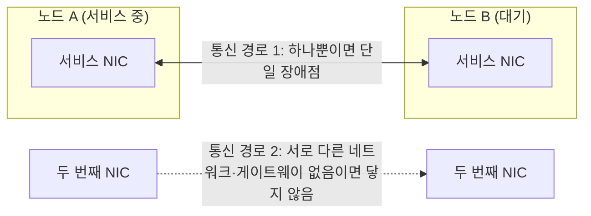

## 원본 메모
- 질문: HA 클러스터 솔루션(LifeKeeper 같은)에서 VIP(가상 IP)와 하트비트(노드 간 통신 경로)는 각각 무엇이고, 하트비트 경로가 하나뿐이면 왜 위험한가?
- 상황 한 줄: DB 두 대에 HA 클러스터가 구성돼 있었는데 노드 간 통신 경로가 서비스 NIC 하나뿐이었음. 두 번째 경로용 NIC를 붙이는 중
- 결과: 두 번째 NIC의 IP 두 개가 서로 다른 네트워크이고 게이트웨이도 없어 서로 닿지 않는 것을 메타데이터로 확인함

## 답
### 왜 필요한가
HA(High Availability, 고가용성) 클러스터는 서버(노드) 두 대 이상이 서로 상태를 확인하면서 한쪽이 죽으면 다른 쪽이 일을 넘겨받는 구성이다. 노드끼리 말을 주고받을 길이 없으면 상대가 살았는지 죽었는지 알 수 없다. LifeKeeper 문서는 이 길을 **통신 경로(communication path)**라고 부르고, "노드끼리 통신하게 해 주는 방법(mechanism)"으로 설명한다. ([Define Communication Paths, LifeKeeper for Linux 9.5.1](https://docs.us.sios.com/spslinux/9.5.1/en/topic/define-communication-paths))

예시 하나로 정리한다. **노드 A**(지금 서비스 중)와 **노드 B**(대기) 두 대가 있고, 둘을 잇는 길이 서비스용 NIC(Network Interface Card, 네트워크 카드) 하나뿐인 상황이다.

- **하트비트(heartbeat)**: 노드 A·B가 서로 "나 살아 있다"를 주고받는 일. 메모에서는 이것을 "노드 간 통신 경로"로 적었고, LifeKeeper 문서의 용어로는 통신 경로가 이 길에 해당한다. 하트비트라는 단어 자체의 정의는 읽은 문서에서 확인하지 못했다.
- **하트비트 경로가 하나뿐일 때 위험한 점**: 문서는 통신 경로를 여러 개 두라고 요구하는 이유를 "단일 장애점(single point of failure, 한 군데가 고장 나면 전체가 멈추는 지점)을 피하기 위해서"라고 쓴다. 각 노드의 네트워크 카드나 노드 사이의 라우터가 그 지점이 될 수 있다고 든다.
> "multiple communication paths are required to avoid a single point of failure" ([Define Communication Paths](https://docs.us.sios.com/spslinux/9.5.1/en/topic/define-communication-paths))
- 경로가 하나뿐이면 GUI가 각 노드에 노란 경고 삼각형을 보여 주고, 두 번째 경로를 정의하면 초록 체크로 바뀐다. 다만 같은 문서는 클라우드에서는 경로 하나로 "충분할 수 있고" 그 경고를 무시해도 된다고도 쓴다. 이 환경이 클라우드 VM이라서 두 번째 NIC를 붙이는 목적이 이 경고 해소인지는 알 수 없다.

내 환경의 결과와 맞춰 보면, 두 번째 NIC를 붙여도 두 IP가 서로 다른 네트워크이고 게이트웨이가 없으면 노드 A·B가 그 NIC로 서로 닿지 않으므로 **새 경로가 실제 경로가 되지 못한다**. (메타데이터로 확인한 내 결과. 문서가 이 경우를 직접 다루지는 않음.)

### VIP(Virtual IP, 가상 IP)
VIP는 특정 서버 한 대가 아니라 "서비스"에 붙는 주소로, 장애가 나면 이 주소가 다른 노드로 옮겨 간다는 뜻으로 쓰는 말이다. 다만 **이 정의는 이번에 읽은 공식 문서에서 확인하지 못해** 여기에 사실로 적지 않는다. 아래 "열린 질문"에 남긴다.

### 원본 메모에서 아직 열린 질문
- VIP의 LifeKeeper 문서상 정의(IP Recovery Kit 등)와, VIP가 서비스 NIC 이름(예: ens3)에 붙는다는 점이 문서에서 어떻게 나오는지 확인하지 못했다. 이 부분은 NIC 이름 고정 질문(같은 날 inbox의 다른 메모)과 이어진다.
- 통신 경로가 모두 끊겼을 때 일어나는 일(스플릿 브레인 등)은 문서에 별도 항목("What is 'Split Brain' and How to Avoid It")이 있다는 것까지만 확인했고 내용은 읽지 못했다.
- 경로 하나로 충분하다는 클라우드 예외가 이 환경에 해당하는지.

## 선행 개념
- [[HA 클러스터]]: 서버 여러 대가 한 서비스를 맡고, 한 대가 못 쓰게 되면 다른 대가 이어받는 구성. PostgreSQL 문서는 공유 디스크 방식에서 주 서버가 죽으면 대기 서버가 디스크를 마운트해 데이터베이스를 시작한다고 설명한다. ([PostgreSQL 18: Comparison of Different Solutions](https://www.postgresql.org/docs/current/different-replication-solutions.html))

## 다음에 볼 개념
### 선행
- [[HA 클러스터]] — 노드 간 상태 확인과 넘김이 왜 필요한지의 바탕
### 다음
- [[공유 디스크 HA와 스트리밍 복제 HA 차이]] — 같은 한 쌍 서버에서 두 방식을 섞을 때 생기는 문제

## 다이어그램

## 확인 과제
내 환경에서 해 보고, 결과를 회사 정보 없이 inbox에 `결과: ...` 한 줄로 넣는다.
- [ ] HA 제품의 GUI 통신 경로 화면에서 노드마다 경로가 몇 개이고 각각 어느 NIC를 쓰는지, 경고 삼각형이 떠 있는지 확인한다 (경고 삼각형은 LifeKeeper 9.5.1 문서 기준, 내 버전 확인 필요).
- [ ] 두 번째 NIC의 IP 두 개가 같은 네트워크 대역인지, 게이트웨이(routes)가 있는지 다시 확인한다 (이미 확인한 결과가 있으면 "닿는다/안 닿는다" 한 줄만).

## 복습 카드
- LifeKeeper 문서는 통신 경로를 하나만 두면 각 노드의 네트워크 카드나 라우터가 ==단일 장애점|single point of failure==이 될 수 있어 여러 개를 요구한다.
- LifeKeeper 문서에서 ==통신 경로|communication path==는 노드끼리 통신할 수 있게 해 주는 방법(mechanism)이다.

## 복습 기록
