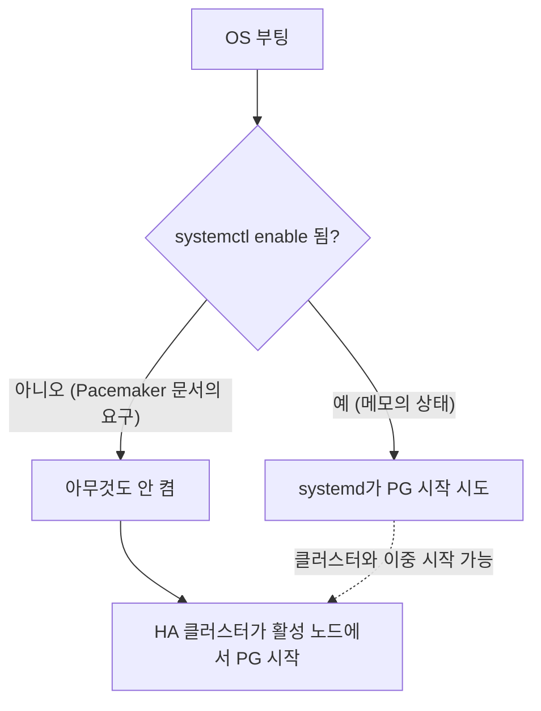

## 원본 메모
- 질문: HA 클러스터가 관리하는 서비스(PG 등)는 왜 OS 부팅 자동 시작(systemctl enable)을 꺼 두나?
- 상황 한 줄: 활성 노드에서 PG는 돌고 있는데 systemctl is-active postgresql은 failed, is-enabled는 enabled였음. PG를 켠 주체가 systemd가 아니라 HA 클러스터였음

## 답
### 왜 필요한가
HA 클러스터는 "지금 어느 노드에서 PG를 켤지"를 스스로 정한다. 그런데 OS 부팅 때 systemd가 PG를 또 켜면 **서비스를 켜는 주체가 둘**이 된다. 이 환경에서 쓰는 LifeKeeper 문서는 이 규칙을 찾지 못했지만, 같은 종류 제품인 Pacemaker 문서는 규칙 자체를 명시한다. 이유 설명은 읽은 부분에 없었다.
> "Make sure that any systemd services to be controlled by the cluster are not enabled to start at boot." · "Do not run systemctl enable on the unit." ([Pacemaker Explained 2.1, 5.2.2 Systemd](https://clusterlabs.org/pacemaker/doc/2.1/Pacemaker_Explained/html/resources.html))

즉 **클러스터가 켜고 끄는 서비스는 부팅 때 systemd가 자동으로 켜게 하지 않는다**가 확인된 규칙이다. LifeKeeper에도 같은 규칙이 있는지, 이유가 무엇인지는 이 노트에서 사실로 적지 않고 아래 열린 질문에 둔다.

### 용어: systemctl enable / is-enabled / is-active
- `systemctl`: 이름 유래: 문서 근거 없음. man NAME: "Control the systemd system and service manager" ([systemctl(1)](https://www.freedesktop.org/software/systemd/man/latest/systemctl.html))
- `enable`: 유닛 파일의 `[Install]` 구역에 정해 둔 심볼릭 링크를 만들어, 부팅 등에서 이 유닛이 시작되게 한다. **지금 당장 시작하지는 않는다.**
> "Note that this does not have the effect of also starting any of the units being enabled." (systemctl(1))
- `is-enabled`: 유닛 파일이 enable 상태인지 본다. → 메모에서 `enabled`: 부팅 때 systemd가 켜는 대상이다.
- `is-active`: 유닛이 지금 active(실행 중)인지 본다. `failed`는 "inactive와 비슷하나 유닛이 어떤 식으로든 실패했다"는 상태다(오류 코드로 종료, 충돌, 시간 초과, 재시작 한도 초과 등).
> "Similar to inactive, but the unit failed in some way." (systemctl(1))

### 메모의 관찰 읽기
- 메모: 활성 노드에서 PG는 돌아가는데 `is-active`는 `failed`, `is-enabled`는 `enabled`.
- `failed`는 **systemd가 관리하는 유닛**의 상태다. PG를 켠 것이 HA 클러스터라면 systemd가 보는 유닛 상태와 실제 프로세스 상태가 따로 놀 수 있다. 메모에서 PG를 켠 주체가 클러스터라고 확인했으므로 이 설명과 맞는다.
- `enabled`가 켜져 있는 것은 클러스터 관리 서비스에 대한 위 규칙과 어긋난다. 이번 부팅 때 systemd의 시작 시도가 실패해 `failed`가 남았는지는 로그를 봐야 알 수 있다. (이 추정은 문서가 아니라 관찰에서 나온 것이므로 확인 과제로 남김)

### 원본 메모에서 아직 열린 질문
- LifeKeeper 문서가 클러스터 관리 서비스의 부팅 자동 시작을 어떻게 안내하는지.
- Pacemaker 문서가 이 규칙의 이유를 어디서 설명하는지.
- 이 환경의 `failed`가 부팅 때 systemd가 PG를 켜려다 실패한 결과인지(`journalctl` 확인).

## 선행 개념
- [[HA 클러스터]]: 서버 여러 대가 한 서비스를 맡고 한 대가 못 쓰면 다른 대가 이어받는 구성. 서비스 시작·정지를 클러스터가 직접 한다. (Pacemaker 문서의 "services to be controlled by the cluster" 표현)

## 다음에 볼 개념
### 선행
- [[HA 클러스터]] — 서비스를 켜고 끄는 주체가 클러스터인 이유
### 다음
- [[HA 클러스터 VIP와 하트비트]] — 클러스터가 노드 상태를 어떻게 확인하는지

## 다이어그램

## 확인 과제
내 환경에서 해 보고, 결과를 회사 정보 없이 inbox에 `결과: ...` 한 줄로 넣는다.
- [ ] `systemctl is-enabled postgresql`와 `systemctl is-active postgresql`: 두 값을 다시 확인 (`is-enabled` 유닛 파일이 enable인지 · `is-active` 지금 실행 중인지, systemctl(1) 기준)
- [ ] `journalctl -u postgresql -b`: 이번 부팅의 PG 유닛 로그에서 실패 이유 확인. `journalctl` 이름 유래: 문서 근거 없음 · `-u` unit, 유닛 지정 · `-b` boot, 이번 부팅분 (옵션 풀이는 journalctl man 페이지 확인 필요)

## 복습 카드
- Pacemaker 문서는 클러스터가 제어할 systemd 서비스를 ==부팅 때 시작되도록|enabled to start at boot== 설정하지 말라고 요구한다.
- systemctl ==enable==은 유닛을 바로 시작하지 않고 [Install] 구역의 심볼릭 링크만 만든다.

## 복습 기록
