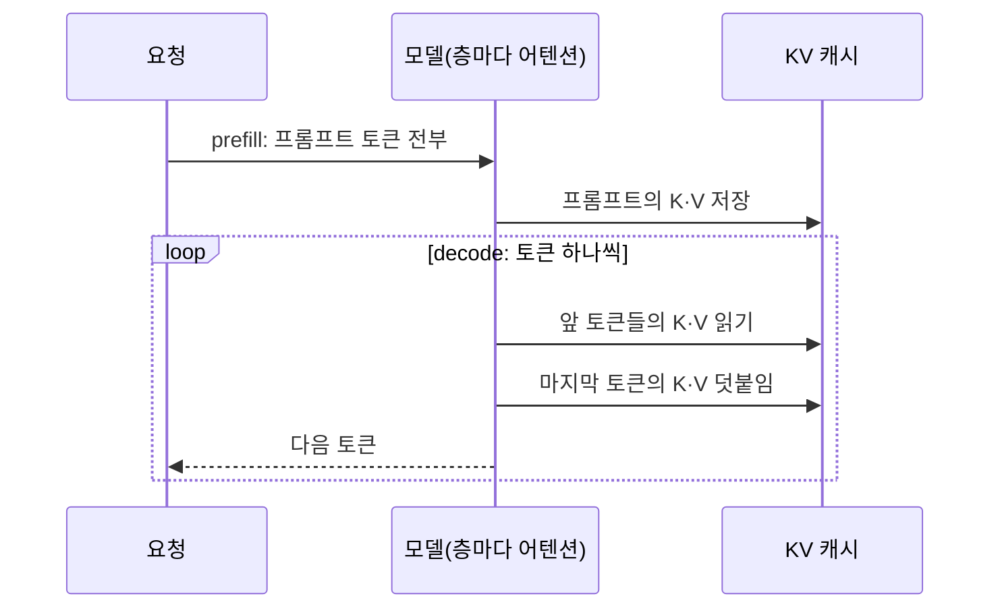

## 원본 메모
(메모 제목: vllm 과 ollama 비교)
- llm 의 동작 방식에서 kv 캐시의 역할을 기준으로개념 정립

## 답
**KV(Key-Value) 캐시는 LLM(Large Language Model)이 이미 처리한 토큰의 계산 결과를 메모리에 쌓아 두는 곳이다.** 덕분에 토큰 하나를 만들 때마다 앞 토큰 전체를 다시 계산하지 않는다. 대신 메모리를 먹기 때문에, 서빙에서는 이 공간을 어떻게 나눠 쓰느냐가 동시 처리량을 정한다. **vLLM과 Ollama의 차이도 여기서 갈린다.**

### 1. LLM 동작 안에서의 역할
1. **prefill**: 프롬프트 토큰은 미리 다 알고 있으니 한꺼번에 계산해서 K·V를 캐시에 넣는다.
> "the computation of the prompt phase can be parallelized using matrix-matrix multiplication operations." ([vLLM 논문 §2.2](https://ar5iv.labs.arxiv.org/html/2309.06180))
2. **decode**: 그 뒤로는 앞 토큰에 의존하므로 한 스텝에 토큰을 하나씩 만든다.
> "the computation at different iterations cannot be parallelized due to the data dependency." ([vLLM 논문 §2.2](https://ar5iv.labs.arxiv.org/html/2309.06180))
3. **스텝마다**: 마지막 토큰의 K·V만 새로 계산해 캐시에 덧붙이고, 캐시 전체와 어텐션을 계산한다.
> "At each step, the new key and value vectors are **stored** in the cache and **appended** to the past keys and values." ([Transformers: Cache explanation](https://huggingface.co/docs/transformers/v5.14.0/cache_explanation))

캐시를 재사용해도 되는 이유는 한 번 처리한 토큰의 표현이 뒤에 오는 토큰 때문에 바뀌지 않기 때문이다.
> "Once a token is processed, its representation never changes with respect to future tokens" ([Transformers: Cache explanation](https://huggingface.co/docs/transformers/v5.14.0/cache_explanation))

| | 캐시 없음 | 캐시 있음 |
| --- | --- | --- |
| 스텝마다 계산 | 앞 토큰 전부의 K·V를 다시 | 현재 토큰의 K·V만 |
| 대가 | 연산 | 메모리 ("memory grows linearly, but compute/token remains low") |

출처: [Transformers: Cache explanation](https://huggingface.co/docs/transformers/v5.14.0/cache_explanation)

### 2. 크기는 무엇으로 정해지나
층(layer)마다 Key와 Value 텐서가 하나씩 있고, 모양은 `[batch_size, num_heads, seq_len, head_dim]`이다. ([Transformers: Cache explanation](https://huggingface.co/docs/transformers/v5.14.0/cache_explanation)) 그래서 **동시 요청 수(`batch_size`)와 토큰 수(`seq_len`)에 모두 비례한다.** 서빙에서 KV 캐시 관리가 최대 배치 크기를 정한다는 말이 여기서 나온다.
> "the way the KV cache is managed is critical in determining the maximum batch size." ([vLLM 논문 §1](https://ar5iv.labs.arxiv.org/html/2309.06180))

### 3. 이 기준으로 본 vLLM과 Ollama
| | vLLM | Ollama |
| --- | --- | --- |
| 캐시 공간 | GPU(Graphics Processing Unit) 메모리의 일정 비율을 미리 잡아 **요청들이 블록 단위로 나눠 씀** | 슬롯 수 × 컨텍스트 길이만큼 **슬롯마다 잡음** |
| 근거 | "vLLM pre-allocates GPU cache using this percentage of memory." ([Optimization](https://docs.vllm.ai/en/stable/configuration/optimization/)) | "Required RAM will scale by `OLLAMA_NUM_PARALLEL` \* `OLLAMA_CONTEXT_LENGTH`." ([FAQ](https://docs.ollama.com/faq)) |
| 단위 | 블록(기본 16토큰, [CacheConfig](https://docs.vllm.ai/en/stable/api/vllm/config/cache/)). 블록은 이어진 공간에 있지 않아도 된다 | 컨텍스트 길이 (2K × 4개 요청 = 8K, [FAQ](https://docs.ollama.com/faq)) |
| 같은 접두어 | 해시로 블록을 찾아 **요청끼리 재사용** ([Prefix caching](https://docs.vllm.ai/en/stable/design/prefix_caching/)) | 슬롯별 프롬프트 캐시 (아래 주의) |

- **vLLM의 블록 방식(PagedAttention)**: 운영체제의 가상 메모리·페이징에서 착안했다. 요청의 최대 길이만큼 이어진 메모리를 미리 잡는 기존 방식의 낭비를 줄인다. ([논문 초록](https://arxiv.org/abs/2309.06180)) · "the blocks for the KV cache are not necessarily stored in contiguous space." ([§1](https://ar5iv.labs.arxiv.org/html/2309.06180))
- **Ollama 쪽 층**: Ollama는 고정한 버전의 llama.cpp로 `llama-server`를 빌드해 쓴다. ([ollama/llama README](https://github.com/ollama/ollama/blob/main/llama/README.md)) llama.cpp에서 `--ctx-size`는 KV 캐시 전체 크기이고, 슬롯 P개에 슬롯당 T토큰을 보장하려면 `T*P`로 잡는다. (메인테이너 설명, 2024년 1월: [llama.cpp 토론 #4130](https://github.com/ggml-org/llama.cpp/discussions/4130))
- **주의**: Ollama의 프롬프트 캐시 동작은 공식 문서에 없다. 슬롯 하나에 프롬프트 캐시 하나라는 내용은 사용자 이슈 보고다. ([ollama #18938](https://github.com/ollama/ollama/issues/18938)) 근거 수준이 낮아 `check`로 둔다.

### 원본 메모에서 아직 열린 질문
- 이 답은 "vLLM과 Ollama를 KV 캐시 기준으로 정리"로 읽었다. 어텐션 수식까지 보고 싶으면 [[어텐션]] 씨앗에 질문을 남기면 된다.

## 선행 개념
- [[어텐션]]: 지금 토큰의 Query와 앞 토큰들의 Key·Value로 다음 토큰을 예측할 표현을 계산한다. 층마다 따로 계산하므로 캐시도 층마다 있다. ([Transformers: Cache explanation](https://huggingface.co/docs/transformers/v5.14.0/cache_explanation))
- [[prefill과 decode]]: 프롬프트를 한꺼번에 처리하는 단계와 토큰을 하나씩 만드는 단계다. 앞은 병렬로 계산할 수 있고 뒤는 앞 토큰에 의존한다. ([vLLM 논문 §2.2](https://ar5iv.labs.arxiv.org/html/2309.06180))

## 다음에 볼 개념
### 선행
- [[어텐션]] — K·V가 쓰이는 계산
- [[prefill과 decode]] — 캐시가 채워지는 단계와 자라는 단계
### 다음
- [[vLLM과 Ollama 동시성 차이]] — 캐시를 나눠 쓰는 방식이 동시 처리에 주는 영향
- [[vLLM과 Ollama 설정값과 튜닝]] — 캐시 크기를 정하는 설정값
- [[PagedAttention]] — 캐시를 블록으로 나눠 관리하는 방식
- [[prefix caching]] — 같은 접두어의 블록을 요청끼리 재사용
- [[LLM 서빙]] — 이 노트들의 부모 개념

## 다이어그램

## 확인 과제
내 환경에서 해 보고, 결과를 회사 정보 없이 inbox에 `결과: ...` 한 줄로 넣는다.
- [ ] `ollama ps`: 모델의 SIZE와 PROCESSOR를 본다. `OLLAMA_CONTEXT_LENGTH`를 2배로 올려 다시 띄운 뒤 SIZE가 어떻게 달라지는지 비교한다. (`ollama` 이름 유래: 문서 근거 없음 · `ps`: 불러온 모델 목록, 옵션 없음. [FAQ](https://docs.ollama.com/faq))
- [ ] `curl -s <서버 주소>/metrics | grep kv_cache_usage_perc`: vLLM에서 요청 전후로 사용 중인 KV 캐시 블록 비율(0~1)을 비교한다. (`curl` man NAME: "transfer a URL" · `-s` silent(진행 표시 숨김) · `grep` man NAME: "print lines that match patterns". 지표: [Metrics](https://docs.vllm.ai/en/stable/design/metrics/))

## 복습 카드
- KV 캐시는 이미 처리한 토큰의 ==Key와 Value|K와 V|키와 값==를 저장해, 다음 토큰을 만들 때 마지막 토큰의 것만 새로 계산하게 한다.
- KV 캐시를 쓰면 토큰당 연산량은 낮게 유지되는 대신 메모리가 토큰 수에 ==선형으로|비례해서== 늘어난다.

## 복습 기록
