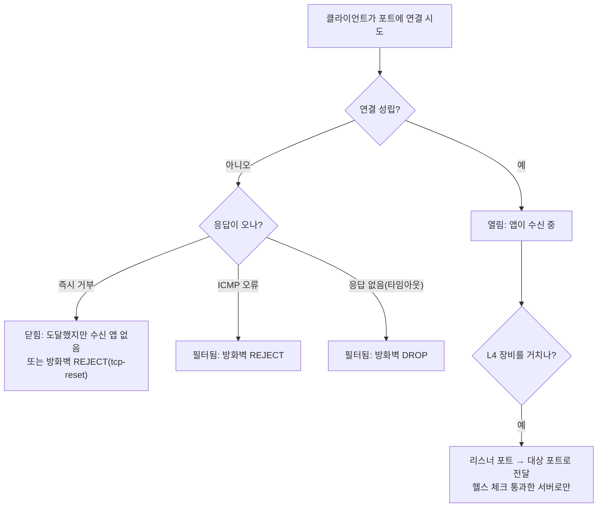

## 원본 메모
- L4 장비의 443 과 81 | 80 포트의 오픈 여부에 따른 네트워크 및 방화벽 상태 차이 -> 이에 따른 애들 확인 ---

## 답
"포트가 열렸나"의 답은 둘이 아니라 셋이다. **열림**(수신 중인 앱이 있음), **닫힘**(장비에 도달했지만 수신 앱이 없음), **필터됨**(방화벽이 막아서 판단 불가). 연결을 시도했을 때 어떤 반응이 오는지로 셋을 구분하고, 이걸로 문제가 서비스 쪽인지 방화벽 쪽인지 갈린다.

> 약어: TCP(Transmission Control Protocol) · RST(reset, 연결을 끊는 TCP 제어 비트) ([RFC 9293](https://www.rfc-editor.org/rfc/rfc9293)) · UDP(User Datagram Protocol) ([RFC 768](https://www.rfc-editor.org/rfc/rfc768)) · ICMP(Internet Control Message Protocol, 오류·제어 메시지) ([RFC 792](https://www.rfc-editor.org/rfc/rfc792)) · DROP·REJECT는 약어 아님(방화벽 규칙의 동작 이름)

| 상태 | 연결 시도 시 보이는 현상 | 뜻 | 근거 |
| --- | --- | --- | --- |
| 열림 | 연결이 성립한다 | 그 포트에서 앱이 수신 중 | "An application is actively accepting TCP connections, UDP datagrams or SCTP associations on this port." ([Nmap](https://nmap.org/man/man-port-scanning-basics.html)) |
| 닫힘 | 즉시 거부 응답이 온다 | 패킷은 도달했지만 수신 중인 앱이 없다. 서비스가 죽었거나 다른 포트에 떠 있다 | "A closed port is accessible (it receives and responds to Nmap probe packets)." ([Nmap](https://nmap.org/man/man-port-scanning-basics.html)) |
| 필터됨 (DROP) | 응답 없이 타임아웃 | 방화벽이 패킷을 버린다 | "packet filtering prevents its probes from reaching the port." ([Nmap](https://nmap.org/man/man-port-scanning-basics.html)) |
| 필터됨 (REJECT) | 즉시 오류 응답이 온다 | 방화벽이 막으면서 오류를 돌려준다. 기본은 ICMP port-unreachable | "it also sends back an error message to the host sending the packet that was blocked." ([iptables REJECT](https://rlworkman.net/howtos/iptables/chunkyhtml/x4571.html)) |

방화벽 REJECT를 `tcp-reset`으로 설정하면 TCP RST를 돌려준다. 그러면 겉보기에는 "닫힘"과 비슷해서, 즉시 거부만 보고 서비스 문제로 단정하면 안 된다.
> "The tcp-reset option will tell REJECT to send a TCP RST packet in reply to the sending host." ([iptables REJECT](https://rlworkman.net/howtos/iptables/chunkyhtml/x4571.html))

### L4 장비가 끼면 확인 지점이 둘이 된다
L4(Layer 4) 장비(로드밸런서)는 OSI 7계층 중 4계층, 즉 전송 계층(TCP/UDP와 포트)에서 동작한다. 클라이언트가 붙는 **리스너 포트**와 실제 서버로 넘기는 **대상 포트**가 따로 있고, 헬스 체크를 통과한 서버로만 보낸다. 아래 인용은 대표적인 L4 로드밸런서인 AWS NLB(Network Load Balancer) 문서 기준이다.
> "A *listener* checks for connection requests from clients, using the protocol and port that you configure, and forwards requests to a target group." · "It monitors the health of its registered targets, and routes traffic only to the healthy targets." ([AWS: Network Load Balancer](https://docs.aws.amazon.com/elasticloadbalancing/latest/network/introduction.html))

그래서 443은 되는데 80/81은 안 되는 식의 차이가 보이면, 두 구간을 따로 확인한다.
1. 클라이언트 → L4 리스너 포트: 방화벽이 이 포트를 열었나
2. L4 → 서버의 대상 포트: 서버에서 그 포트로 앱이 떠 있나, 헬스 체크를 통과하나

### 원본 메모에서 아직 열린 질문
말로 복습 때 채운다.
- "이에 따른 애들 확인"의 "애들"은 무엇이었나?
- 81 포트는 80과 어떤 관계였나? (리스너 포트인가, 서버의 대상 포트인가)

## 선행 개념
- [[L4 스위치]]: 위 "L4 장비가 끼면" 단락이 답이다. 4계층 정보(프로토콜·포트)로 트래픽을 나눈다.

## 다음에 볼 개념
### 선행
- [[포트]] — 한 호스트 안에서 통신할 프로세스를 구분하는 16비트 번호
### 다음
- [[TCP 3-way handshake]] — SYN → SYN-ACK → ACK로 TCP 연결을 여는 절차
- [[헬스 체크]] — 뒤쪽 서버가 살아 있는지 주기적으로 확인해 죽은 서버를 빼는 기능
- [[TLS 종료]] — HTTPS 암호화를 서버 대신 로드밸런서에서 푸는 구성
- [[SNAT와 DSR]] — 응답이 L4 장비를 거쳐 오는지(SNAT) 서버에서 바로 가는지(DSR)

## 다이어그램

## 확인 과제
IP·호스트명은 `<호스트 IP>`처럼 바꿔서 inbox에 `결과: ...` 한 줄로 넣는다. 이 결과가 블로그 "직접 확인한 결과" 문단이 된다.
- [ ] 클라이언트 쪽: `nc -zv <L4 주소> 443`, `nc -zv <L4 주소> 80`: 성립 / 즉시 거부 / 타임아웃 중 무엇인가
  - `nc` = netcat · `-z` 데이터를 보내지 않고 수신 중인지만 확인 · `-v` verbose, 자세히 출력 ([nc(1)](https://linux.die.net/man/1/nc))
- [ ] 서버 쪽: `ss -ltnp`: 80, 81, 443 중 어느 포트에 앱이 떠 있나
  - `ss`: 이름 유래 문서 근거 없음(흔히 socket statistics로 읽고, [Red Hat 문서](https://docs.redhat.com/en/documentation/Red_Hat_Enterprise_Linux/7/html/Performance_Tuning_Guide/sect-Red_Hat_Enterprise_Linux-Performance_Tuning_Guide-Tool_Reference-ss.html)는 소켓 통계를 보여 주는 도구로 설명) · `-l` listening, 수신 대기 소켓만 · `-t` tcp · `-n` numeric, 서비스 이름 대신 포트 번호 · `-p` processes, 소켓을 쓰는 프로세스 ([ss(8)](https://manpages.ubuntu.com/manpages/xenial/man8/ss.8.html))
- [ ] 서버 방화벽: `sudo iptables -L -n` 또는 `sudo firewall-cmd --list-all`: 해당 포트에 DROP·REJECT 규칙이 있나
  - `iptables -L` list, 규칙 나열 · `-n` numeric, IP·포트를 이름으로 바꾸지 않음 ([RHEL: iptables 나열 옵션](https://docs.redhat.com/en/documentation/red_hat_enterprise_linux/5/html/deployment_guide/s2-iptables-options-list)) · `firewall-cmd --list-all`: 현재 영역에 추가·활성화된 규칙 전부 ([firewall-cmd(1)](https://www.mankier.com/1/firewall-cmd))

## 복습 카드
포트 상태가 닫힘(closed)이라는 것은 무엇을 뜻하나?::패킷은 도달하지만 그 포트에서 수신 중인 앱이 없다는 뜻이다
포트 상태가 필터됨(filtered)이라는 것은 무엇을 뜻하나?::방화벽 같은 패킷 필터가 막아서 열림·닫힘을 판단할 수 없다는 뜻이다
방화벽의 REJECT와 DROP은 어떻게 다른가?::REJECT는 막으면서 보낸 쪽에 오류를 돌려주고 DROP은 응답 없이 버린다
L4 로드밸런서는 어떤 서버로만 트래픽을 보내나?::헬스 체크를 통과한 서버로만 보낸다
