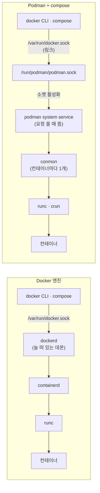

## 원본 메모
- 질문: podman과 compose를 사용해서 배포 환경을 구성할 때 그냥 도커 엔진을 사용할 때랑 무슨 차이인지. 그리고 관련 개념들
- 상황 한 줄: 서버에서 Docker 엔진 대신 podman + docker compose 플러그인으로 앱 컨테이너를 배포함. 컨테이너 저장소 폴더(/var/lib/containers/storage)를 살펴봄

## 답
**compose 파일은 그대로 쓰고, 차이는 그 아래 엔진에서 난다.** Docker는 늘 떠 있는 데몬(`dockerd`)이 모든 컨테이너를 맡는다. Podman은 데몬 없이 컨테이너마다 감시 프로세스(conmon)를 하나씩 붙인다. 그래서 Podman에서 compose를 쓰려면 세 가지를 따로 챙겨야 한다.
1. Docker 호환 API(Application Programming Interface) 소켓을 켜고 `docker.sock` 자리에 이어 준다.
2. 재부팅 뒤 컨테이너를 다시 띄우는 일을 systemd 유닛에 맡긴다. 데몬이 없어서다.
3. 이미지 저장소와 로그가 Docker와 다른 곳에 있다는 것을 알고 있어야 한다.

> 약어: OCI(Open Container Initiative) ([opencontainers.org](https://opencontainers.org/)) · REST(Representational State Transfer) · CLI(Command Line Interface) · RHEL(Red Hat Enterprise Linux) · COW(Copy On Write)

| 항목 | Docker 엔진 | Podman + compose |
| --- | --- | --- |
| 실행 구조 | `dockerd` 데몬이 늘 떠 있고 containerd → runc 순서로 실행 | 데몬 없음. 컨테이너마다 conmon이 붙고 runc·crun이 실행 |
| CLI·compose가 붙는 곳 | `/var/run/docker.sock` (dockerd) | `/run/podman/podman.sock` (Docker 호환 API). `docker.sock`을 이 소켓으로 링크 |
| 재부팅 뒤 재시작 | 데몬이 다시 뜨면서 재시작 정책을 적용 | `podman-restart.service`가 필요. 4.9.4 유닛은 `always`만 다시 띄움 |
| 저장소 | `/var/lib/docker` | root: `/var/lib/containers/storage` · 일반 계정: `~/.local/share/containers/storage` |
| 기본 로그 드라이버 | json-file | journald (journal을 못 쓰면 k8s-file) |
| 권한 | 데몬이 root 권한으로 돎. 데몬을 다룰 수 있는 사용자는 신뢰할 수 있는 사람만 | root로도, 일반 계정(rootless)으로도 실행 |
| RHEL 8 | 배포판에서 빠짐. 설치하려면 podman·runc를 먼저 지우라고 안내 | 배포판이 제공 |

### 1. 실행 구조: 늘 떠 있는 데몬 vs 데몬 없음
- `docker`: 이름 유래: 문서 근거 없음. `dockerd`: 이름 유래: 문서 근거 없음. 공식 문서 설명은 "`dockerd` is the persistent process that manages containers." ([dockerd](https://docs.docker.com/reference/cli/dockerd/))
- Docker는 클라이언트-서버 구조다. `docker` 명령(클라이언트)은 요청만 보내고 일은 데몬이 한다.
> "Docker uses a client-server architecture." · "The Docker client and daemon communicate using a REST API, over UNIX sockets or a network interface." ([Docker overview](https://docs.docker.com/get-started/docker-overview/))
- 데몬 아래에서는 containerd가 컨테이너 생명주기를 맡고, 실제 실행은 runc가 한다.
> "Docker Engine uses containerd for managing the container lifecycle" · "By default, containerd uses runc as its container runtime." ([Alternative container runtimes](https://docs.docker.com/engine/daemon/alternative-runtimes/))
- `podman`: 이름은 "the POD MANager"에서 왔다. ([containers/podman README](https://github.com/containers/podman)) Podman은 데몬이 없다.
> "daemonless, open source, Linux native tool" ([Podman 문서](https://docs.podman.io/en/latest/)) · "if you are not running containers, Podman is not running." ([RHEL 8: Starting with containers](https://docs.redhat.com/en/documentation/red_hat_enterprise_linux/8/html/building_running_and_managing_containers/assembly_starting-with-containers_building-running-and-managing-containers))
- 데몬 대신 컨테이너 하나마다 conmon이 붙는다(이름 유래: 문서 근거 없음). conmon은 Podman과 OCI 런타임(runc·crun) 사이에서 컨테이너 출력을 로그로 쓰고, 컨테이너가 끝나면 종료 코드를 남긴다.
> "Conmon is a monitoring program and communication tool between a container manager (like Podman or CRI-O) and an OCI runtime (like runc or crun) for a single container." ([conmon README](https://github.com/containers/conmon))
- 두 엔진 모두 맨 아래에서는 OCI 런타임이 컨테이너를 만든다.
> "runc is a CLI tool for spawning and running containers on Linux according to the OCI specification." ([runc README](https://github.com/opencontainers/runc))

### 2. compose는 어떻게 podman에 붙나: Docker 호환 API 소켓
- `podman system service`(man NAME: "Run an API service")는 Docker API와 호환되는 REST API를 연다. systemd 소켓 활성화를 지원한다. 그래서 `podman.socket`만 켜 두면 서비스가 늘 떠 있지 않고, 요청이 올 때 뜬다.
> "a compatibility layer offering support for the Docker v1.40 API, and a Podman-native Libpod layer." · "it will be activated as soon as a client connects to the listening socket." · "The default endpoint for a rootful service is unix:///run/podman/podman.sock" ([podman-system-service(1)](https://docs.podman.io/en/latest/markdown/podman-system-service.1.html))
- `docker` CLI는 기본으로 `/var/run/docker.sock`에 붙는다(dockerd 기본 소켓 `unix:///var/run/docker.sock`, [dockerd](https://docs.docker.com/reference/cli/dockerd/)). 그래서 이 경로를 podman 소켓으로 링크한다. RHEL의 `podman-docker` 패키지가 이 링크를 만들어 준다.
> "Podman also supports the Docker Socket API," ([RHEL 8: Starting with containers](https://docs.redhat.com/en/documentation/red_hat_enterprise_linux/8/html/building_running_and_managing_containers/assembly_starting-with-containers_building-running-and-managing-containers))
- 패키지 없이 직접 이을 때는 tmpfiles.d 설정에 `L+ /run/docker.sock - - - - /run/podman/podman.sock` 한 줄을 넣는다. `L`은 심볼릭 링크를 만들고, `+`는 그 자리에 이미 있는 파일을 지운 뒤 만든다. ([tmpfiles.d(5)](https://www.freedesktop.org/software/systemd/man/latest/tmpfiles.d.html)) 링크를 부팅마다 다시 만드는 이유는 `/run`이 부팅 이후의 실행 정보만 담는 곳이기 때문이다([[tmpfs]]).
> "This directory contains information which describes the system since it was booted." ([hier(7)](https://man7.org/linux/man-pages/man7/hier.7.html))
- `podman compose`는 compose를 직접 구현하지 않는다. 외부 compose 도구를 실행하고, 그 도구가 podman 소켓에 붙도록 환경을 맞춰 준다. `docker-compose`가 설치돼 있으면 그쪽을 먼저 쓴다.
> "podman compose is a thin wrapper around an external compose provider such as docker-compose or podman-compose." · "If installed, docker-compose takes precedence" ([podman-compose(1)](https://docs.podman.io/en/latest/markdown/podman-compose.1.html))

### 3. 재부팅 뒤 재시작: 데몬 대신 systemd 유닛
- Docker는 데몬이 다시 뜰 때 재시작 정책(`restart:`)을 보고 컨테이너를 띄운다.
> "If you manually stop a container, the restart policy is ignored until the Docker daemon restarts" ([Start containers automatically](https://docs.docker.com/engine/containers/start-containers-automatically/))
- Podman은 부팅 때 정책을 읽어 줄 데몬이 없다. 그래서 `podman-restart.service` 유닛이 그 일을 한다. **버전마다 다르다.** 4.9.4의 유닛은 `restart-policy=always`인 컨테이너만 띄운다. 그래서 4.9에서는 `unless-stopped` 컨테이너가 재부팅 뒤 안 뜬다.
> `ExecStart=@@PODMAN@@ $LOGGING start --all --filter restart-policy=always` ([podman v4.9.4 podman-restart.service.in](https://raw.githubusercontent.com/containers/podman/v4.9.4/contrib/systemd/system/podman-restart.service.in))
- 최신 문서는 `unless-stopped`도 이 유닛과 함께 재부팅 뒤 다시 띄운다고 설명한다. systemd 유닛 안에서 컨테이너를 돌릴 때는 `--restart` 대신 유닛의 `Restart=`를 쓰라고 권한다. ([podman-run(1) --restart](https://docs.podman.io/en/latest/markdown/podman-run.1.html))
- `systemctl`: 이름 유래: 문서 근거 없음. man NAME: "Control the systemd system and service manager" ([systemctl(1)](https://www.freedesktop.org/software/systemd/man/latest/systemctl.html))

### 4. 저장소 위치와 폴더 구성
- Docker의 기본 저장 위치는 `/var/lib/docker`다.
> "Root directory of persistent Docker state (default "/var/lib/docker")" ([dockerd](https://docs.docker.com/reference/cli/dockerd/))
- Podman은 root와 일반 계정의 저장소가 따로 있다. 그래서 일반 계정에서 `podman ps`를 하면 root가 띄운 컨테이너가 보이지 않는다.
> "container storage graph dir (default: "/var/lib/containers/storage")" · "Otherwise `$HOME/.local/share/containers/storage` is used." ([containers-storage.conf(5)](https://github.com/containers/storage/blob/main/docs/containers-storage.conf.5.md))
- 저장 방식은 COW 드라이버(기본 overlay)다. 저장소 안 폴더는 아래와 같다. 다만 문서 스스로 "구현 세부라 바뀔 수 있으니 파일을 직접 건드리지 말라"고 경고한다. ([containers-storage architecture](https://raw.githubusercontent.com/containers/storage/4ac5364f669ec63837f3a2e426d35d3133c41f23/docs/containers-storage-architecture.md))
  - `overlay/<레이어>/`: `diff/`(풀어 놓은 파일 트리) · `work/`(overlayfs 작업용) · `merged/`(마운트 지점) · `link` · `lower`(아래 레이어 목록)
  - `overlay/l/`: 마운트 옵션 문자열을 짧게 하려고 둔 짧은 이름 → `diff/` 링크
  - `overlay-layers/`: 레이어 메타데이터(`layers.json`, 레이어마다 `*.tar-split.gz`, `layers.lock`)
  - `storage.lock`: 프로세스 사이 잠금 파일
  > "NOTE: These are implementation details subject to change." (같은 문서)
- 같은 문서에서 컨테이너는 "부모가 이미지인 레이어"다. 이미지 레이어는 아래(lower)에 읽기 전용으로 두고, 컨테이너가 쓰는 내용은 위(upper)에 쌓는다. 실행 중에는 둘을 합친 `merged/`가 컨테이너의 `/`가 된다. 이것이 [[OverlayFS]]다.
> "An overlay filesystem combines two filesystems - an ‘upper’ filesystem and a ‘lower’ filesystem." · "the file is first copied from the lower filesystem to the upper filesystem (copy_up)." ([Overlay Filesystem](https://docs.kernel.org/filesystems/overlayfs.html))

### 5. 로그 드라이버와 권한
- 기본 로그 드라이버가 다르다. 로그 수집기를 붙일 때 경로와 형식이 달라진다.
> "As a default, Docker uses the json-file logging driver" ([Configure logging drivers](https://docs.docker.com/engine/logging/configure/)) · "The journald driver is used by default if the systemd journal is readable and writable." · "Otherwise, the k8s-file driver is used." ([containers.conf(5)](https://github.com/containers/common/blob/main/docs/containers.conf.5.md))
- Docker는 데몬 하나가 root 권한으로 모든 컨테이너를 다룬다. Podman은 root로도 일반 계정으로도 컨테이너를 띄울 수 있다([[rootless 컨테이너]]).
> "This daemon requires root privileges unless you opt-in to Rootless mode" · "only trusted users should be allowed to control your Docker daemon." ([Docker Engine security](https://docs.docker.com/engine/security/)) · "Containers under the control of Podman can either be run by root or by a non-privileged user." ([Podman 문서](https://docs.podman.io/en/latest/))

### 6. RHEL 8에서 Docker 엔진을 같이 설치하기 어려운 이유
- RHEL 8은 Docker 엔진을 배포판에서 뺐다. 대신 Podman을 준다.
> "Red Hat removed the Docker container engine and the docker command from RHEL 8." ([RHEL 8: Starting with containers](https://docs.redhat.com/en/documentation/red_hat_enterprise_linux/8/html/building_running_and_managing_containers/assembly_starting-with-containers_building-running-and-managing-containers))
- Docker 공식 설치 문서는 설치 전에 충돌 패키지를 지우라고 한다. 지울 목록에 `podman`과 `runc`가 들어 있다. podman을 지울 수 없는 서버라면 Docker 엔진 대신 docker CLI와 compose 플러그인만 넣고 podman 소켓에 붙이는 구성이 된다.
> "Before you can install Docker Engine, you need to uninstall any conflicting packages." ([Install Docker Engine on RHEL](https://docs.docker.com/engine/install/rhel/))

### 원본 메모에서 아직 열린 질문
- 저장소 폴더 중 `overlay-images/`, `overlay-containers/`, `libpod/`, `db.sql`, `secrets/`, `userns.lock`이 각각 무엇을 담는지는 공식 문서에서 찾지 못했다. 이름으로 짐작만 가능하다(이미지 메타데이터, 컨테이너 메타데이터, Podman 상태 DB 등). 출처를 찾으면 보강한다.
- Docker 호환 API 버전(문서상 v1.40)과 실제 서버의 podman이 알려 주는 API 버전이 다를 수 있다. 서버에서 `docker version`으로 확인할 것.

## 코드 예제
compose 파일은 엔진과 상관없이 같다. 다만 Podman 4.9에서는 재부팅 뒤 다시 뜨게 하려면 `always`를 써야 한다.

```yaml
# compose.yaml — docker compose 플러그인이 podman 소켓으로 실행
services:
  app:
    image: example/app:1.0.0
    ports:
      - "8080:8080"
    restart: always            # ← podman 4.9의 podman-restart.service는 always만 다시 띄움
    # restart: unless-stopped  # ← 4.9에서는 재부팅 뒤 안 뜸 (Docker는 데몬이 다시 띄움)
    volumes:
      - /data/app/logs:/app/logs
```

- `podman-restart.service`(v4.9.4)의 `ExecStart`가 `--filter restart-policy=always`다. ([podman v4.9.4 podman-restart.service.in](https://raw.githubusercontent.com/containers/podman/v4.9.4/contrib/systemd/system/podman-restart.service.in))
- Docker의 `unless-stopped`는 사용자가 멈추지 않았다면 데몬이 다시 뜰 때 컨테이너를 다시 띄운다. ([Start containers automatically](https://docs.docker.com/engine/containers/start-containers-automatically/))

## 선행 개념
- [[데몬]]: 백그라운드에서 계속 돌며 다른 프로세스에 기능을 제공하는 서비스 프로세스다. Docker의 `dockerd`가 데몬이고, Podman은 이것이 없다는 점이 두 엔진의 가장 큰 차이다. ([daemon(7)](https://man7.org/linux/man-pages/man7/daemon.7.html))
- [[OCI 런타임]]: OCI 명세대로 실제 컨테이너 프로세스를 만들고 실행하는 가장 아래 층의 도구다(runc, crun). Docker는 containerd를 거쳐, Podman은 conmon을 거쳐 결국 이것을 부른다. ([runc README](https://github.com/opencontainers/runc))
- [[유닉스 도메인 소켓]]: 같은 머신 안의 프로세스끼리 파일 경로(`/var/run/docker.sock` 같은)를 주소로 삼아 통신하는 소켓이다. docker CLI가 엔진에 붙는 통로가 이것이라, 링크만 바꾸면 Podman에도 붙는다. ([unix(7)](https://man7.org/linux/man-pages/man7/unix.7.html))

## 다음에 볼 개념
### 선행
- [[데몬]] — 백그라운드에서 계속 도는 서비스 프로세스. dockerd
- [[OCI 런타임]] — 컨테이너를 실제로 만드는 맨 아래 층(runc, crun)
- [[유닉스 도메인 소켓]] — 파일 경로를 주소로 쓰는 같은 머신 안 통신. docker.sock
### 다음
- [[OverlayFS]] — 읽기 전용 이미지 레이어 위에 쓰기 층을 겹쳐 하나로 보여 주는 파일시스템. 저장소의 `overlay/` 폴더
- [[rootless 컨테이너]] — 일반 계정으로 컨테이너를 띄우는 방식. 계정마다 저장소가 따로 있음
- [[conmon]] — Podman 컨테이너마다 붙는 감시 프로세스. 로그와 종료 코드
- [[tmpfs]] — `/run`처럼 메모리에 두는 파일시스템. 부팅마다 링크를 다시 만드는 이유
- [[마운트]] — overlay의 `merged/`도 마운트 지점이다

## 다이어그램


## 확인 과제
내 환경에서 해 보고, 결과를 회사 정보 없이 inbox에 `결과: ...` 한 줄로 넣는다(호스트명·계정명은 `<호스트>`, `<계정>`처럼).
- [ ] root와 일반 계정에서 각각 `podman info --format '{{.Store.GraphRoot}}'`를 실행해 저장소 경로가 다른지 본다 (`podman info`: man NAME "Display Podman related system information" · `--format` 출력을 json 또는 Go 템플릿으로 바꿈 · `.Store.GraphRoot` 저장소 최상위 폴더) ([podman-info(1)](https://docs.podman.io/en/latest/markdown/podman-info.1.html))
- [ ] 컨테이너가 떠 있을 때 `findmnt -t overlay`로 `merged/` 마운트가 보이는지 본다 (`findmnt`: man NAME "find a filesystem" · `-t` types, 출력할 파일시스템 종류를 제한) ([findmnt(8)](https://man7.org/linux/man-pages/man8/findmnt.8.html))
- [ ] `systemctl is-enabled podman.socket podman-restart.service`로 소켓과 재부팅 재시작 유닛이 켜져 있는지 본다 (`is-enabled` 유닛 파일이 enable 상태인지 확인) ([systemctl(1)](https://www.freedesktop.org/software/systemd/man/latest/systemctl.html))

## 복습 카드
- Docker는 늘 떠 있는 데몬 ==dockerd==가 컨테이너를 맡고, Podman은 데몬 없이 컨테이너마다 ==conmon==이 붙는다.
- docker compose를 Podman에 붙일 때는 `/var/run/docker.sock`을 Podman의 ==Docker 호환 API 소켓|podman.sock|podman 소켓==으로 링크한다.
- Podman 4.9의 `podman-restart.service`는 재부팅 뒤 재시작 정책이 ==always==인 컨테이너만 다시 띄운다.

## 복습 기록
