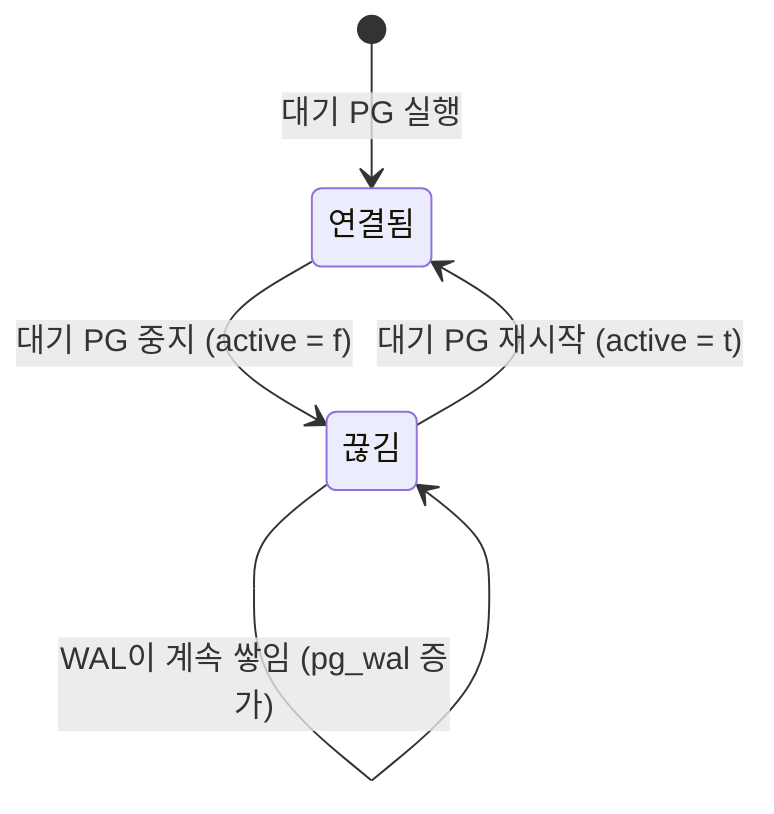

## 원본 메모
- 질문: PostgreSQL 복제 슬롯은 무엇이고, 대기 서버를 멈춘 채 슬롯을 남겨 두면 왜 WAL이 쌓이나?
- 상황 한 줄: 대기 PG를 잠깐 멈추자 주 서버의 슬롯 active가 f로 바뀌었다가, 다시 켜자 t로 돌아옴

## 답
### 왜 필요한가
스트리밍 복제에서 대기 서버는 주 서버가 쓴 WAL(write-ahead log) 조각을 받아 따라간다. 주 서버는 오래된 WAL 조각을 지워 공간을 비우는데, 대기 서버가 멈추거나 느리면 **아직 못 받은 조각까지 지워질 수 있다.** 이를 막으려고 `wal_keep_size`(남길 WAL 크기)나 보관소(archive)를 쓸 수도 있지만 필요 이상으로 많이 남기기 쉽다. 복제 슬롯은 "대기 서버가 어디까지 받았는지"를 주 서버가 기억해 필요한 만큼만 남기게 한다.
> "Replication slots provide an automated way to ensure that the primary server does not remove WAL segments until they have been received by all standbys ... even when the standby is disconnected." · "replication slots retain only the number of segments known to be needed." ([PostgreSQL 18: Log-Shipping Standby Servers, 26.2.6 Replication Slots](https://www.postgresql.org/docs/current/warm-standby.html))

예시: **주 서버**에 슬롯 `standby_slot`이 있고, **대기 서버**를 멈췄다고 하자. 슬롯은 "이 대기 서버가 아직 받지 못한 WAL부터는 지우지 않는다"는 표시를 계속 들고 있다.

### 대기 서버를 멈춘 채 슬롯을 남기면 WAL이 쌓이는 이유
- 슬롯은 대기 서버가 연결돼 있지 않아도 WAL 보존을 계속한다. 그래서 주 서버에서는 대기 서버가 돌아올 때까지 쓰는 WAL이 지워지지 않고 쌓인다.
> "Beware that replication slots can cause the server to retain so many WAL segments that they fill up the space allocated for `pg_wal`." (같은 문서)
- 상한을 두려면 `max_slot_wal_keep_size`를 쓴다. 한도를 넘기면 슬롯이 필요한 WAL 일부를 더 이상 유지하지 않는다. 문서의 `wal_status` 값: `reserved`(한도 안) · `extended`(`max_wal_size`는 넘었지만 아직 보존) · `unreserved`(필요한 WAL을 더는 안 잡음, 다음 체크포인트에서 지워질 수 있음) · `lost`(슬롯 사용 불가). ([pg_replication_slots](https://www.postgresql.org/docs/current/view-pg-replication-slots.html))

### 메모의 관찰(active f → t)
- `active`는 "이 슬롯이 지금 스트리밍되고 있는가"다. 대기 PG를 멈추면 연결이 끊겨 `f`, 다시 켜 연결되면 `t`로 돌아오는 것이 그대로 맞는다.
> "active (bool): True if this slot is currently being streamed" ([pg_replication_slots](https://www.postgresql.org/docs/current/view-pg-replication-slots.html))
- 같은 뷰의 `restart_lsn`은 이 슬롯이 아직 필요로 할 수 있는 가장 오래된 WAL의 주소(LSN)다. `active = f`인 동안 이 값이 현재 위치에서 점점 뒤처지면 그만큼 WAL이 쌓인다는 뜻으로 읽을 수 있다. (이 연결은 문서의 두 정의를 이은 해석)

### 원본 메모에서 아직 열린 질문
- 슬롯 이름·생성 방법, 대기 서버가 영영 안 돌아올 때 슬롯을 지우는 방법(`26.2.6.1`)은 읽지 못했다.
- HA 넘김 때 이 슬롯이 어떻게 되는지.

## 선행 개념
- [[PostgreSQL 스트리밍 복제]]: 대기 서버가 주 서버의 WAL 기록 흐름을 받아 최신으로 유지하는 방식 ([PostgreSQL 18](https://www.postgresql.org/docs/current/different-replication-solutions.html))
- [[WAL]]: 대기 서버가 읽어 따라가는 write-ahead log 기록. 같은 문서가 "reading a stream of write-ahead log (WAL) records"라고 쓴다.

## 다음에 볼 개념
### 선행
- [[PostgreSQL 스트리밍 복제]] — 슬롯이 붙는 복제 구조
- [[WAL]] — 슬롯이 보존하는 대상
### 다음
- [[공유 디스크 HA와 스트리밍 복제 HA 차이]] — 대기 PG를 켜 두는 구성의 부담

## 다이어그램

## 확인 과제
내 환경에서 해 보고, 결과를 회사 정보 없이 inbox에 `결과: ...` 한 줄로 넣는다.
> 예제 기준: PostgreSQL 18 문서(내 서버 버전 확인 필요. `max_slot_wal_keep_size`·`wal_status`는 18 문서 기준이며 버전별 도입 시점은 확인하지 못함)
- [ ] 주 서버에서 `SELECT slot_name, active, restart_lsn, wal_status FROM pg_replication_slots;`: 슬롯 상태. (`SELECT` 구문 풀이: 열 이름을 나열해 고름. 컬럼 뜻은 위 문서)
- [ ] 대기 PG를 멈추기 전후로 같은 쿼리를 반복해 `active`와 `restart_lsn`이 어떻게 변하는지 기록한다.
- [ ] `SHOW max_slot_wal_keep_size;`: 현재 상한 값 (`SHOW`는 설정 값을 보여 줌, 값 -1 의미는 문서 확인 필요)

## 복습 카드
- 복제 슬롯은 모든 대기 서버가 받을 때까지 주 서버가 ==WAL 조각|WAL segment==을 지우지 않게 한다.
- 슬롯이 남은 채 대기 서버가 멈추면 WAL이 쌓여 ==pg_wal==이 찰 수 있고, ==max_slot_wal_keep_size==로 보존 상한을 둘 수 있다.
- pg_replication_slots의 ==active==는 슬롯이 지금 스트리밍되고 있으면 참이다.

## 복습 기록
