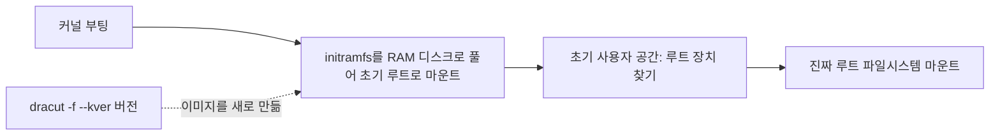

## 원본 메모
- 질문: NIC 이름 설정을 바꾼 뒤 dracut -f는 왜 하나? initramfs는 무엇인가?
- 상황 한 줄: 인자 없는 dracut -f는 지금 도는 커널 이미지만 다시 만들어서, 다음 부팅 커널이 다르면 반영이 안 된다고 들음
- 결과: uname -r과 grubby --default-kernel 버전이 같은지 먼저 확인하고 실행함

## 답
### 왜 필요한가
리눅스 커널이 진짜 루트 파일시스템(디스크의 `/`)을 마운트하려면 그 디스크를 다루는 블록 장치 모듈이 먼저 필요하다. dracut 문서는 이 이미지가 "블록 장치 모듈을 미리 불러오는(preloading) 용도로 커널이 쓰는 초기 이미지"를 만든다고 쓴다. 그래서 진짜 루트를 붙이기 전 단계용 이미지가 따로 필요하다. 커널 문서는 initrd가 "시스템 시작이 두 단계로 일어나게 하려고" 설계됐고, 추가 모듈을 initrd에서 불러온다고 설명한다. ([Using the initial RAM disk (initrd), 커널 문서 7.4.0-rc3 표기](https://docs.kernel.org/admin-guide/initrd.html))

### initramfs란
- `initramfs`는 위 초기 이미지다. dracut man 페이지는 "Initramfs images are also called "initrd""라고 쓴다. 부팅 때 "커널이 그 아카이브를 RAM 디스크에 풀고 초기 루트 파일시스템으로 마운트해 쓴다". 루트 장치를 찾는 일은 모두 이 초기 사용자 공간(early userspace)에서 일어난다. ([dracut(8)](https://man7.org/linux/man-pages/man8/dracut.8.html), 버전 표기 없음)
- `dracut`은 이 이미지를 만드는 도구다: "dracut - low-level tool for generating an initramfs/initrd image". 이름 유래: 문서 근거 없음.

### 명령어 풀이
- `dracut -f`: `-f` force(덮어쓰기). 이미 있는 이미지 파일이면 오류가 나므로 덮어쓰려고 쓴다. "Overwrite existing initramfs file."
- `dracut -f --kver <커널버전>`: `--kver` kernel version. 만들 이미지의 커널 버전을 지정한다. 문서는 `<kernel version>`을 생략하면 "실행 중인 커널의 버전"을 쓴다고 쓴다. 메모에서 들은 "인자 없는 dracut은 지금 도는 커널 것만 만든다"가 이 문장과 맞다.
- 이미지를 어디에 쓰는지는 "로컬 설정이나 배포판 정책이 정한다"고만 나오고, 정확한 경로는 이번 문서에서 확인하지 못했다.

### 메모의 확인 절차
`uname -r`(실행 중인 커널 버전)과 `grubby --default-kernel`(다음 부팅 기본 커널) 버전이 같은지 보는 이유는, 인자 없는 `dracut -f`가 "실행 중인 커널" 것만 다시 만들기 때문이다. 다르면 `--kver`로 다음 부팅 커널 버전을 지정해야 한다(메모의 설명 + 위 문서). `grubby`가 무엇의 줄임인지는 읽은 문서가 없다(이름 유래: 문서 근거 없음).

### 원본 메모에서 아직 열린 질문
- NIC 이름 설정(`.link`, udev 규칙)을 바꾸면 왜 initramfs도 다시 만들어야 하는지, 곧 그 파일들이 initramfs 안에 들어가는지는 읽은 문서에 없다. 질문 제목의 "왜 하나?"에 대해 문서로 확인된 것은 "initramfs가 부팅 초기 사용자 공간"이라는 사실까지다.
- 내 환경의 dracut 버전·배포판: 버전 확인 필요.

## 코드 예제
> 예제 기준: dracut(man7.org man 페이지, 버전 표기 없음 → 버전 확인 필요), Linux 커널 문서 7.4.0-rc3 표기. 내 환경 버전 확인 필요

```bash
uname -r                          # ← 지금 실행 중인 커널
grubby --default-kernel           # ← 다음 부팅에 쓸 커널
dracut -f                         # ← 실행 중인 커널용 initramfs 덮어쓰기 (-f force)
dracut -f --kver <다음_부팅_커널버전>  # ← 다른 커널용이면 --kver로 지정
```

이 코드에서 "대상 커널을 고르는" 줄은 `--kver`가 붙은 마지막 줄이다. 서비스 NIC 이름 설정(`ens3`)을 바꿨다면, 두 버전이 같을 때는 세 번째 줄만으로 실행 중인 커널의 이미지가 새로 만들어지고, 다르면 마지막 줄로 다음 부팅 커널용을 만든다. (근거: dracut(8) `--kver`, `-f`)

## 선행 개념
- [[리눅스 NIC 이름 결정 방식]]: 이름을 정하는 `.link`·udev 규칙을 바꾼 것이 이 작업의 계기다. ([systemd.link(5)](https://www.freedesktop.org/software/systemd/man/latest/systemd.link.html))

## 다음에 볼 개념
### 선행
- [[udev 규칙과 systemd link 파일 차이]] — 무엇을 바꿨는지
### 다음
- [[systemd-udevd]] — 이름을 붙이는 쪽 데몬

## 다이어그램


## 확인 과제
내 환경에서 해 보고, 결과를 회사 정보 없이 inbox에 `결과: ...` 한 줄로 넣는다.
- [ ] `uname -r` (`uname` unix name, `-r` kernel release): 실행 중인 커널 버전을 적는다. (`uname` 이름 유래는 문서 근거 없음)
- [ ] `dracut --help`로 `--kver`, `-f` 설명이 내 버전에도 있는지 본다.

## 복습 카드
- `dracut`은 부팅 초기에 쓰는 ==initramfs|initrd== 이미지를 만드는 도구이다.
- 커널 버전을 생략한 `dracut`은 ==실행 중인 커널|running kernel==의 버전을 사용한다.

## 복습 기록
