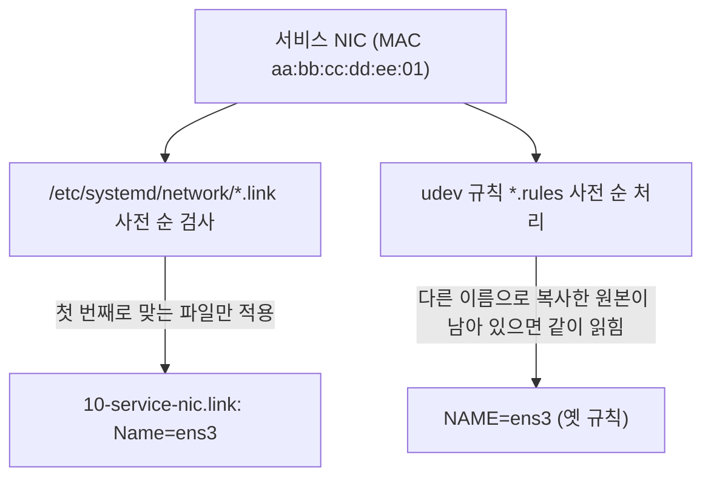

## 원본 메모
- 질문: NIC 이름을 고정할 때 udev 규칙 파일(70-persistent-net.rules)과 systemd .link 파일은 무엇이 다른가?
- 상황 한 줄: 기존 udev 규칙은 cloud-init이 만든 파일이었고, 이를 지우고 .link 파일로 바꾸는 절차를 받음
- 코드 모양: .link 파일은 [Match] 섹션에 MACAddress 한 줄, [Link] 섹션에 Name 한 줄. 받은 절차는 규칙 파일을 cp만 하고 지우지 않아서 원본이 계속 적용되는 모양이었음
- 결과: [Match]의 MACAddress 자리에 IP를 넣으면 그 줄이 무시되어 모든 NIC에 맞는 파일이 된다고 판단함 (확인 필요)

## 답
### 왜 필요한가
NIC 이름을 "이 MAC 주소를 가진 카드는 `ens3`"처럼 고정하려면 어딘가에 대응표를 적어 둬야 한다. 옛 방식은 udev(장치가 나타날 때 규칙대로 처리하는 부분)의 규칙 파일에 적는 것이고, 새 방식은 systemd의 `.link` 파일에 적는 것이다. udev 문서는 규칙의 `NAME=`을 설명하면서 이름을 정하는 "더 높은 수준의 방법"으로 systemd.link(5)를 보라고 안내한다. ([udev(7)](https://www.freedesktop.org/software/systemd/man/latest/udev.html), NAME=) 둘이 함께 남아 있으면 어느 쪽이 적용되는지 헷갈리므로, 메모처럼 하나로 정리하는 절차가 나온다.

### 두 파일의 차이 (문서로 확인되는 것)
예시: 서비스 NIC의 MAC `aa:bb:cc:dd:ee:01`을 이름 `ens3`에 묶는다.

- **udev 규칙(`*.rules`)**: `키 연산자 "값"`을 쉼표로 이은 한 줄이 규칙이다. `==`는 조건 비교, `=`는 값 지정이다. 파일은 `/usr/lib/udev/rules.d`, `/etc/udev/rules.d` 등에서 읽고, 디렉토리와 관계없이 이름의 사전 순서로 모두 처리한다. 같은 이름의 파일은 서로 대체하고 `/etc/`가 우선한다. ([udev(7)](https://www.freedesktop.org/software/systemd/man/latest/udev.html), Rules Files)
- **systemd `.link` 파일**: `[Match]`가 어느 NIC에 해당하는지, `[Link]`가 무엇을 할지 적는다. 파일은 `/etc/systemd/network` 등에서 읽고, 모든 파일을 사전 순서로 정렬한 뒤 **조건이 맞는 첫 번째 파일만 적용하고 나머지는 무시한다**. ([systemd.link(5)](https://www.freedesktop.org/software/systemd/man/latest/systemd.link.html), Description·[Match])
- 규칙은 맞는 줄이 모두 실행되는 규칙 목록이고, `.link`는 첫 번째로 맞는 파일 하나만 쓰는 방식이라는 점이 구조 차이다.

### 메모의 두 가지 판단 점검
1. **"규칙 파일을 cp만 하고 지우지 않으면 원본이 계속 적용된다"**: 문서상 같은 이름의 파일만 서로 대체한다. 다른 이름으로 복사하면 둘 다 읽히므로 원본 규칙도 남는다. 원본 파일을 지우거나, 같은 이름의 빈 파일 또는 `/dev/null` 링크로 가리는 방법이 문서에 있다. (udev(7)·systemd.link(5) 모두 같은 설명)
2. **"MACAddress 자리에 IP를 넣으면 줄이 무시돼 모든 NIC에 맞는다"**: 그대로 받아들이기 어렵다. 문서는 `[Match]`에 "유효한 설정이 없으면" 파일이 모든 인터페이스에 맞고 경고를 낸다고 쓴다. 그런데 `MACAddress=`는 4바이트(IPv4 터널용)·6바이트(이더넷) 등의 주소를 받고 IPv4·IPv6 형식 표기도 허용한다고 한다. 따라서 IP를 넣으면 "무시"가 아니라 4바이트 하드웨어 주소로 읽혀 이더넷 NIC에는 맞지 않을 가능성이 있다. 어느 쪽인지 문서만으로 확정하지 못해 **확인 필요**다. 모든 NIC에 맞는 파일을 의도하지 않으려면 `[Match]`에 MAC을 정확히 적는다.

### `Name=`이 항상 이기지는 않는다
`[Link]`의 `Name=`은 `NamePolicy=`보다 우선순위가 낮다. `Name=`은 `NamePolicy=`가 설정되지 않았거나 비었거나 꺼졌거나, 모든 정책이 실패할 때만 쓰인다. ([systemd.link(5)](https://www.freedesktop.org/software/systemd/man/latest/systemd.link.html), [Link]) 메모처럼 `NamePolicy=` 줄이 없는 파일이 먼저 맞으면 `Name=`이 적용될 것으로 읽히지만, 이 해석은 문서 문장에서 추론한 것이다(내 환경에서 확인 필요).

### 원본 메모에서 아직 열린 질문
- `.link`와 udev `NAME=` 규칙이 둘 다 같은 NIC에 맞을 때 최종 이름이 무엇인지는 읽은 문서에 없다.
- `70-persistent-net.rules`를 cloud-init이 만드는 구조는 읽은 문서가 없어 다루지 않았다.

## 코드 예제
> 예제 기준: systemd 262 문서(systemd.link(5), udev(7)). 내 환경의 systemd 버전: 버전 확인 필요

```ini
# /etc/systemd/network/10-service-nic.link
[Match]
# ← 어느 NIC인지 고르는 조건 (서비스 NIC)
MACAddress=aa:bb:cc:dd:ee:01

[Link]
# ← 붙일 이름
Name=ens3
```

```
# 옛 방식의 같은 뜻 (udev 규칙 한 줄 모양)
ATTR{address}=="aa:bb:cc:dd:ee:01", NAME="ens3"   # ← == 조건, = 이름 지정
```

이 코드에서 NIC를 고르는 줄은 `MACAddress=`(규칙에서는 `ATTR{address}==`)이고, 이름을 붙이는 줄은 `Name=`(규칙에서는 `NAME=`)이다. MAC `aa:bb:cc:dd:ee:01`을 가진 서비스 NIC가 잡히면 `.link`가 이름을 `ens3`으로 정한다. 규칙 파일의 `ATTR{filename}` 형식은 문서에 있지만, `address` 속성을 쓰는 이 한 줄은 문서의 예시가 아니라 모양을 보인 것이다(확인 필요).

## 선행 개념
- [[리눅스 NIC 이름 결정 방식]]: 이름은 `NamePolicy=`의 정책 순서로 정해지고 `ID_NET_NAME`으로 udev에 전달된다. ([systemd.link(5)](https://www.freedesktop.org/software/systemd/man/latest/systemd.link.html))

## 다음에 볼 개념
### 선행
- [[리눅스 NIC 이름 결정 방식]] — 고정하려는 이름이 어디서 나오는지
### 다음
- [[dracut과 initramfs]] — 파일을 바꾼 뒤 부팅 초기 이미지에도 반영해야 하는지
- [[systemd-udevd]] — `.link`를 읽어 이름을 정하는 쪽

## 다이어그램


## 확인 과제
내 환경에서 해 보고, 결과를 회사 정보 없이 inbox에 `결과: ...` 한 줄로 넣는다.
- [ ] `ls /etc/udev/rules.d /etc/systemd/network` (`ls` list): 남아 있는 규칙·link 파일 이름과 순서를 적는다.
- [ ] 위 `ls` 결과에서 `99-default.link`(시스템이 기본으로 싣는 파일)보다 사전 순으로 앞서는 내 `.link` 파일 이름인지 확인한다. 문서는 번호 접두어를 70 미만으로 쓰라고 권한다.

## 복습 카드
- systemd `.link` 파일은 사전 순으로 정렬해 조건이 맞는 ==첫 번째 파일|first matching file==만 적용하고 나머지는 무시한다.
- `[Link]`의 `Name=`은 `NamePolicy=`보다 우선순위가 ==낮다|lower==.

## 복습 기록
