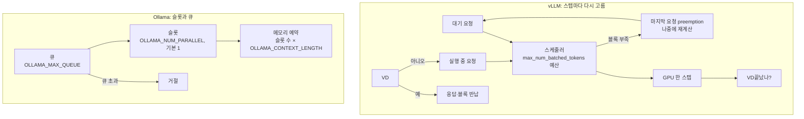

## 원본 메모
(메모 제목: vllm 과 ollama 비교)
- 운영 환경에서의 동시성을 둘이 llm 의  작동과정 상에서 무슨 차이??

## 답
**vLLM은 스텝마다 "이번에 어느 요청의 토큰을 계산할지"를 다시 고른다. Ollama는 모델마다 정해 둔 슬롯 수만큼만 같이 돌리고 나머지는 큐에 세운다.** 게다가 Ollama의 슬롯 기본값은 1이다. 설정을 안 건드리면 모델 하나가 요청을 하나씩 처리한다.

| LLM 작동 과정 | vLLM | Ollama |
| --- | --- | --- |
| 요청 받기 | 대기 요청을 먼저 온 순서(FCFS, First Come First Served)로 받음. `priority` 정책도 있음 | 슬롯이 차면 큐에서 대기(`OLLAMA_MAX_QUEUE`, 기본 512. 넘치면 거절) |
| 같이 돌리는 수 | 스텝마다 `max_num_seqs`와 `max_num_batched_tokens` 안에서 | `OLLAMA_NUM_PARALLEL`(기본 1) |
| prefill | 긴 프롬프트를 토큰 예산만큼 잘라 처리(chunked prefill, 기본 켜짐) | 문서 근거 없음 |
| decode | 끝난 요청은 빠지고 새 요청이 스텝 사이에 합류(continuous batching) | 문서 근거 없음 |
| KV 캐시 부족 | 마지막에 들어온 실행 중 요청을 빼고, 나중에 다시 계산(preemption) | 슬롯 수 × 컨텍스트만큼 메모리를 잡음. 모자라면 새 요청은 대기하고 쉬는 모델을 내림. 실행 중 preemption은 문서 근거 없음 |
| 같은 접두어 | 요청끼리 블록 재사용(기본 켜짐) | 공식 문서에 없음(사용자 보고만) |
| 여러 모델 | 문서 근거를 이번에 확인하지 못함 | 메모리가 되면 동시에 올림. 안 되면 쉬는 모델을 내림 |

### 1. vLLM: 스텝마다 다시 짜는 배치
- 스케줄러는 Engine Core 프로세스 안에서 스텝마다 실행할 요청을 정한다. 한 스텝의 토큰 예산을 실행 중·대기 요청에 나눈다.
> "each step, it fills a budget of max_num_batched_tokens across both running and waiting requests." ([Architecture](https://docs.vllm.ai/en/latest/design/arch_overview/))
- 배치 구성은 스텝마다 바뀐다.
> "After each iteration, completed requests are removed from the batch, and new ones are added." ([vLLM 논문 §2.3](https://ar5iv.labs.arxiv.org/html/2309.06180))
- decode를 먼저 채우고 남는 예산을 prefill에 준다. 그래서 긴 프롬프트가 들어와도 이미 생성 중인 요청이 덜 밀린다. chunked prefill은 V1에서 기본 켜짐이다.
> "It batches all pending decode requests before scheduling any prefill operations." ([Optimization](https://docs.vllm.ai/en/stable/configuration/optimization/))
- 다만 최신 개발 문서는 스케줄러가 두 단계를 나누지 않고 요청마다 "아직 계산 안 된 토큰"을 채운다고 쓴다("There are no separate prefill and decode phases.", [Architecture](https://docs.vllm.ai/en/latest/design/arch_overview/)). 버전에 따라 설명이 다르니 쓰는 버전의 문서를 확인한다.
- 스케줄링 정책 기본값은 `fcfs`다. ([SchedulerConfig](https://docs.vllm.ai/en/latest/api/vllm/config/scheduler/))

### 2. vLLM: KV 캐시가 모자라면 preemption
- 블록을 못 받으면 실행 중인 요청을 빼낸다. 기본 FCFS에서는 마지막에 들어온 요청이 대상이다.
> "When the KV cache is exhausted, the last-admitted running request is preempted." ([Architecture](https://docs.vllm.ai/en/latest/design/arch_overview/))
- 빠진 요청은 공간이 나면 다시 계산한다. 지연이 늘 수 있고, V1 기본은 스왑이 아니라 재계산이다.
> "Preempted requests are recomputed when sufficient KV cache space becomes available again." ([Optimization](https://docs.vllm.ai/en/stable/configuration/optimization/))

### 3. Ollama: 슬롯과 큐
- 동시 처리는 두 층이다. 여러 모델을 함께 올리는 것과, 모델 하나가 요청을 함께 처리하는 것이다.
> "Ollama supports two levels of concurrent processing." ([FAQ](https://docs.ollama.com/faq))
- 모델당 동시 처리 수의 기본값은 1이다.
> "The maximum number of parallel requests each model will process at the same time, default 1." ([FAQ](https://docs.ollama.com/faq))
- 슬롯을 늘리면 메모리도 그만큼 잡는다. vLLM처럼 공용 블록에서 나눠 쓰는 설명은 공식 문서에 없다.
> "a 2K context with 4 parallel requests will result in an 8K context and additional memory allocation." ([FAQ](https://docs.ollama.com/faq))
- 큐가 차면 거절한다(기본 512). 메모리가 모자라면 새 요청은 기다리고 쉬는 모델을 내린다. ([FAQ](https://docs.ollama.com/faq))
- Ollama는 llama.cpp의 `llama-server`를 빌드해 쓴다. ([ollama/llama README](https://github.com/ollama/ollama/blob/main/llama/README.md)) llama.cpp에서는 슬롯 P개에 슬롯당 T토큰을 보장하려면 KV 캐시를 `T*P`로 잡는다. (메인테이너 설명, 2024년 1월: [llama.cpp 토론 #4130](https://github.com/ggml-org/llama.cpp/discussions/4130))
- **운영 함정(사용자 보고, 공식 문서 아님)**: Ollama 0.34.0에서 일부 모델 구조는 `OLLAMA_NUM_PARALLEL`을 줘도 1로 고정된다는 이슈가 있다. 슬롯이 하나면 클라이언트끼리 프롬프트 캐시를 밀어내 매번 전체를 다시 계산했다는 측정도 함께 보고됐다. 이슈는 #4165의 중복으로 닫혔다. ([ollama #18938](https://github.com/ollama/ollama/issues/18938))

### 4. 수치 비교에 대해
- vLLM 논문의 2~4배 처리량은 **FasterTransformer·Orca와 비교한 값이고 Ollama와 비교한 값이 아니다.** ([논문 초록](https://arxiv.org/abs/2309.06180))
- 같은 하드웨어에서 둘을 비교한 공식 수치는 찾지 못해 쓰지 않는다.

### 원본 메모에서 아직 열린 질문
- Ollama에서 prefill과 decode를 스텝 안에서 어떻게 섞는지, 슬롯별 컨텍스트가 차면 어떻게 되는지는 공식 문서에서 찾지 못했다.
- vLLM의 여러 모델 동시 운영은 이번에 확인하지 못했다.

## 선행 개념
- [[KV 캐시]]: 처리한 토큰의 K·V를 저장하는 메모리. 크기가 요청 수와 토큰 수에 비례해서 동시 처리량을 제한한다. ([vLLM 논문 §1](https://ar5iv.labs.arxiv.org/html/2309.06180))
- [[continuous batching]]: 배치를 스텝마다 다시 구성해, 끝난 요청을 빼고 새 요청을 넣는다. 모든 요청이 끝나길 기다리지 않는다. ([vLLM 논문 §2.3](https://ar5iv.labs.arxiv.org/html/2309.06180))
- [[llama.cpp 슬롯]]: `--parallel`로 정하는 동시 처리 칸. 칸마다 컨텍스트를 보장하려면 전체 KV 캐시를 `T*P`로 잡는다. ([llama.cpp 토론 #4130](https://github.com/ggml-org/llama.cpp/discussions/4130))

## 다음에 볼 개념
### 선행
- [[KV 캐시]] — 동시성을 제한하는 자원
- [[continuous batching]] — vLLM 스케줄러의 기본 동작
- [[llama.cpp 슬롯]] — Ollama가 쓰는 엔진의 동시 처리 단위
### 다음
- [[vLLM과 Ollama 설정값과 튜닝]] — 이 동작을 바꾸는 설정값
- [[prefix caching]] — 요청끼리 프롬프트 계산을 재사용
- [[PagedAttention]] — 블록 단위 KV 캐시 관리
- [[LLM 서빙]] — 부모 개념

## 다이어그램

## 확인 과제
내 환경에서 해 보고, 결과를 회사 정보 없이 inbox에 `결과: ...` 한 줄로 넣는다.
- [ ] Ollama 기본 설정으로 요청 2개를 동시에 보내고 두 번째의 응답 시작이 첫 번째가 끝난 뒤인지 본다. 그다음 `OLLAMA_NUM_PARALLEL=2`로 다시 띄워 비교하고, `ollama ps`로 SIZE 변화를 본다. (`OLLAMA_NUM_PARALLEL`: 모델당 동시 처리 수. `ollama` 이름 유래: 문서 근거 없음 · `ps`: 옵션 없음)
- [ ] `curl -s <서버 주소>/metrics | grep -E 'vllm:(num_requests_running|num_requests_waiting|kv_cache_usage_perc)'`: vLLM에 요청을 몰아넣으며 실행·대기 수와 KV 캐시 사용률이 어떻게 움직이는지 본다. (`curl` man NAME: "transfer a URL" · `-s` silent · `grep` man NAME: "print lines that match patterns" · `-E` extended regexp. 지표: [Metrics](https://docs.vllm.ai/en/stable/design/metrics/))

## 복습 카드
- vLLM 스케줄러는 매 스텝 ==max_num_batched_tokens== 예산 안에서 실행 중·대기 요청에 계산할 토큰을 나눠 준다.
- Ollama에서 모델 하나가 동시에 처리하는 요청 수는 `OLLAMA_NUM_PARALLEL`로 정하고, 기본값은 ==1==이다.

## 복습 기록
