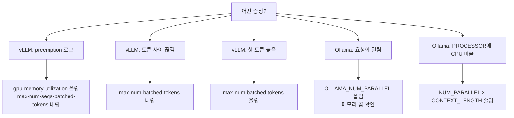

## 원본 메모
(메모 제목: vllm 과 ollama 비교)
- 각종 설정값들의 의미 그리고 튜닝 방법

## 답
**설정값 대부분은 KV 캐시 크기와, 한 번에 처리할 양을 정한다.** vLLM은 스텝당 처리량을 조절해 지연과 처리량을 맞바꾼다. Ollama는 슬롯 수와 컨텍스트 길이를 곱한 만큼 메모리를 쓰므로 이 둘부터 정한다. 기본값은 문서 페이지·버전마다 다른 것이 있어서, **운영에서는 아래 값들을 명시해 두는 편이 안전하다.**

> 약어: ITL(Inter-Token Latency, 토큰 사이 지연) · TTFT(Time To First Token, 첫 토큰까지 시간) · RAM(Random Access Memory) · VRAM(Video RAM)

### 1. vLLM 설정값
`vllm serve`는 OpenAI 호환 서버를 띄우는 명령이다. ([OpenAI-Compatible Server](https://docs.vllm.ai/en/v0.7.3/serving/openai_compatible_server.html)) (이름 유래: 문서 근거 없음)

| 옵션 | 의미 | 기본값 | 튜닝 |
| --- | --- | --- | --- |
| `--max-model-len` | 시퀀스 최대 길이(프롬프트 + 생성) | 모델 설정에서 자동 | 서비스에 필요한 길이를 명시 |
| `--gpu-memory-utilization` | 모델 실행에 쓸 GPU 메모리 비율(0~1) | 0.92 (v0.7.1 문서는 0.9) | KV 캐시가 모자라면 올림 |
| `--max-num-seqs` | 스텝당 최대 시퀀스 수 | 문서마다 다름 (256 / 테스트용 128) | preemption이 나면 내림 |
| `--max-num-batched-tokens` | 스텝당 최대 토큰 수 | 실행 환경에 따라 정해짐 (2048은 테스트용) | 아래 2번 참고 |
| `--enable-chunked-prefill` | 긴 프롬프트를 토큰 예산만큼 나눠 처리 | 켜짐 | 끄면 `max_num_batched_tokens`를 `max_model_len`보다 크게 |
| `--enable-prefix-caching` | 같은 접두어의 블록 재사용 | 켜짐 | `--no-enable-prefix-caching`으로 끔 |
| `--kv-cache-dtype` | KV 캐시 데이터 형식 | `auto`(모델 형식) | |
| `--tensor-parallel-size` | 가중치를 나눠 올릴 GPU 수 | 1 | GPU당 KV 캐시 공간이 늘지만 동기화 비용이 생김 |
| `--scheduling-policy` | `fcfs` 또는 `priority` | `fcfs` | 요청에 우선순위를 줄 때 |

출처: [Engine Arguments](https://docs.vllm.ai/en/latest/models/engine_args.html) · [Engine Arguments v0.7.1](https://docs.vllm.ai/en/v0.7.1/serving/engine_args.html) · [CacheConfig](https://docs.vllm.ai/en/stable/api/vllm/config/cache/) · [SchedulerConfig](https://docs.vllm.ai/en/latest/api/vllm/config/scheduler/) · [Optimization](https://docs.vllm.ai/en/stable/configuration/optimization/)

- `kv_cache_memory_bytes`를 지정하면 `gpu_memory_utilization`은 무시된다. ([CacheConfig](https://docs.vllm.ai/en/stable/api/vllm/config/cache/))

### 2. vLLM 튜닝: 증상별
| 증상 | 조치 | 근거 |
| --- | --- | --- |
| 로그에 `Sequence group 0 is preempted ... not enough KV cache space` | `gpu_memory_utilization` 올림 → `max_num_seqs`·`max_num_batched_tokens` 내림 → `tensor_parallel_size` 늘림 | [Optimization](https://docs.vllm.ai/en/stable/configuration/optimization/) |
| 토큰 사이가 끊김(ITL 높음) | `max_num_batched_tokens`를 작게 | "Smaller values (e.g., 2048) achieve better ITL" ([Optimization](https://docs.vllm.ai/en/stable/configuration/optimization/)) |
| 첫 토큰이 늦음(TTFT 높음) | `max_num_batched_tokens`를 크게 | "Higher values achieve better time to first token (TTFT)" ([Optimization](https://docs.vllm.ai/en/stable/configuration/optimization/)) |
| 처리량이 목표 | 작은 모델·큰 GPU면 8192 초과 | "we recommend setting `max_num_batched_tokens > 8192`" ([Optimization](https://docs.vllm.ai/en/stable/configuration/optimization/)) |

**관찰 지표** (`/metrics`, Prometheus 형식): `vllm:kv_cache_usage_perc`(사용 중인 블록 비율), `vllm:num_requests_running`·`vllm:num_requests_waiting`, `vllm:time_to_first_token_seconds`, `vllm:inter_token_latency_seconds`. ([Metrics](https://docs.vllm.ai/en/stable/design/metrics/))

### 3. Ollama 설정값
| 설정 | 의미 | 기본값 | 출처 |
| --- | --- | --- | --- |
| `OLLAMA_NUM_PARALLEL` | 모델당 동시 처리 수 | 1 | [FAQ](https://docs.ollama.com/faq) |
| `OLLAMA_CONTEXT_LENGTH` / `num_ctx` | 컨텍스트 창 크기 | 4096 (FAQ) · 2048 (Modelfile 문서) | [FAQ](https://docs.ollama.com/faq) · [Modelfile](https://docs.ollama.com/modelfile) |
| `OLLAMA_MAX_QUEUE` | 대기 큐 상한. 넘으면 거절 | 512 | [FAQ](https://docs.ollama.com/faq) |
| `OLLAMA_MAX_LOADED_MODELS` | 동시에 올릴 모델 수 | GPU 수 × 3, CPU는 3 | [FAQ](https://docs.ollama.com/faq) |
| `OLLAMA_KEEP_ALIVE` / `keep_alive` | 요청 뒤 메모리에 두는 시간 | 5분 | [FAQ](https://docs.ollama.com/faq) |
| `num_predict` | 생성 토큰 상한 | -1(무제한) | [Modelfile](https://docs.ollama.com/modelfile) |

- **기본 컨텍스트 값은 믿지 말고 명시한다.** 공식 문서끼리 4096과 2048로 다르다. VRAM에 따라 기본값이 달라진다는 PR 설명도 있다(4K·32K·256K 단계, 0.15.5부터, 머지되지 않은 PR의 설명: [ollama #14120](https://github.com/ollama/ollama/pull/14120)).

### 4. Ollama 튜닝
- **동시 요청이 밀리면** `OLLAMA_NUM_PARALLEL`을 올린다. 단, 메모리가 곱으로 는다.
> "Required RAM will scale by `OLLAMA_NUM_PARALLEL` \* `OLLAMA_CONTEXT_LENGTH`." ([FAQ](https://docs.ollama.com/faq))
- **메모리가 모자라 보이면** `ollama ps`의 PROCESSOR를 본다. `100% GPU`면 전부 GPU에 있고, `48%/52% CPU/GPU`처럼 나오면 일부가 시스템 메모리에 있다. ([FAQ](https://docs.ollama.com/faq)) 이때는 위 곱을 줄인다.
- **일부 모델 구조는 `OLLAMA_NUM_PARALLEL`이 먹지 않는다는 사용자 보고가 있다.** ([ollama #18938](https://github.com/ollama/ollama/issues/18938)) 값을 올린 뒤 실제로 동시에 처리되는지 확인한다.
- **설정 위치(Linux)**: `systemctl edit ollama.service`로 `[Service]` 아래에 `Environment=`를 넣고 `systemctl daemon-reload`, `systemctl restart ollama`를 실행한다. ([FAQ](https://docs.ollama.com/faq)) (`systemctl` man NAME: "Control the systemd system and service manager")

### 원본 메모에서 아직 열린 질문
- "각종 설정값"은 동시성·메모리에 관한 값으로 좁혀 읽었다. `temperature`·`top_p` 같은 샘플링 값이나 양자화까지 궁금하면 inbox에 남긴다.
- 값을 얼마로 잡을지는 모델과 GPU에 달려 있고, 공통 권장값은 위에 적은 것 외에 찾지 못했다.

## 코드 예제
값은 예시다. 모델과 GPU에 맞춰 바꾼다.
```bash
# vLLM: 스텝당 처리량과 캐시 공간을 명시
vllm serve <모델> \
  --max-model-len 8192 \
  --gpu-memory-utilization 0.9 \
  --max-num-seqs 32 \
  --max-num-batched-tokens 4096   # ← 작으면 ITL, 크면 TTFT에 유리

# Ollama: systemctl edit ollama.service 에 넣을 내용
[Service]
Environment="OLLAMA_NUM_PARALLEL=4"
Environment="OLLAMA_CONTEXT_LENGTH=8192"   # ← 메모리는 4 × 8192 기준으로 늚
```
출처: [Engine Arguments](https://docs.vllm.ai/en/latest/models/engine_args.html) · [Optimization](https://docs.vllm.ai/en/stable/configuration/optimization/) · [OpenAI-Compatible Server](https://docs.vllm.ai/en/v0.7.3/serving/openai_compatible_server.html) · [Ollama FAQ](https://docs.ollama.com/faq)

## 선행 개념
- [[KV 캐시]]: 대부분의 설정이 결국 조절하는 자원. 요청 수와 토큰 수에 비례해 늘어난다. ([Transformers: Cache explanation](https://huggingface.co/docs/transformers/v5.14.0/cache_explanation))
- [[vLLM과 Ollama 동시성 차이]]: vLLM은 스텝마다 토큰 예산으로 배치를 다시 짜고, Ollama는 슬롯 수만큼 함께 처리한다. 그래서 만지는 설정이 다르다. ([Architecture](https://docs.vllm.ai/en/latest/design/arch_overview/) · [FAQ](https://docs.ollama.com/faq))

## 다음에 볼 개념
### 선행
- [[KV 캐시]] — 설정값이 조절하는 자원
- [[vLLM과 Ollama 동시성 차이]] — 설정값이 바꾸는 동작
### 다음
- [[prefix caching]] — 켜 두면 재사용되는 프롬프트 블록
- [[continuous batching]] — `max_num_seqs`·`max_num_batched_tokens`가 제한하는 배치
- [[llama.cpp 슬롯]] — Ollama 슬롯 수의 아래층
- [[LLM 서빙]] — 부모 개념

## 다이어그램


## 확인 과제
내 환경에서 해 보고, 결과를 회사 정보 없이 inbox에 `결과: ...` 한 줄로 넣는다.
- [ ] `systemctl show ollama --property=Environment`: 지금 Ollama에 들어간 환경 변수를 본다. (`show`: 유닛 속성 출력 · `--property=` 볼 속성 지정)
- [ ] `ollama ps`: `OLLAMA_NUM_PARALLEL`을 1과 4로 바꿔 띄워 SIZE와 PROCESSOR를 비교한다. (`ollama` 이름 유래: 문서 근거 없음 · `ps`: 옵션 없음)
- [ ] vLLM을 띄운 뒤 부하를 주며 로그에서 `preempted`를 찾고, `--max-num-batched-tokens`를 2048과 8192로 바꿔 `vllm:time_to_first_token_seconds`와 `vllm:inter_token_latency_seconds`를 비교한다. (`--max-num-batched-tokens`: 스텝당 최대 토큰 수)

## 복습 카드
- vLLM의 `max_num_batched_tokens`를 작게 잡으면 ==ITL|토큰 간 지연==이 좋아지고, 크게 잡으면 ==TTFT|첫 토큰 시간==이 좋아진다.
- Ollama에 필요한 메모리는 ==OLLAMA_NUM_PARALLEL== × `OLLAMA_CONTEXT_LENGTH`에 맞춰 늘어난다.

## 복습 기록
