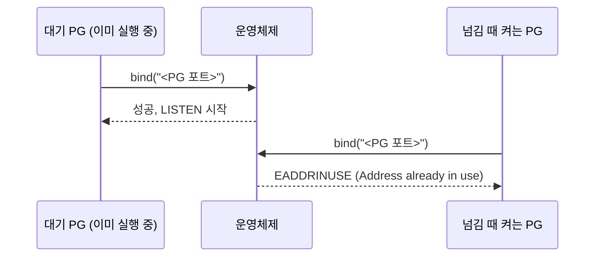

## 원본 메모
- 질문: 한 서버에서 두 프로세스가 같은 포트를 동시에 못 쓰는 이유는? PostgreSQL 유닉스 소켓 잠금 파일(.s.PGSQL.<포트>.lock)은 무엇을 막나?
- 결과: ss -ltnp로 0.0.0.0:<PG 포트>와 [::]:<PG 포트>를 postgres가 LISTEN 중인 것을 봄. 소켓 폴더에 .lock 파일도 있었음

## 답
### 왜 필요한가
한 서버에는 프로세스가 여러 개 돌고, 들어오는 연결은 "포트 번호"로 어느 프로세스에게 줄지 가른다. 같은 번호를 프로세스 둘이 동시에 받으면 연결이 어느 쪽으로 가야 하는지 정할 수 없다. 그래서 운영체제는 소켓에 주소를 붙이는 순간(bind)에 이미 쓰는 주소를 거절한다. 다만 **이 설계 이유 자체를 설명하는 공식 문서는 이번에 읽지 못했다.** 확인된 것은 "이미 쓰는 주소를 요청하면 오류가 난다"는 동작이다.

예시는 노드 B의 PG다. PG가 `<PG 포트>`를 잡고 있는 상태에서 둘째 프로세스가 같은 포트를 받으려 하면 아래처럼 막힌다.

### 1. TCP 포트: bind에서 막힌다
- `bind()`는 소켓(통신 끝점)에 주소를 정해 주는 시스템 호출이다. 서버 프로그램은 포트를 받으려고 이 호출을 하고, 주소가 이미 쓰이면 오류 `EADDRINUSE`가 돌아온다.
> "bind() assigns the address specified by addr to the socket referred to by the file descriptor sockfd." · EADDRINUSE: "The given address is already in use." ([bind(2)](https://man7.org/linux/man-pages/man2/bind.2.html))
- 그래서 둘째 프로세스(`nc` 같은 도구)가 같은 포트를 받으려 하면 `Address already in use`가 난다. 메모의 결과가 그 예다. `ss -ltnp`에서 보인 `0.0.0.0:<PG 포트>`와 `[::]:<PG 포트>` 두 줄은 postgres가 그 포트를 LISTEN(연결 기다림) 중이라는 증거다. 두 줄이 왜 따로 나오는지(IPv4·IPv6 구분으로 보이나 이번에 문서로 확인하지 못함)는 열린 질문에 둔다.

### 2. 유닉스 소켓 잠금 파일(.s.PGSQL.<포트>.lock)
- PostgreSQL은 TCP 포트 외에 **유닉스 도메인 소켓**([[유닉스 도메인 소켓]]) 파일을 소켓 폴더에 만든다. 파일 이름에 포트 번호가 들어간다(`.s.PGSQL.<포트>`).
- `.lock` 파일은 그 소켓 파일 옆에 두는 **일반 잠금 파일**이다. PostgreSQL 개발자 메일링 리스트에서 Tom Lane은 이유를 이렇게 답했다.
> "We can't portably lock the socket file itself, so we make a separate ordinary file for locking purposes." ([pgsql-admin 메일, 2010](https://www.postgresql.org/message-id/23168.1281488995%40sss.pgh.pa.us))
- 같은 스레드의 2000년 커밋 설명에 따르면, 소켓 파일 자체를 `fcntl(F_SETLK)`로 잠그는 이식성 낮은 방식을 없애고 소켓 옆의 일반 파일로 바꿨다. 이 잠금은 같은 소켓 경로를 두 postmaster(PG 서버 프로세스)가 동시에 차지하지 못하게 하는 용도로 읽힌다. (메일 요약 기준. 정확한 검사 절차는 공식 문서로 확인하지 못함.)
- 이 파일은 공식 매뉴얼 본문이 아니라 소스 코드(`miscinit.c`)에만 설명이 있다고 같은 스레드에서 언급된다.

### 원본 메모에서 아직 열린 질문
- TCP 포트가 한 프로세스만 가능한 설계 이유(커널 문서).
- `0.0.0.0`과 `[::]`가 각각 IPv4 전체, IPv6 전체를 뜻하는지와 PG 한 프로세스가 두 줄로 보이는 이유.
- `.lock`이 막는 대상의 공식 설명(매뉴얼 부재).

## 선행 개념
- [[포트]]: 한 호스트 안에서 통신할 프로세스를 구분하는 번호. ([RFC 9293](https://www.rfc-editor.org/rfc/rfc9293), 씨앗 노트의 출처)
- [[유닉스 도메인 소켓]]: 파일 경로를 주소로 쓰는 같은 머신 안 통신. PG의 `.s.PGSQL.<포트>` 파일이 이것이다.

## 다음에 볼 개념
### 선행
- [[포트]] — 포트 번호가 하는 일
- [[유닉스 도메인 소켓]] — 소켓 파일과 경로
### 다음
- [[공유 디스크 HA와 스트리밍 복제 HA 차이]] — 포트 충돌이 HA 넘김에서 문제가 되는 사례

## 다이어그램

## 확인 과제
내 환경에서 해 보고, 결과를 회사 정보 없이 inbox에 `결과: ...` 한 줄로 넣는다.
- [ ] `ss -ltnp`: PG 포트를 쥔 프로세스 확인. `ss` 이름 유래: 문서 근거 없음(흔히 socket statistics로 읽고, [Red Hat 문서](https://docs.redhat.com/en/documentation/Red_Hat_Enterprise_Linux/7/html/Performance_Tuning_Guide/sect-Red_Hat_Enterprise_Linux-Performance_Tuning_Guide-Tool_Reference-ss.html)는 소켓 통계를 보여 주는 도구로 설명) · `-l` listening, 수신 대기 소켓만 · `-t` tcp · `-n` numeric, 서비스 이름 대신 포트 번호 · `-p` processes, 소켓을 쓰는 프로세스 ([ss(8)](https://manpages.ubuntu.com/manpages/xenial/man8/ss.8.html))
- [ ] PG 소켓 폴더에서 `.s.PGSQL.<포트>`와 `.s.PGSQL.<포트>.lock` 두 파일이 같은 포트 번호를 쓰는지 눈으로 확인한다.

## 복습 카드
- 이미 쓰는 주소에 bind를 요청하면 오류 ==EADDRINUSE|Address already in use==가 돌아온다.
- PostgreSQL이 소켓 파일 옆에 일반 ==잠금 파일|lock file==을 두는 이유는 소켓 파일 자체를 이식성 있게 잠글 수 없어서다.

## 복습 기록
