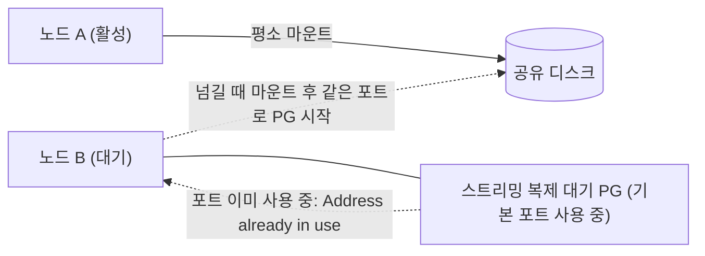

## 원본 메모
- 질문: 공유 디스크 방식 HA와 PostgreSQL 스트리밍 복제 방식 HA는 무엇이 다른가? 둘을 한 쌍의 서버에 같이 두면 장애 넘김 때 무슨 일이 생기나?
- 상황 한 줄: 예전에 만든 스트리밍 복제 대기 PG가 대기 노드에서 기본 포트로 떠 있는데, HA 클러스터는 넘길 때 그 노드에 공유 디스크를 붙이고 같은 포트로 PG를 켜려 함
- 결과: 대기 노드에서 nc -l <PG 포트>를 치니 Address already in use가 나옴

## 답
### 왜 필요한가
DB 서버가 죽으면 서비스가 멈춘다. 그래서 대기 서버를 하나 두고 넘겨받게 하는데, 대기 서버가 **데이터를 어떻게 갖고 있느냐**에 따라 방식이 둘로 갈린다. 하나는 데이터를 한 벌만 두고 서버가 번갈아 쓰는 방식(공유 디스크), 다른 하나는 데이터를 서버마다 한 벌씩 두고 계속 맞추는 방식(복제)이다. 두 방식은 대기 서버의 상태가 전혀 다르므로 구분해 둬야 한다.

예시는 **노드 A**(활성)와 **노드 B**(대기) 한 쌍이다.

| 항목 | 공유 디스크 방식 | 스트리밍 복제 방식 |
| --- | --- | --- |
| 데이터 벌 수 | 디스크 배열 하나를 서버들이 공유, 데이터베이스는 한 벌 | 서버마다 자기 데이터 한 벌 |
| 대기 서버(노드 B)는 평소에 | 주 서버가 죽은 뒤에 디스크를 마운트하고 데이터베이스를 시작함 (평소 상태는 문서에 없음) | PG를 켜 두고 노드 A의 WAL 기록 흐름을 읽어 따라감 |
| 넘길 때 | 노드 B가 디스크를 마운트(장치를 디렉토리에 붙이는 일)하고 PG를 시작. 충돌 복구처럼 시작 | 노드 B를 새 주 서버로 승격 |
| 데이터 손실 | 문서: 데이터 손실 없이 빠른 넘김 | 대기 서버에 "거의 모든 데이터"가 있음. 동기·비동기 선택 가능 |

- **공유 디스크 방식**: "한 벌만 두므로 동기화 부담이 없고, 주 서버가 죽으면 대기 서버가 데이터베이스를 마운트해 충돌에서 복구하듯 시작한다. 빠른 넘김에 데이터 손실이 없다." ([PostgreSQL 18: Comparison of Different Solutions](https://www.postgresql.org/docs/current/different-replication-solutions.html))
> "Shared disk failover avoids synchronization overhead by having only one copy of the database." (같은 문서)
- **스트리밍 복제 방식**: 대기 서버가 WAL(Write-Ahead Log, 쓰기 전 기록) 기록의 흐름을 읽어 최신으로 유지한다. 주 서버가 죽으면 대기 서버를 곧 새 주 서버로 만들 수 있다. 동기·비동기 모두 가능하고 서버 전체 단위로만 된다.
> "Warm and hot standby servers can be kept current by reading a stream of write-ahead log (WAL) records." (같은 문서)

### 둘을 한 쌍에 같이 두면
HA 클러스터가 노드 A → B로 넘길 때 **노드 B에 공유 디스크를 붙이고 같은 포트로 PG를 시작**하려 한다. 그런데 노드 B에는 예전 스트리밍 복제의 대기 PG가 그 포트를 이미 잡고 있다. 내 결과(`Address already in use`)는 이 충돌을 보여 준다. bind(소켓에 주소를 붙이는 시스템 호출) 문서가 "이미 쓰는 주소"를 오류 `EADDRINUSE`로 정의한다. ([bind(2)](https://man7.org/linux/man-pages/man2/bind.2.html)) 포트가 왜 한 프로세스만 쓸 수 있는지는 [[같은 포트를 두 프로세스가 못 쓰는 이유]]에서 이어진다.

정리하면, 이 구성에서 넘김은 **둘째 PG가 포트를 못 잡아 시작에 실패하는** 방향으로 흐른다고 읽는 것이 자연스럽다. 이 환경에서 HA 제품이 실제로 어떻게 반응하는지(실패, 재시도, 포트 변경)는 읽은 문서로 확인하지 못했다.

### 원본 메모에서 아직 열린 질문
- 이 두 방식을 한 쌍에서 함께 쓰는 것이 문서상 권장·비권장인지.
- 공유 디스크 PG와 스트리밍 복제 PG가 같은 노드에서 데이터 디렉토리나 설정 파일을 어떻게 나누는지(출처 없음, 내 환경 확인 필요).
- HA 제품이 포트 충돌 시 취하는 동작.

## 선행 개념
- [[HA 클러스터]]: 한 서비스를 맡은 서버가 죽으면 다른 서버가 이어받는 구성. 공유 디스크 방식에서는 대기 서버가 디스크를 마운트해 시작한다. ([PostgreSQL 18](https://www.postgresql.org/docs/current/different-replication-solutions.html))
- [[PostgreSQL 스트리밍 복제]]: 대기 서버가 주 서버의 WAL 기록 흐름을 받아 최신으로 따라가는 방식. 대기 PG는 평소에도 켜져 포트를 잡는다. ([PostgreSQL 18](https://www.postgresql.org/docs/current/different-replication-solutions.html))

## 다음에 볼 개념
### 선행
- [[HA 클러스터]] — 넘김의 기본 구조
- [[PostgreSQL 스트리밍 복제]] — 대기 서버가 켜져 있는 이유
### 다음
- [[같은 포트를 두 프로세스가 못 쓰는 이유]] — 포트 충돌이 왜 나는지
- [[PostgreSQL 복제 슬롯]] — 스트리밍 복제 대기 서버가 멈출 때 주 서버에 생기는 일

## 다이어그램

## 확인 과제
내 환경에서 해 보고, 결과를 회사 정보 없이 inbox에 `결과: ...` 한 줄로 넣는다.
- [ ] 노드 B에서 `ss -ltnp`: PG 포트를 어느 프로세스가 잡았는지. `ss` 이름 유래: 문서 근거 없음(흔히 socket statistics로 읽고, [Red Hat 문서](https://docs.redhat.com/en/documentation/Red_Hat_Enterprise_Linux/7/html/Performance_Tuning_Guide/sect-Red_Hat_Enterprise_Linux-Performance_Tuning_Guide-Tool_Reference-ss.html)는 소켓 통계를 보여 주는 도구로 설명) · `-l` listening, 수신 대기 소켓만 · `-t` tcp · `-n` numeric, 서비스 이름 대신 포트 번호 · `-p` processes, 소켓을 쓰는 프로세스 ([ss(8)](https://manpages.ubuntu.com/manpages/xenial/man8/ss.8.html))
- [ ] HA 제품 문서나 설정에서 PG 리소스가 쓰는 포트를 확인하고, 대기 PG 포트와 같은지 비교한다 (제품·버전 확인 필요).

## 복습 카드
- 공유 디스크 방식은 데이터베이스를 ==한 벌|one copy==만 두므로 동기화 부담이 없다.
- 스트리밍 복제의 대기 서버는 주 서버의 ==WAL|write-ahead log== 기록 흐름을 읽어 최신 상태를 유지한다.
- 대기 노드에 이미 포트를 쓰는 PG가 있으면 같은 포트로 둘째 프로세스를 켤 때 ==EADDRINUSE|Address already in use== 오류가 난다.

## 복습 기록
