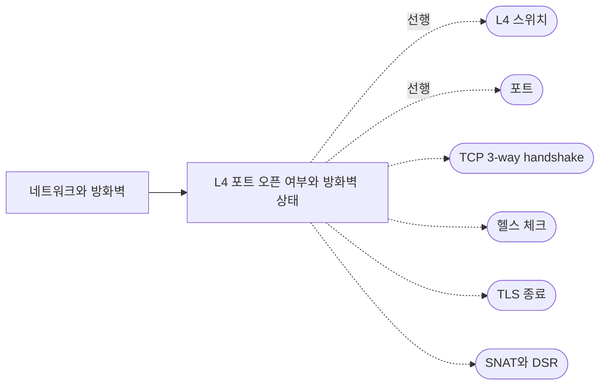

## 원본 메모
(별도 원본 메모 없음. [[L4 포트 오픈 여부와 방화벽 상태]]를 정리하면서 `part_of` 부모 노트로 만들었다.)

> 묶음 노트: 하위 개념을 잇는 허브다. 복습 카드와 확인 과제는 없고, 말로 복습 대상이 아니다.

## 개요
포트에 연결이 안 될 때 원인은 서비스(수신 중인 앱이 없음)와 방화벽(패킷 필터가 막음) 중 하나로 갈리고, L4 장비가 끼면 리스너 포트와 대상 포트 두 구간을 따로 봐야 한다.
> "A closed port is accessible (it receives and responds to Nmap probe packets)." · "packet filtering prevents its probes from reaching the port." ([Nmap: Port Scanning Basics](https://nmap.org/man/man-port-scanning-basics.html))

## 하위 개념
- [[L4 포트 오픈 여부와 방화벽 상태]] — 포트 상태 3가지, DROP·REJECT 구분, L4 두 구간 확인 (draft, 말로 복습 대기)

## 하위 개념 지도
실선은 하위 노트, 점선은 하위 노트가 가리키는 선행 개념과 다음에 볼 개념이다(아직 질문하지 않은 씨앗 노트).

## 다음에 볼 개념
아직 질문하지 않은 씨앗이다. 한 줄 설명만 있고, inbox에 질문을 남기면 답 노트로 키운다.

### 선행
- [[L4 스위치]] — IP·포트만 보고 요청을 여러 서버로 나누는 장비
- [[포트]] — 한 호스트 안에서 통신할 프로세스를 구분하는 16비트 번호

### 다음
- [[TCP 3-way handshake]] — SYN → SYN-ACK → ACK로 TCP 연결을 여는 절차
- [[헬스 체크]] — 뒤쪽 서버가 살아 있는지 주기적으로 확인해 죽은 서버를 빼는 기능
- [[TLS 종료]] — HTTPS 암호화를 서버 대신 로드밸런서에서 푸는 구성
- [[SNAT와 DSR]] — 응답이 L4 장비를 거쳐 오는지(SNAT) 서버에서 바로 가는지(DSR)
