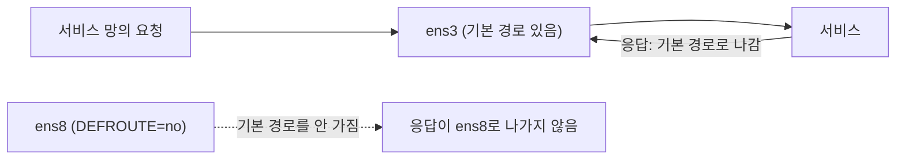

## 원본 메모
- 질문: NIC 두 개가 모두 DHCP일 때 두 번째 NIC의 ifcfg에 DEFROUTE=no가 왜 필요한가?
- 상황 한 줄: 기본 경로가 두 번째 NIC로 넘어가면 서비스 망으로 들어온 요청의 응답이 다른 NIC로 나가 클라우드가 버린다고 들음

## 답
### 왜 필요한가
기본 경로(default route)는 "목적지가 어느 경로에도 안 맞을 때 보내는 길"이다. NIC 두 개가 모두 DHCP로 주소를 받아 둘 다 기본 경로를 갖게 되면, 어느 NIC가 기본이 될지가 설정에 달려 흔들린다. 메모는 그 결과로 서비스 망(`ens3`)에 들어온 요청의 응답이 두 번째 NIC(`ens8`)로 나갈 수 있고 클라우드가 이를 버린다고 들었다고 적었다. 이 마지막 부분(응답이 다른 NIC로 나가면 버려진다)은 읽은 문서에서 확인하지 못했다.

### DEFROUTE=no가 하는 일 (문서로 확인되는 것)
- `ifcfg`(옛 방식의 `/etc/sysconfig/network-scripts/ifcfg-*` 설정 파일)는 NetworkManager의 ifcfg-rh 플러그인이 읽고 쓴다. ([nm-settings-ifcfg-rh](https://networkmanager.dev/docs/api/latest/nm-settings-ifcfg-rh.html))
- 같은 문서는 `DEFROUTE=no`를 "이 연결에는 기본 경로를 주지 말라고 NetworkManager에 알리는 것"으로 설명하고, `DEFROUTE`는 `never-default` 속성과 반대 의미라고 쓴다. 이 두 문장은 문서를 요약해 읽은 결과라서 원문 표현은 라이브 페이지로 다시 확인해야 한다(확인 필요).
- 따라서 두 번째 NIC(`ens8`)에 `DEFROUTE=no`를 두면 기본 경로는 서비스 NIC(`ens3`)쪽 하나로 정해진다는 것이 메모의 의도와 맞는 읽기다.

### 원본 메모에서 아직 열린 질문
- 기본 경로가 둘이 될 때 NetworkManager가 어떤 것을 고르는지(RHEL 9 문서에 "여러 기본 게이트웨이" 항목 제목만 확인, 본문은 읽지 못함).
- 응답이 요청이 들어온 NIC와 다른 NIC로 나갈 때 클라우드가 버리는지, `rp_filter` 같은 설정과의 관계는 읽은 문서에 없다.
- 두 번째 NIC의 네트워크가 `ipv4`이고 `routes`가 비어 있으면(게이트웨이 없음), 애초에 기본 경로가 생기는지.

## 코드 예제
> 예제 기준: NetworkManager ifcfg-rh 플러그인 문서(버전 표기 없음), Red Hat 계열 RHEL 9 문서 제목 확인. 내 OS·NetworkManager 버전: 버전 확인 필요

```ini
# /etc/sysconfig/network-scripts/ifcfg-ens8  (두 번째 NIC)
DEVICE=ens8
BOOTPROTO=dhcp
DEFROUTE=no      # ← 이 연결에는 기본 경로를 주지 않음
```

이 코드에서 `DEFROUTE=no`가 개념을 지정하는 줄이다. 서비스 NIC `ens3`의 파일은 `DEFROUTE`를 두지 않으면 문서상 기본값 `yes`이므로 기본 경로를 갖는다. 그래서 두 NIC가 모두 DHCP로 주소를 받아도 기본 경로는 `ens3` 쪽에만 생기도록 의도한 설정이다. (`DEFROUTE` 기본값 yes는 문서 요약에서 읽음, 확인 필요)

## 선행 개념
- [[클라우드 메타데이터 network_data.json]]: 두 번째 NIC에 게이트웨이(`routes`)가 있는지는 메타데이터에서 읽는다. ([스키마](https://docs.openstack.org/nova/latest/_downloads/4e8fe1ae7db6dd6eebca372db68fe63e/network_data.json))

## 다음에 볼 개념
### 선행
- [[클라우드 메타데이터 network_data.json]] — 두 NIC의 네트워크 type과 routes
### 다음
- [[NetworkManager]] — ifcfg 파일을 읽는 쪽

## 다이어그램


## 확인 과제
내 환경에서 해 보고, 결과를 회사 정보 없이 inbox에 `결과: ...` 한 줄로 넣는다.
- [ ] `ip route show` (`ip` IP 관련 설정 명령, `route` 경로 보기, `show` 표시): `default`로 시작하는 줄이 몇 개이고 어느 NIC에 붙었는지 적는다. (`ip` 이름 유래: 문서 근거 없음)
- [ ] `grep DEFROUTE /etc/sysconfig/network-scripts/ifcfg-*` (`grep` 패턴 검색): 두 NIC의 `DEFROUTE` 값을 적는다.

## 복습 카드
- ifcfg에서 `DEFROUTE=`를 ==no==로 두면 이 연결에 기본 경로를 주지 않도록 NetworkManager에 알린다.
- `DEFROUTE`는 NetworkManager의 ==never-default|never default== 속성과 반대 의미이다.

## 복습 기록
