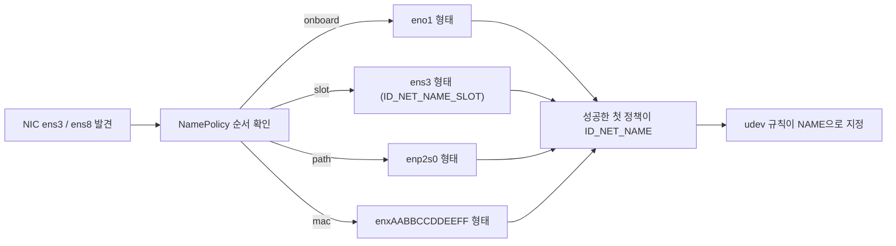

## 원본 메모
- 질문: 리눅스 NIC 이름(ens3, ens8 같은)은 어떻게 정해지고, 재부팅이나 NIC 추가 때 왜 바뀔 수 있나?
- 상황 한 줄: 클라우드 VM 두 대에 두 번째 NIC가 붙은 뒤 HA 클러스터 엔지니어가 "NIC 이름 고정"을 요청함. 장애 넘김 때 VIP가 서비스 NIC 이름(ens3)에 붙기 때문이라고 함
- 결과: 두 번째 NIC가 ens8로 잡혀 있었고, udevadm info에 ID_NET_NAME_SLOT=ens3이 보였음 (슬롯 번호를 따라 이름이 붙는 것으로 보임)

## 답
### 왜 필요한가
커널이 붙이는 `eth0`, `eth1` 같은 이름은 재부팅 때 같은 카드에 같은 이름이 붙는다고 보장할 수 없다. 메모의 상황처럼 설정이 NIC 이름(`ens3`)으로 NIC를 가리키면, 이름이 흔들릴 때 엉뚱한 NIC에 설정이 붙는다. systemd 문서도 커널이 붙인 이름은 "재부팅 사이에 불안정한 것으로 알려져 있다"고 쓴다. ([systemd.link(5)](https://www.freedesktop.org/software/systemd/man/latest/systemd.link.html), OriginalName= 항목)

> "Caution is advised when matching on kernel-assigned names, as they are known to be unstable between reboots." (systemd.link(5))

### 이름은 어떻게 만들어지나
예시 하나로 간다. **서비스 NIC `ens3`**, **두 번째 NIC `ens8`** 이다. 이름은 두 글자 접두어 + 위치 정보로 이뤄진다.

- 접두어 `en`은 Ethernet(이더넷)이다. "모든 이름은 인터페이스 종류를 나타내는 두 글자 접두어로 시작한다". ([systemd.net-naming-scheme(7)](https://www.freedesktop.org/software/systemd/man/latest/systemd.net-naming-scheme.html), Policies)
- 뒤의 `s3`의 `s`는 PCI 슬롯 번호(slot)다. 이 이름은 udev 속성 `ID_NET_NAME_SLOT`으로 나오고 "슬롯 위치를 설명한다". 그래서 `ens3`은 "이더넷, 슬롯 3"으로 읽는다. 같은 문서에 PCI 카드가 `ID_NET_NAME_SLOT=ens1`, `ID_NET_NAME_PATH=enp5s0`을 갖는 예가 있다.
- 같은 문서에는 후보가 여러 가지 나온다: 펌웨어가 준 온보드 번호(`o`, `ID_NET_NAME_ONBOARD`, 예 `eno1`), 장착 위치 경로(`p`, `ID_NET_NAME_PATH`, 예 `enp2s0f0`), MAC 주소(`x`+12자리, `ID_NET_NAME_MAC`).
- 이 후보 중 무엇을 쓸지는 systemd.link의 `NamePolicy=`가 정한다. "정책을 순서대로 나열하고, 성공한 첫 번째 것을 쓴다". 이름은 직접 붙지 않고 udev 속성 `ID_NET_NAME`으로 내보내진 뒤 udev 규칙이 `NAME`으로 정한다. ([systemd.link(5)](https://www.freedesktop.org/software/systemd/man/latest/systemd.link.html), NamePolicy=)

### 왜 바뀔 수 있나 (문서로 확인되는 것만)
- systemd 버전이 올라가면 "더 많은 속성을 반영해서 같은 장치의 이름이 바뀔 수도 있다". 또 새 커널이 새 sysfs 속성을 추가하면 "이름이 여전히 바뀔 수 있다". ([net-naming-scheme(7)](https://www.freedesktop.org/software/systemd/man/latest/systemd.net-naming-scheme.html), Description·Limiting the use of specific sysfs attributes)
- MAC 기반 이름은 장치를 옮겨도 안정적이지만 "하드웨어가 교체되면 바뀐다".
- 슬롯 이름은 PCI 브리지가 슬롯과 연결된 구성에서는 만들지 않는다(이름 충돌 방지).

### 원본 메모에서 아직 열린 질문
- 메모의 `ens8`은 `ID_NET_NAME_SLOT=ens3`이 보인 NIC와 같은 NIC인지 메모만으로 알 수 없다. 같다면 이름(`ens8`)이 슬롯 이름과 다른 이유(이미 사용자 공간이 준 이름을 `keep`했을 가능성 등)를 확인하지 못했다. 정책 `keep`은 "이미 사용자 공간이 이름을 줬으면 그대로 둔다"는 뜻이다(문서 확인).
- NIC를 나중에 붙일 때 슬롯 번호를 누가(하이퍼바이저, 펌웨어) 어떻게 정하는지는 읽은 문서에 없다.
- `NamePolicy=` 기본값의 정확한 목록은 문서의 일부만 읽어서 확인하지 못했다(기본 파일 `99-default.link`가 시스템에 포함된다는 것까지 확인).
- 내 환경의 systemd 버전: 버전 확인 필요. (참고한 문서 표기는 systemd 262)

## 선행 개념
- [[HA 클러스터 VIP와 하트비트]]: 통신 경로와 VIP의 바탕. VIP가 NIC 이름에 붙는다는 요청의 배경이다.

## 다음에 볼 개념
### 선행
- [[HA 클러스터]] — 장애 때 서비스를 넘기는 구성이라 NIC 이름이 설정에 박힌다
### 다음
- [[udev 규칙과 systemd link 파일 차이]] — 이름을 고정하는 두 방법
- [[dracut과 initramfs]] — 이름 설정을 바꾼 뒤 부팅 초기 이미지에도 반영해야 하는 이유
- [[systemd-udevd]] — 이름 정책을 받아 NAME을 정하는 데몬

## 다이어그램

## 확인 과제
내 환경에서 해 보고, 결과를 회사 정보 없이 inbox에 `결과: ...` 한 줄로 넣는다.
- [ ] `udevadm info /sys/class/net/ens3` (이름 유래: 문서 근거 없음, 이번에 읽은 문서에 풀이 없음): 출력에서 `ID_NET_NAME_*` 줄을 모두 적고 실제 이름과 같은 줄이 어느 것인지 본다. 같은 일을 `ens8`에도 한다. (인자 없이 장치 경로만 줬다. 출력 형식은 내 버전 기준으로 확인 필요)
- [ ] `ls /sys/class/net` (`ls` list, 옵션 없음): NIC 이름 목록을 확인한다.

## 복습 카드
- `ens3`에서 `en`은 ==이더넷|Ethernet==, `s3`의 `s`는 PCI ==슬롯|slot== 번호를 뜻한다.
- 커널이 붙인 `eth0` 같은 이름은 재부팅 사이에 ==불안정|unstable==한 것으로 알려져 있어 systemd가 위치·MAC 기반 이름을 쓴다.

## 복습 기록
