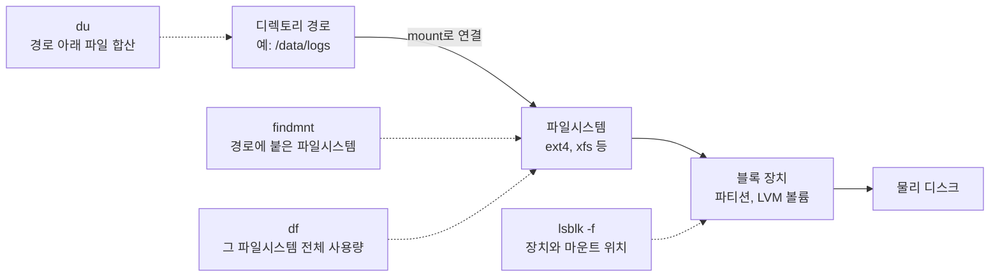

## 원본 메모
- 리눅스 서버의 논리적 디렉토리와 물리적 디스크 사이의 간극을 명령어로 어떻게 확인 및 명령어의 풀네임을 통한 작동방식 확인

## 답
리눅스에서 보이는 디렉토리 트리는 `/` 하나지만, 그 아래 데이터는 여러 장치에 나뉘어 있다. 둘을 잇는 것이 **마운트**다. 그래서 "이 디렉토리가 실제로 어느 디스크에 있나"는 경로만 봐서는 알 수 없고 명령어로 확인해야 한다.
> "All files accessible in a Unix system are arranged in one big tree, the file hierarchy, rooted at /." · "These files can be spread out over several devices." ([mount(8)](https://www.man7.org/linux/man-pages/man8/mount.8.html))

### 간극을 확인하는 명령어
명령어 이름을 풀어 보면 각 명령이 어느 층을 보는지 드러난다. 이름 풀이는 옛 Unix 매뉴얼·man 페이지에 적힌 것만 쓰고, 근거가 없으면 man 페이지 NAME 설명만 둔다.

| 명령어 | 이름 풀이 · man 페이지 NAME | 보는 층 | 근거 |
| --- | --- | --- | --- |
| `du` | **d**isk **u**sage ([Unix 10판 du(1)](https://man.cat-v.org/unix_10th/1/du)) · estimate file space usage | 디렉토리: 경로 아래 파일을 재귀로 합산 | "Summarize device usage of the set of FILEs, recursively for directories." ([du(1)](https://man7.org/linux/man-pages/man1/du.1.html)) |
| `df` | **d**isk **f**ree ([Unix V7 df(1)](https://typewritten.org/Manual/Sun/Unisoft/V7/man1/df.html)) · report file system space usage | 파일시스템: 경로가 속한 파일시스템 전체 | "df displays the amount of space available on the file system containing each file name argument." ([df(1)](https://www.man7.org/linux/man-pages/man1/df.1.html)) |
| `findmnt` | 이름 유래: 문서 근거 없음 · find a filesystem | 연결: 어느 경로에 어느 파일시스템이 붙었나 | "The command prints all mounted filesystems in the tree-like format by default." ([findmnt(8)](https://www.man7.org/linux/man-pages/man8/findmnt.8.html)) |
| `lsblk` | **l**i**s**t **bl**oc**k** devices (NAME 그대로) | 장치: 디스크·파티션과 마운트 위치 (`-f`면 파일시스템 종류까지) | "lsblk lists information about all available or the specified block devices." ([lsblk(8)](https://manpages.debian.org/jessie/util-linux/lsblk.8.en.html)) |

핵심 차이는 `du`와 `df`다. `du /data`는 `/data` 아래 파일만 더하고, `df /data`는 `/data`가 올라간 **파일시스템 전체**를 본다. 같은 경로를 줘도 보는 대상이 다르다.

### df와 du 숫자가 다를 때
간극이 실제로 드러나는 대표 증상이다.
- **삭제했지만 프로세스가 아직 열고 있는 파일**: `du`에는 안 보이지만 `df`에는 사용 중으로 잡힌다. `lsof`(**l**i**s**t **o**pen **f**iles)에 `+L1`(링크 수가 1보다 작은 파일, 즉 지워졌지만 아직 열려 있는 파일만)을 줘서 찾는다. ([lsof 튜토리얼](https://lsof.readthedocs.io/en/latest/tutorial/))
  > "if a process deleted a huge log file but still keeps it open, `du` won't see the file anymore." ([Tecmint](https://www.tecmint.com/df-du-disk-usage-difference-linux/))
- **마운트에 가려진 파일**: 디렉토리에 다른 파일시스템을 마운트하면, 그 전에 그 디렉토리에 있던 파일은 보이지 않게 된다. 보이지 않으니 `du`로는 셀 수 없지만, 원래 파일시스템의 공간은 계속 차지한다.
  > "The previous contents (if any) and owner and mode of dir become invisible" ([mount(8)](https://www.man7.org/linux/man-pages/man8/mount.8.html))

## 선행 개념
- [[마운트]]: 어떤 장치의 파일시스템을 디렉토리 트리의 한 지점에 붙이는 일이다. 붙인 뒤에는 그 경로가 장치 파일시스템의 루트를 가리킨다.
  > "The mount command serves to attach the filesystem found on some device to the big file tree." ([mount(8)](https://www.man7.org/linux/man-pages/man8/mount.8.html))

## 다음에 볼 개념
### 다음
- [[블록 장치]] — 블록 단위로 읽고 쓰는 저장 장치. lsblk가 보여 줌
- [[LVM]] — 여러 디스크를 묶어 논리 볼륨으로 나눠 쓰는 계층
- [[inode]] — 파일의 메타데이터를 담는 구조. 이름은 디렉토리 항목에 있음
- [[fstab]] — 부팅 때 무엇을 어디에 마운트할지 적는 설정 파일
- [[tmpfs]] — 메모리에 파일을 두는 파일시스템. 재부팅하면 사라짐

## 다이어그램

## 확인 과제
서버에서 실행해 보고, 경로·장치명 외 회사 정보는 빼고 inbox에 `결과: ...` 한 줄로 넣는다. 이 결과가 블로그 "직접 확인한 결과" 문단이 된다.
- [ ] `findmnt`: 궁금했던 디렉토리에 어떤 파일시스템이 붙어 있는지 (옵션 없이 쓰면 마운트된 파일시스템 전체를 트리로 보여 준다)
- [ ] `lsblk -f`: 그 파일시스템이 어느 디스크·파티션에 있는지 (`-f` = `--fs`: 파일시스템 종류·UUID·마운트 위치까지)
- [ ] `df -hT <경로>`와 `du -sh <경로>`: 두 숫자가 얼마나 다른지 (`-h` human-readable: K·M·G 단위 · `-T` print-type: 파일시스템 종류 표시 · `-s` summarize: 하위 항목 없이 합계만)
- [ ] 차이가 크면 `sudo lsof +L1`: 삭제됐지만 열려 있는 파일이 있는지 (`+L1` = 링크 수 1 미만인 열린 파일만)

## 복습 카드
- `df`는 인자로 준 경로가 속한 ==파일시스템 전체|파일시스템==를 기준으로 사용량을 보여준다.
- `du`는 지정한 디렉토리 아래 파일들을 ==재귀적으로|재귀== 합산한다.
- 파일을 지웠는데 `df` 사용량이 줄지 않는 대표 원인은 ==프로세스==가 삭제된 파일을 아직 ==열고 있기|열고 있어서|열고== 때문이다.
- 디렉토리에 다른 파일시스템을 ==마운트==하면 원래 있던 파일은 지워지지 않고 보이지 않게 ==가려진다|가려짐|숨겨진다==.

