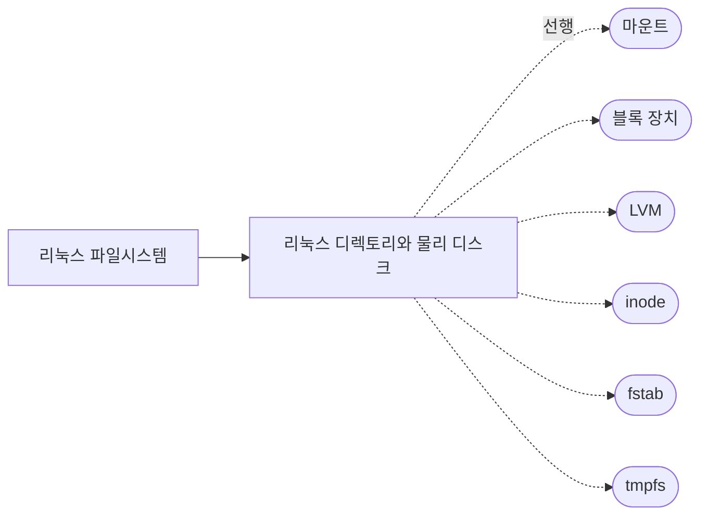

## 원본 메모
(별도 원본 메모 없음. [[리눅스 디렉토리와 물리 디스크]]를 정리하면서 `part_of` 부모 노트로 만들었다.)

> 묶음 노트: 하위 개념을 잇는 허브다. 복습 카드와 확인 과제는 없고, 말로 복습 대상이 아니다.

## 개요
리눅스의 모든 파일은 `/`에서 시작하는 트리 하나에 놓이지만, 실제 데이터는 여러 장치에 나뉘어 있고 마운트가 장치의 파일시스템을 트리에 붙인다.
> "All files accessible in a Unix system are arranged in one big tree, the file hierarchy, rooted at /." · "The mount command serves to attach the filesystem found on some device to the big file tree." ([mount(8)](https://www.man7.org/linux/man-pages/man8/mount.8.html))

## 하위 개념
- [[리눅스 디렉토리와 물리 디스크]] — du·df·findmnt·lsblk가 보는 층의 차이와 df·du 불일치 원인 (draft, 말로 복습 대기)

## 하위 개념 지도
실선은 하위 노트, 점선은 하위 노트가 가리키는 선행 개념과 다음에 볼 개념이다(아직 노트 없음).

## 다음에 볼 개념
- 선행: [[마운트]]
- 다음: [[블록 장치]] · [[LVM]] · [[inode]] · [[fstab]] · [[tmpfs]]
