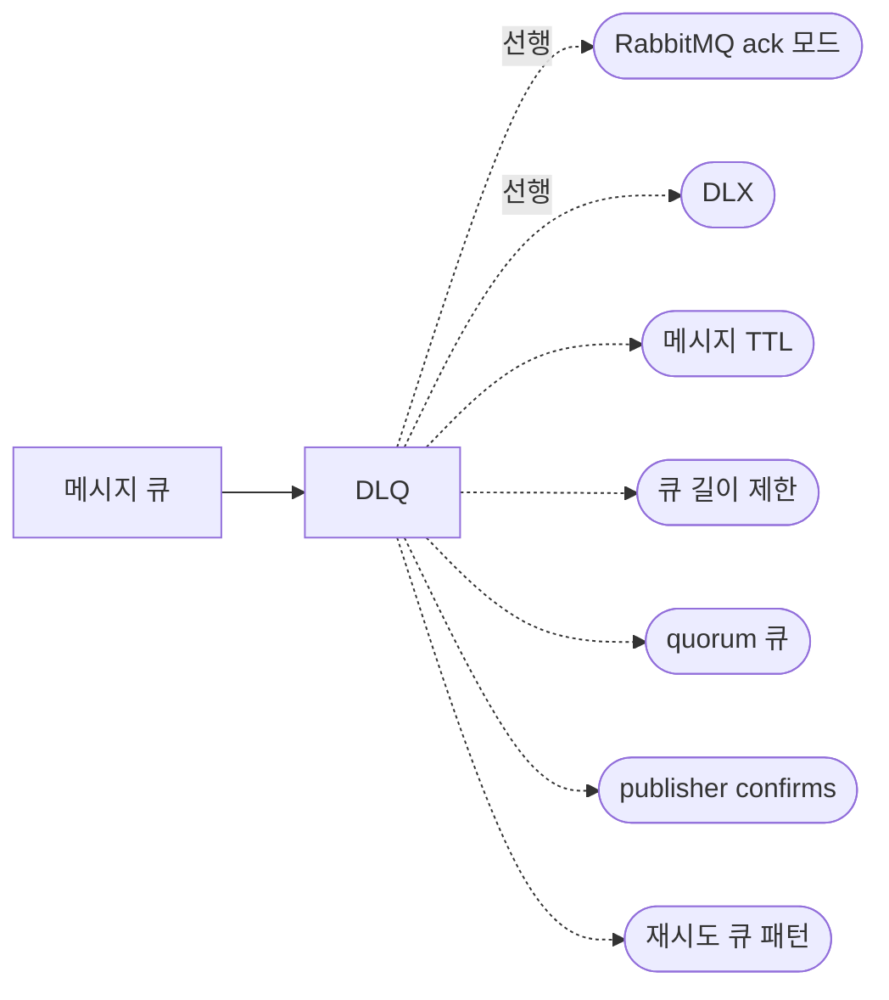

## 원본 메모
(별도 원본 메모 없음. [[DLQ]]를 정리하면서 `part_of` 부모 노트로 만들었다.)

> 묶음 노트: 하위 개념을 잇는 허브다. 복습 카드와 확인 과제는 없고, 말로 복습 대상이 아니다.

## 개요
메시지 큐는 메시지를 순서대로 쌓아 두었다가 소비자에게 전달하는 저장소다. 이 볼트의 메시지 큐 노트는 RabbitMQ 기준이다.
> "A queue in RabbitMQ is an ordered collection of messages." · "Messages are enqueued and dequeued (delivered to consumers) in a FIFO ("first in, first out") manner." ([RabbitMQ: Queues](https://www.rabbitmq.com/docs/queues))

## 하위 개념
- [[DLQ]] — 처리 못 한 메시지가 DLX를 거쳐 모이는 큐와 운영 시나리오 (draft, 말로 복습 대기)

## 하위 개념 지도
실선은 하위 노트, 점선은 하위 노트가 가리키는 선행 개념과 다음에 볼 개념이다(아직 질문하지 않은 씨앗 노트).

## 다음에 볼 개념
아직 질문하지 않은 씨앗이다. 한 줄 설명만 있고, inbox에 질문을 남기면 답 노트로 키운다.

### 선행
- [[RabbitMQ ack 모드]] — 소비자가 처리 완료를 알리는 방식. 소비자 장애 대비는 수동 ack
- [[DLX]] — 처리 못 한 메시지를 다시 받는 교환기. 여기 묶인 큐가 DLQ

### 다음
- [[메시지 TTL]] — 메시지가 큐에 머물 수 있는 최대 시간
- [[큐 길이 제한]] — 큐에 쌓을 수 있는 개수·용량 상한과 넘칠 때 동작
- [[quorum 큐]] — Raft로 여러 노드에 복제되는 내구성 큐
- [[publisher confirms]] — 브로커가 메시지를 안전하게 받았다고 생산자에게 알려 주는 확인
- [[재시도 큐 패턴]] — TTL 대기 큐 + DLX로 일정 시간 뒤 다시 처리하는 구성
