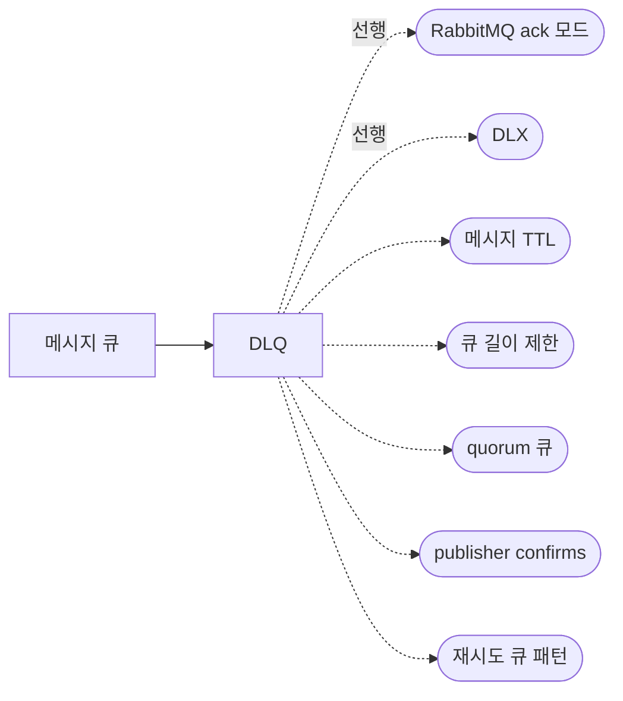

## 원본 메모
(별도 원본 메모 없음. [[DLQ]]를 정리하면서 `part_of` 부모 노트로 만들었다.)

> 묶음 노트: 하위 개념을 잇는 허브다. 복습 카드와 확인 과제는 없고, 말로 복습 대상이 아니다.

## 개요
메시지 큐는 메시지를 순서대로 쌓아 두었다가 소비자에게 전달하는 저장소다. 이 볼트의 메시지 큐 노트는 RabbitMQ 기준이다.
> "A queue in RabbitMQ is an ordered collection of messages." · "Messages are enqueued and dequeued (delivered to consumers) in a FIFO ("first in, first out") manner." ([RabbitMQ: Queues](https://www.rabbitmq.com/docs/queues))

## 하위 개념
- [[DLQ]] — 처리 못 한 메시지가 DLX를 거쳐 모이는 큐와 운영 시나리오 (draft, 말로 복습 대기)
- 관련 예시 노트: [[RabbitMQ 메시지 흐름]], [[RabbitMQ prefetch]] (형식 확인용)

## 하위 개념 지도
실선은 하위 노트, 점선은 하위 노트가 가리키는 선행 개념과 다음에 볼 개념이다(아직 노트 없음).

## 다음에 볼 개념
- 선행: [[RabbitMQ ack 모드]] · [[DLX]]
- 다음: [[메시지 TTL]] · [[큐 길이 제한]] · [[quorum 큐]] · [[publisher confirms]] · [[재시도 큐 패턴]]
