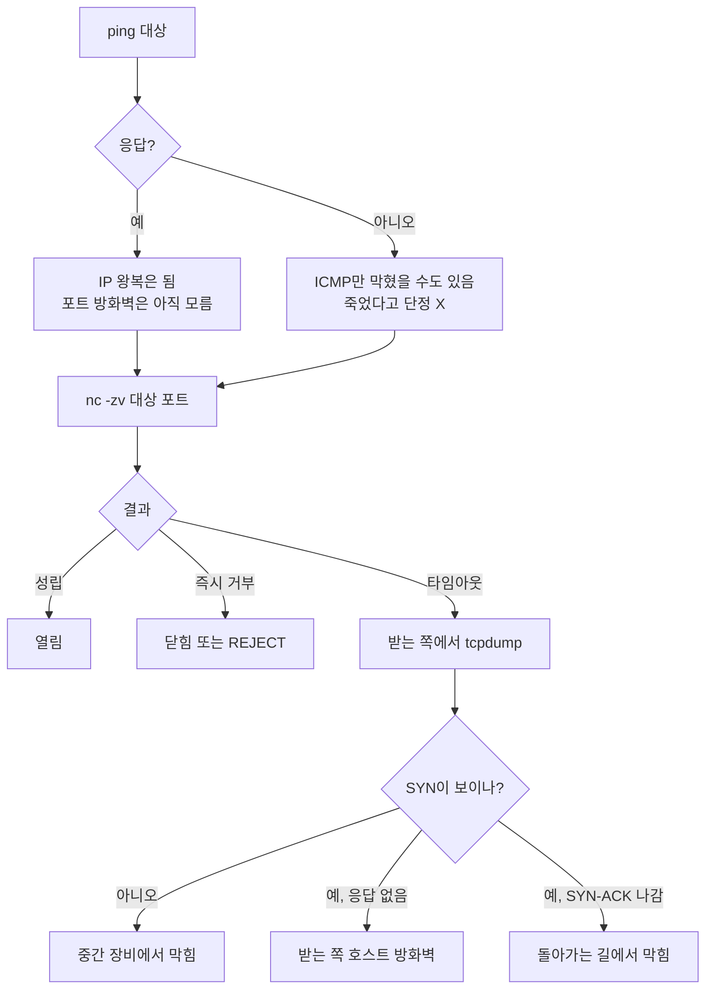

## 원본 메모
- 질문: 방화벽 및 네트워크 관련. Ping으로 이종장비 간의 방화벽을 확인한다고 할 때와 tcpdump 및 nc -zv를 사용할 때의 차이를 관련 개념들 및 공통으로 알아야 할 네트워크 지식들을 키워드화

## 답
세 도구는 **보는 층과 위치가 다르다.** ping은 "IP로 상대에게 닿는가"(포트 없음), `nc -zv`는 "이 TCP 포트로 연결이 열리는가"(보내는 쪽에서 본 결과), tcpdump는 "패킷이 이 지점에 실제로 왔다 갔는가"(한 지점에서 관찰한 사실)를 알려 준다. 그래서 방화벽 확인은 ping 하나로 끝나지 않고, **nc로 증상을 보고 tcpdump로 막힌 위치를 가른다.**

> 약어: ICMP(Internet Control Message Protocol) ([RFC 792](https://www.rfc-editor.org/rfc/rfc792)) · TCP(Transmission Control Protocol) · SYN(synchronize) · ACK(acknowledgment) · RST(reset) ([RFC 9293](https://www.rfc-editor.org/rfc/rfc9293)) · UDP(User Datagram Protocol) ([RFC 768](https://www.rfc-editor.org/rfc/rfc768)) · BPF(Berkeley Packet Filter)

| 도구 | 보내는 것 | 알 수 있는 것 | 알 수 없는 것 |
| --- | --- | --- | --- |
| `ping` | ICMP 에코 요청 | IP 수준에서 왕복이 되는가 | 특정 TCP 포트가 열렸는가. 응답이 없어도 "죽었다"고 단정 못 함 |
| `nc -zv` | 대상 포트로 TCP 연결 시도 | 열림 / 즉시 거부 / 타임아웃 (보내는 쪽 증상) | 패킷이 어디서 사라졌는가 |
| `tcpdump` | 아무것도 안 보냄(관찰만) | 이 인터페이스에 SYN이 왔는가, 응답이 나갔는가 | 이 지점 밖에서 일어난 일 |

### 1. ping: ICMP 에코, 포트 개념이 없다
- `ping`: 이름 유래는 소나(sonar) 음향. 약어 아님. 작성자 Mike Muuss: "I named it after the sound that a sonar makes" · "PING is not an acronym standing for Packet InterNet Grouper, it's a sonar analogy." ([The Story of the PING Program](https://wpollock.com/Networking/ping.html)) · man 페이지 NAME: "ping - send ICMP ECHO_REQUEST to network hosts" ([ping(8)](https://www.man7.org/linux/man-pages/man8/ping.8%40%40iputils.html))
> "ping uses the ICMP protocol's mandatory ECHO_REQUEST datagram to elicit an ICMP ECHO_RESPONSE from a host or gateway." ([ping(8)](https://www.man7.org/linux/man-pages/man8/ping.8%40%40iputils.html))
- ICMP 에코 메시지 형식은 Type·Code·Checksum·Identifier·Sequence Number로 되어 있고 **포트 필드가 없다** ([RFC 792, Echo or Echo Reply Message](https://www.rfc-editor.org/rfc/rfc792)). 그래서 ping 성공은 "그 포트의 방화벽 규칙이 열렸다"는 뜻이 아니다. 포트별 필터 결과는 [[L4 포트 오픈 여부와 방화벽 상태]]의 열림·닫힘·필터됨으로 따로 본다.
- 반대로 ping 무응답도 "장비가 죽었다"가 아니다. ICMP만 막는 곳이 많다.
> "many hosts and firewalls now block these packets, rather than responding as required by RFC 1122." · "ICMP-only scans are rarely reliable enough against unknown targets over the Internet." ([Nmap: Host Discovery Techniques](https://nmap.org/book/host-discovery-techniques.html))
- 예시: `ping -c 3 -W 2 <대상 IP>` → `-c` count, 요청 3번 보내고 끝 · `-W` 응답을 기다릴 시간(초) ([ping(8)](https://www.man7.org/linux/man-pages/man8/ping.8%40%40iputils.html))

### 2. nc -zv: 실제 TCP 포트로 연결을 시도한다
- `nc` = netcat. man 페이지 NAME: "nc - arbitrary TCP and UDP connections and listens" · "The nc (or netcat) utility is used for just about anything under the sun involving TCP or UDP." ([nc(1)](https://linux.die.net/man/1/nc))
- 예시: `nc -zv -w 3 <대상 IP> 443` → `-z` 데이터를 보내지 않고 수신 중인지만 확인 ("just scan for listening daemons, without sending any data to them") · `-v` verbose, 자세히 출력 · `-w` timeout(초) ([nc(1)](https://linux.die.net/man/1/nc))
- 결과 읽기는 [[L4 포트 오픈 여부와 방화벽 상태]]의 표 그대로다: 성립 = 열림 / 즉시 거부 = 닫힘(또는 방화벽 REJECT tcp-reset) / 타임아웃 = 방화벽 DROP 가능성. 막힌 쪽이 응답 없이 버리는 경우가 훨씬 흔하다.
> "filters that simply drop probes without responding are far more common." ([Nmap: Port Scanning Basics](https://nmap.org/man/man-port-scanning-basics.html))
- UDP는 nc로 판단하기 어렵다(`-u` UDP 사용).
> "UDP port scans will always succeed (i.e. report the port as open)" ([nc(1)](https://linux.die.net/man/1/nc))

### 3. tcpdump: 한 지점에서 패킷을 관찰한다
- `tcpdump`: 이름 유래 문서 근거 없음. man 페이지 NAME: "tcpdump - dump traffic on a network" ([tcpdump(8)](https://manpages.debian.org/unstable/tcpdump/tcpdump.8.en.html))
> "tcpdump prints out a description of the contents of packets on a network interface that match the Boolean expression" ([tcpdump(8)](https://manpages.debian.org/unstable/tcpdump/tcpdump.8.en.html))
- 예시: `sudo tcpdump -i any -n 'tcp port 443 or icmp'` → `-i` interface, `any`는 모든 일반 인터페이스 · `-n` 주소·포트를 이름으로 바꾸지 않음 · 따옴표 안은 pcap 필터 표현식 ([tcpdump(8)](https://manpages.debian.org/unstable/tcpdump/tcpdump.8.en.html), [pcap-filter(7)](https://man.netbsd.org/pcap-filter.7)). 인터페이스에서 읽으려면 권한이 필요하다("may require that you have special privileges").
- 출력의 Flags로 handshake 단계를 본다: `[S]` SYN, `[S.]` SYN-ACK, `[R]` RST, `.` ACK.
> "Tcpflags are some combination of S (SYN), F (FIN), P (PSH), R (RST), U (URG), W (CWR), E (ECE)" · "or `.' (ACK)" ([tcpdump(8)](https://manpages.debian.org/unstable/tcpdump/tcpdump.8.en.html))
- 수신 패킷은 IP 처리 전에 복제되어 tcpdump로 간다. 그래서 서버에서 SYN이 보이면 "적어도 서버 NIC까지는 왔다"는 근거가 된다(서버 자체 방화벽이 버리는 경우도 SYN은 보일 수 있다 — `check`).
> "they are grabbed by tcpdump before IP processing" (netfilter 작성자 Rusty Russell, [LKML 2001](https://lkml.iu.edu/hypermail/linux/kernel/0110.3/1180.html))

### 4. 같이 쓰는 순서 (nc 타임아웃일 때)
보내는 쪽에서 `nc -zv`, 받는 쪽에서 `tcpdump`를 동시에 켜고 결과를 짝 맞춘다. 아래는 위 근거들을 조합한 판단 표다.

| 받는 쪽 tcpdump | 해석 |
| --- | --- |
| SYN이 안 보임 | 중간 장비(방화벽·L4·라우팅)에서 막힘. 받는 쪽 문제가 아님 |
| SYN 보임, 응답 없음 | 받는 쪽 호스트 방화벽 DROP 가능성 |
| SYN 보임, `[R]` 나감 | 패킷은 도달, 그 포트에 수신 앱 없음(닫힘) |
| SYN 보임, `[S.]` 나감, 보내는 쪽은 타임아웃 | 돌아가는 길에서 막힘(응답 경로·상태 기반 방화벽 확인) |

상태 기반 방화벽은 연결의 양방향 패킷을 추적해서 응답을 통과시킨다. 가는 길과 오는 길이 다른 장비를 지나면 응답이 "모르는 연결"로 보일 수 있다.
> ESTABLISHED: "The packet is associated with a connection which has seen packets in both directions." ([iptables conntrack 모듈 man](https://googlers.googlesource.com/maze/iptables/+/next/extensions/libxt_conntrack.man))

### 공통으로 알아야 할 키워드
| 키워드 | 한 줄 | 출처 |
| --- | --- | --- |
| 계층: L3(IP·ICMP) vs L4(TCP·UDP·포트) | ping은 L3, nc·포트 방화벽은 L4 | [RFC 792](https://www.rfc-editor.org/rfc/rfc792), [RFC 9293](https://www.rfc-editor.org/rfc/rfc9293) |
| [[ICMP]] | 오류·제어 메시지. 에코(ping)와 목적지 도달 불가 오류를 함께 담당 | [RFC 792](https://www.rfc-editor.org/rfc/rfc792) |
| [[포트]] | TCP·UDP에서 프로세스를 구분하는 번호. ICMP에는 없음 | [RFC 9293](https://www.rfc-editor.org/rfc/rfc9293) |
| [[TCP 3-way handshake]] | SYN → SYN-ACK → ACK. nc 결과와 tcpdump Flags 해석의 기준 | [RFC 9293](https://www.rfc-editor.org/rfc/rfc9293) |
| 열림·닫힘·필터됨 / DROP·REJECT | 응답 모양으로 서비스 문제와 방화벽 문제를 가름 | [[L4 포트 오픈 여부와 방화벽 상태]] |
| ICMP 3/13 (administratively prohibited) | 방화벽이 막으면서 돌려주는 ICMP 오류 | "type 3 code 13" ([Nmap](https://nmap.org/man/man-port-scanning-basics.html)) |
| [[상태 기반 방화벽]] | 연결 상태를 추적해 응답 패킷을 통과시키는 방화벽 | [conntrack man](https://googlers.googlesource.com/maze/iptables/+/next/extensions/libxt_conntrack.man) |
| [[pcap 필터 표현식]] | tcpdump가 볼 패킷을 고르는 문법(`host`, `port`, `tcp`) | [pcap-filter(7)](https://man.netbsd.org/pcap-filter.7) |

### 원본 메모에서 아직 열린 질문
말로 복습 때 채운다.
- "이종 장비"는 무엇과 무엇이었나? (리눅스 서버 ↔ L4·방화벽 어플라이언스? 다른 OS?) 어플라이언스 쪽은 tcpdump를 직접 못 돌릴 수 있어, 장비가 제공하는 캡처 기능이 있는지가 다음 질문이 된다.
- ping은 되는데 nc가 안 됐나, ping도 안 됐나?

## 선행 개념
- [[L4 포트 오픈 여부와 방화벽 상태]]: 포트 상태는 열림·닫힘·필터됨 셋이고, 즉시 거부와 타임아웃으로 서비스 문제와 방화벽 문제를 가른다. nc 결과를 읽는 기준이 이 노트다. ([Nmap](https://nmap.org/man/man-port-scanning-basics.html))
- [[ICMP]]: IP 위에서 오류·제어 메시지를 나르는 프로토콜이다. ping의 에코 요청·응답도, 방화벽 REJECT가 돌려주는 도달 불가 오류도 ICMP다. 포트 필드가 없어서 포트별 규칙 확인에는 쓸 수 없다. ([RFC 792](https://www.rfc-editor.org/rfc/rfc792))

## 다음에 볼 개념
### 선행
- [[L4 포트 오픈 여부와 방화벽 상태]] — 포트 상태 3가지와 DROP·REJECT 구분
- [[ICMP]] — ping과 도달 불가 오류를 나르는 IP 계층 제어 메시지
- [[포트]] — 한 호스트 안에서 통신할 프로세스를 구분하는 16비트 번호
### 다음
- [[TCP 3-way handshake]] — tcpdump Flags `[S]`·`[S.]`·`[R]`을 읽는 기준
- [[상태 기반 방화벽]] — 연결 상태를 추적해 응답만 통과시키는 방화벽. 비대칭 경로에서 문제가 됨
- [[pcap 필터 표현식]] — tcpdump에 `tcp port 443` 같은 조건을 거는 문법

## 다이어그램

## 확인 과제
IP·호스트명은 `<호스트 IP>`처럼 바꿔서 inbox에 `결과: ...` 한 줄로 넣는다.
- [ ] `ping -c 3 -W 2 <대상 IP>`와 `nc -zv -w 3 <대상 IP> <포트>`를 같은 대상에 해 보고 결과가 갈리는지 본다 (`-c` count 횟수 · `-W` 응답 대기 초 · `-z` 데이터 없이 수신 확인 · `-v` verbose · `-w` timeout 초)
- [ ] 받는 쪽에서 `sudo tcpdump -i any -n 'tcp port <포트>'`를 켜 둔 채 보내는 쪽에서 nc를 실행한다: SYN이 오는가, `[S.]`과 `[R]` 중 무엇이 나가는가 (`-i any` 모든 인터페이스 · `-n` 이름 변환 안 함)
- [ ] (가능하면) 받는 쪽 호스트 방화벽이 그 포트를 DROP할 때도 tcpdump에 SYN이 보이는지 확인한다 — 위 "check" 문장 검증용

## 복습 카드
- `ping`은 포트 필드가 없는 ==ICMP== 에코라서, 성공해도 ==TCP 포트별 규칙|TCP 포트 규칙|포트별 규칙==이 열렸는지는 확인하지 못한다. <!--til:2026-11-05,1,2,0-->
- `nc -zv`가 타임아웃일 때 받는 쪽에서 `tcpdump`를 같이 보는 이유는 ==SYN==이 받는 쪽까지 왔는지 보고, 막힌 위치가 ==중간 장비==인지 받는 쪽인지 가르기 위해서다. <!--til:2026-11-05,1,2,0-->

## 복습 기록
