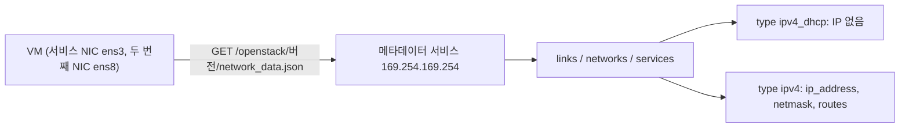

## 원본 메모
- 질문: 클라우드 VM 메타데이터(169.254.169.254의 network_data.json)로 NIC·네트워크 정보를 어떻게 읽나? 네트워크 type이 ipv4_dhcp일 때와 ipv4일 때 무엇이 다른가?
- 상황 한 줄: 두 번째 NIC의 네트워크가 ipv4로 나와서, ifcfg를 BOOTPROTO=dhcp로 두면 IP를 못 받는다고 판단함
- 결과: ipv4_dhcp 항목에는 IP·넷마스크가 없고, ipv4 항목에는 ip_address·netmask·routes가 있었음. routes가 빈 배열이면 게이트웨이가 없다는 뜻으로 읽음 (확인 필요)

## 답
### 왜 필요한가
VM은 생성 뒤에 어떤 NIC가 몇 개 붙었고 IP를 어떻게 받아야 하는지 스스로 알 수 없다. 그래서 클라우드가 인스턴스 안에서 읽을 수 있는 정보 서비스(메타데이터 서비스)를 제공한다. Nova 문서는 인스턴스가 이 서비스에 `169.254.169.254`로 접근한다고 쓴다. ([Metadata, nova 34.1.0.dev178 문서](https://docs.openstack.org/nova/latest/user/metadata.html), The metadata service)

### 어떻게 읽나
- OpenStack 형식에는 버전마다 `meta_data.json`과 `network_data.json` 두 파일이 있고, 예시 주소는 `http://169.254.169.254/openstack/2018-08-27/network_data.json`이다. 네트워크 메타데이터는 Liberty 릴리스(nova 12.0.0)에서 추가됐다. (같은 문서, OpenStack format metadata)
- 구조는 `links`(NIC 자체: MAC `ethernet_mac_address`, `id`, `type` 등), `networks`(각 NIC에 붙는 네트워크: `id`, `link`, `network_id`, `type`), `services`(예: DNS 주소) 세 덩어리다. 세 키 모두 최상위 필수다. ([network_data.json 스키마](https://docs.openstack.org/nova/latest/_downloads/4e8fe1ae7db6dd6eebca372db68fe63e/network_data.json))
- 이 문서 형식을 쓰는 클라우드인지는 메모만으로 알 수 없다. 메모의 파일 이름·`ipv4_dhcp` 값이 이 형식과 같다는 것까지만 확인된다.

### `ipv4_dhcp`와 `ipv4`의 차이
- 스키마가 허용하는 IPv4 `type` 값은 `ipv4`와 `ipv4_dhcp` 두 가지다(IPv6는 `ipv6`, `ipv6_dhcp`, `ipv6_slaac`).
- 네트워크 항목의 필수 필드는 `id`, `link`, `network_id`, `type`뿐이다. `ip_address`, `netmask`, `routes`는 선택 필드로 정의돼 있다. 그래서 메모의 관찰(dhcp 항목은 IP가 없고 `ipv4` 항목은 IP·넷마스크·routes가 있음)은 스키마와 모순되지 않는다. 다만 `type` 값별로 어떤 필드가 있어야 하는지는 스키마가 따로 말하지 않는다.
- `routes`는 `network`, `netmask`, `gateway`를 모두 갖는 항목의 배열이다. 게이트웨이는 네트워크 수준 필드가 아니라 `routes` 항목 안에만 있다. `routes`에 최소 개수 제한이 없어 **빈 배열도 스키마상 허용**된다. 메모의 "빈 배열이면 게이트웨이가 없다"는 읽기는 이 구조(게이트웨이는 routes 안에만 있음)와 맞는다.

### 원본 메모에서 아직 열린 질문
- `type`이 `ipv4`일 때 `BOOTPROTO=dhcp`로 두면 왜 IP를 못 받는지(해당 네트워크에 DHCP 서버가 응답하지 않기 때문인지)는 읽은 문서가 설명하지 않는다. 메모의 판단은 확인하지 못했다.
- 메타데이터를 읽어 `ifcfg`를 만드는 주체(cloud-init 등)는 읽은 문서가 없다.
- 문서 페이지 하단의 갱신 표기(2022-08-05)가 문서 버전(34.1.0.dev178)과 맞지 않아 오래된 부분이 있을 수 있다.

## 코드 예제
> 예제 기준: OpenStack Nova 34.1.0.dev178 문서와 network_data.json 스키마(draft-07). 내 클라우드 버전: 버전 확인 필요

```jsonc
{
  "links":    [{"id": "link1", "ethernet_mac_address": "aa:bb:cc:dd:ee:02", "type": "phy"}],
  "networks": [{
    "id": "network1", "link": "link1", "network_id": "net-svc2",
    "type": "ipv4",                    // ← DHCP가 아니라 주소가 직접 적힌 형태
    "ip_address": "192.0.2.10",        // ← 두 번째 NIC에 줄 IP (문서용 예시 주소)
    "netmask": "255.255.255.0",
    "routes": []                       // ← 빈 배열: 게이트웨이 항목 없음
  }],
  "services": []
}
```

이 코드에서 `type`이 `ipv4`라는 점과 `ip_address`, `netmask`가 직접 적혀 있다는 점이 메모의 관찰과 같은 모양이다. 두 번째 NIC(MAC `aa:bb:cc:dd:ee:02`)는 `link1`을 통해 `network1`에 이어지고, 게이트웨이는 `routes`가 비어 있어 없다. (JSON에는 주석이 없으므로 `//` 설명은 이 노트용 표기이고, 값은 스키마 형식 예시이며 `link`의 `type` 값 `phy`는 스키마 enum에 있는 값이다.)

## 선행 개념
- [[메타데이터 서비스]]: 인스턴스가 `169.254.169.254`로 읽는 정보 서비스. ([Nova 메타데이터 문서](https://docs.openstack.org/nova/latest/user/metadata.html))

## 다음에 볼 개념
### 선행
- [[메타데이터 서비스]] — 정보를 주는 쪽
### 다음
- [[두 번째 NIC의 DEFROUTE]] — 두 번째 NIC에 기본 경로를 안 주는 설정
- [[HA 클러스터 VIP와 하트비트]] — 메모의 결과(게이트웨이 없는 두 번째 NIC)가 통신 경로에 주는 의미

## 다이어그램


## 확인 과제
내 환경에서 해 보고, 결과를 회사 정보 없이 inbox에 `결과: ...` 한 줄로 넣는다.
- [ ] 두 NIC의 `type`이 각각 `ipv4_dhcp`인지 `ipv4`인지, `routes`가 비었는지 한 줄로 적는다 (IP는 적지 않는다).
- [ ] 두 번째 NIC에 `BOOTPROTO=dhcp`를 줬을 때 IP를 받는지 여부(받는다/못 받는다)만 적는다.

## 복습 카드
- 인스턴스는 메타데이터 서비스에 ==169.254.169.254==로 접근한다.
- `network_data.json` 스키마에서 게이트웨이는 네트워크 필드가 아니라 ==routes|routes 항목==의 `gateway`에만 있다.

## 복습 기록
