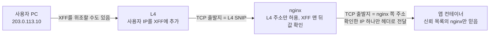

## 원본 메모
질문: L4 - web(nginx) - was(컨테이너) 구성에서 접속자 실 IP를 알기 위해 필요한 구성은?

(금칙 정보 치환함) 메모의 요지만 일반 표현으로 옮긴다.
- 사용자의 요청은 앱에 닿기 전에 L4 장비에서 한 번, nginx에서 한 번 "대신 전달"된다. 대신 전달할 때마다 출발지 주소가 전달한 장비 주소로 바뀐다. 그래서 원래 사용자 IP는 헤더에 적어 넘겨야 하는데, 지금은 그 헤더를 이어 주는 설정이 빠져 있다.
- L4는 맨 앞에서 요청을 받아 web 서버들로 나누고, HTTPS도 여기서 푼다(TLS 종료). 그래서 nginx 입장에서는 모든 요청이 `<L4 SNIP>`(L4가 뒤쪽 서버에 연결할 때 쓰는 자기 주소)에서 온 것으로 보인다.
- `$remote_addr`, `getRemoteAddr()`, `peerIp`는 모두 "바로 앞에서 연결해 온 상대"의 주소다.
- XFF(X-Forwarded-For)는 프록시를 지날 때마다 뒤에 덧붙는다. 사용자 PC가 직접 `X-Forwarded-For: 1.2.3.4`를 보내면 `1.2.3.4, <사용자 IP>`가 되므로 맨 앞 값을 믿으면 속는다. 믿을 수 있는 건 우리 L4가 덧붙인 값(맨 뒤)뿐이다.
- 설계 아이디어: nginx가 사용자 PC가 보낸 같은 이름의 헤더는 지우고, 자기가 확인한 IP 하나만 `<신뢰 헤더>`에 적어 앱에 넘긴다. 앱은 "신뢰 프록시 CIDR 목록"에 있는 주소에서 온 요청의 이 헤더만 믿는다. 지금은 운영 nginx에 이 헤더가 없고 신뢰 목록도 비어 있다.
- 운영 nginx 빌드에는 realip 모듈이 없다(`--with-http_ssl_module`만). 쓰려면 재빌드가 필요하다.
- nginx에 "L4 SNIP만 받는다"는 allow 줄이 주석 처리되어 있다. 꺼져 있으면 누군가 nginx 포트로 직접 붙어 XFF를 꾸밀 수 있다.
- 고칠 곳: ① L4가 사용자 IP를 XFF에 넣는지 확인(**아직 확인 못 함**), ② nginx에서 allow 켜기 + XFF 맨 뒤 값을 신뢰 헤더로 넣기, ③ 앱 env에 web 서버 `/32` 목록 넣기. 반영 뒤 앱 로그에서 `clientIp`가 사용자 IP, `peerIp`가 web 주소인지 본다.

## 답
**핵심: 프록시를 지날 때마다 TCP 출발지 주소는 바뀌므로, 원래 IP는 헤더(XFF)로 넘기고, 그 헤더를 "믿을 수 있는 프록시가 쓴 부분만" 읽도록 각 층을 맞춰야 한다.**

1. **L4가 사용자 IP를 헤더에 넣는다.** XFF(X-Forwarded-For)는 프록시를 거치는 클라이언트의 원래 IP를 알리는 사실상 표준 헤더다. 프록시를 여러 개 지나면 각 프록시 주소가 뒤에 이어 적힌다.
   > "the rightmost IP address is the IP address of the most recent proxy and the leftmost IP address is the address of the originating client (assuming well-behaved client and proxies)." ([MDN: X-Forwarded-For](https://developer.mozilla.org/en-US/docs/Web/HTTP/Reference/Headers/X-Forwarded-For))
   - L4가 XFF를 넣는 설정이 켜져 있는지는 메모에서 **확인되지 않았다**(L4 장비 종류별 문서가 필요해 여기서는 다루지 않는다).
2. **맨 앞 값은 믿지 않는다.** 클라이언트가 XFF를 직접 써서 보낼 수 있기 때문이다.
   > "Leftmost (untrusted) values must only be used for cases where there is no negative impact from using spoofed values." ([MDN](https://developer.mozilla.org/en-US/docs/Web/HTTP/Reference/Headers/X-Forwarded-For))
   - 보안 용도(접근 제한, 감사 기록 등)는 신뢰하는 프록시가 덧붙인 값만 써야 한다. 방법은 두 가지다. ① 프록시 개수를 설정해 오른쪽에서 세기, ② 신뢰 프록시 IP 목록을 두고 오른쪽부터 목록에 있는 주소를 건너뛰고 처음 나오는 주소를 쓰기. 둘 다 같은 페이지에 있다.
3. **서버가 인터넷에서 직접 접근되면 XFF 전체를 못 믿는다.**
   > "If the server can be directly connected to from the internet — even if it is also behind a trusted reverse proxy — no part of the X-Forwarded-For IP list can be considered trustworthy or safe for security-related uses." ([MDN](https://developer.mozilla.org/en-US/docs/Web/HTTP/Reference/Headers/X-Forwarded-For))
   - 그래서 nginx가 L4 주소에서 온 연결만 받도록 막는 것(메모의 allow 줄)이 "맨 뒤 값 = L4가 쓴 값"이라는 전제를 지킨다. (이 allow 구문 자체의 공식 문서는 이번에 확인하지 않았다.)
4. **nginx가 그 헤더를 자기 주소로 반영하려면 realip 모듈을 쓴다.** 이 모듈은 기본 빌드에 없고 `--with-http_realip_module`로 켜야 한다.
   > "This module is not built by default, it should be enabled with the `--with-http_realip_module` configuration parameter." ([nginx: ngx_http_realip_module](https://nginx.org/en/docs/http/ngx_http_realip_module.html))
   - `set_real_ip_from`: 올바른 대체 주소를 보내 준다고 믿는 주소(L4 SNIP 등)를 지정한다.
   - `real_ip_header`: 클라이언트 주소를 대체할 값을 가져올 헤더(예: `X-Forwarded-For`)를 지정한다.
   - `real_ip_recursive`: off면 믿는 주소에서 온 요청의 주소를 헤더의 **마지막 주소**로, on이면 헤더의 **마지막 "믿지 않는" 주소**로 바꾼다.
   - `$realip_remote_addr`는 바뀌기 전 원래 연결 상대 주소를 보관한다.
   - 재빌드가 어려우면 대안(예: `map`으로 XFF 맨 뒤 값 추출)이 메모에 있지만, 공식 문서로 확인하지 않아 여기서는 **쓰지 않는다**.
5. **앱(was)은 nginx가 확인해서 넘긴 값만, 신뢰 목록에 있는 nginx에서 온 요청일 때만 쓴다.** 이 부분(앱 설정 이름, 신뢰 CIDR 목록)은 앱 프레임워크마다 달라서 이 노트에서는 원칙(위 2번의 "신뢰 프록시 목록")만 적는다.

### 원본 메모에서 아직 열린 질문
- L4가 XFF를 실제로 넣는지(장비 설정 확인 필요).
- 컨테이너 네트워크(Podman)를 거치며 출발지 주소가 바뀌는지: 공식 문서를 확인하지 못해 답하지 않았다. 확인 과제 3번으로 직접 본다.

## 선행 개념
- [[L4 스위치]]: IP·포트만 보고 요청을 여러 서버로 나누는 장비다. 요청을 받아 새 연결로 뒤쪽 서버에 보내면 서버가 보는 출발지는 장비 쪽 주소가 된다.
- [[SNAT와 DSR]]: SNAT(Source NAT)는 장비가 출발지 IP를 자기 IP로 바꿔 응답이 장비를 거치게 한다. 그래서 뒤쪽 서버에는 모든 요청이 장비 주소에서 온 것으로 보인다. ([F5: About SNATs](https://techdocs.f5.com/en-us/bigip-14-1-0/big-ip-tmos-routing-administration-14-1-0/nats-and-snats/about-snats.html), 기존 씨앗 노트 출처)

## 다음에 볼 개념
### 선행
- [[TLS 종료]] — L4가 HTTPS를 풀기 때문에 HTTP 헤더를 덧붙일 수 있다
### 다음
- [[nginx realip 모듈]] — `set_real_ip_from`·`real_ip_header`로 nginx가 보는 클라이언트 주소를 바꾸는 모듈
- [[PROXY protocol]] — 헤더 대신 연결 맨 앞에 원래 주소를 실어 보내는 방식. realip의 `real_ip_header` 값 중 하나

## 다이어그램

## 확인 과제
내 환경에서 해 보고, 결과를 회사 정보 없이 inbox에 `결과: ...` 한 줄로 넣는다.
- [ ] nginx 로그 형식에 `$remote_addr`와 `$http_x_forwarded_for`를 함께 찍고 요청 한 번 보내 보기: 앞은 L4 주소인지, 뒤에 사용자 IP가 있는지 확인. (L4가 XFF를 넣는지 판단)
- [ ] `curl -H 'X-Forwarded-For: 1.2.3.4' https://<서비스 주소>/` 로 요청 후 같은 로그 보기: `curl` 이름 유래: 문서 근거 없음 · `-H` header 추가(curl man 페이지 기준). 위조 값이 맨 앞에 남고 진짜 IP가 뒤에 붙는지 확인.
- [ ] 앱 컨테이너 쪽 로그나 `ss -tn` 로 앱이 보는 연결 상대 주소가 nginx 주소인지, 컨테이너 네트워크 주소로 바뀌는지 확인: `ss` 이름 유래: 문서 근거 없음 · `-t` tcp · `-n` numeric(이름 풀이 안 함). 근거: ss(8) man 페이지.

## 복습 카드
- 프록시를 거치면 서버가 보는 TCP 출발지는 원래 사용자가 아니라 ==바로 앞 프록시|직전 프록시==의 주소다.
- XFF 헤더에서 ==맨 앞|가장 왼쪽== 값은 클라이언트가 위조할 수 있어 보안 용도로 믿지 않는다.
- nginx의 realip 모듈은 기본 빌드에 없고 ==--with-http_realip_module==로 켜야 한다.
- XFF에서 믿을 수 있는 값은 ==신뢰하는 프록시|우리 프록시==가 덧붙인 부분뿐이다.

## 복습 기록
