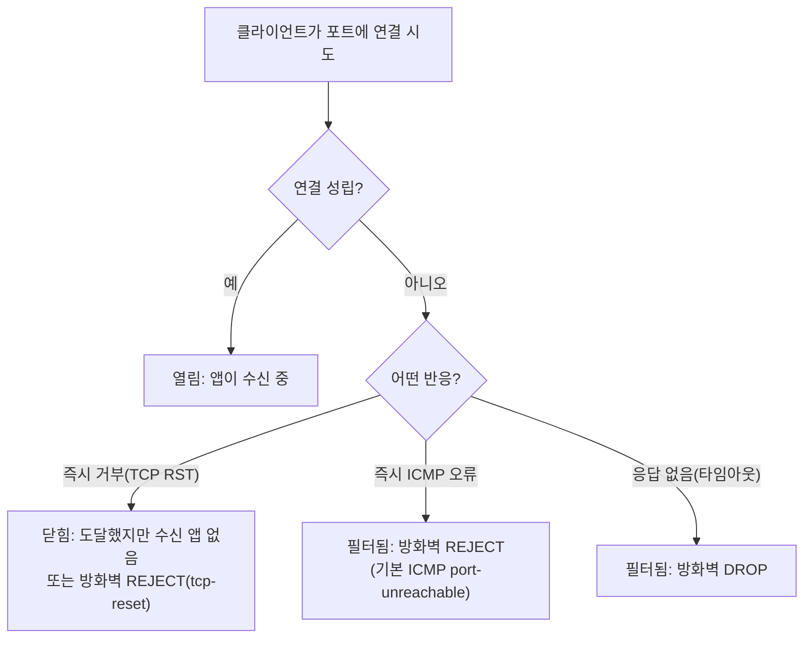
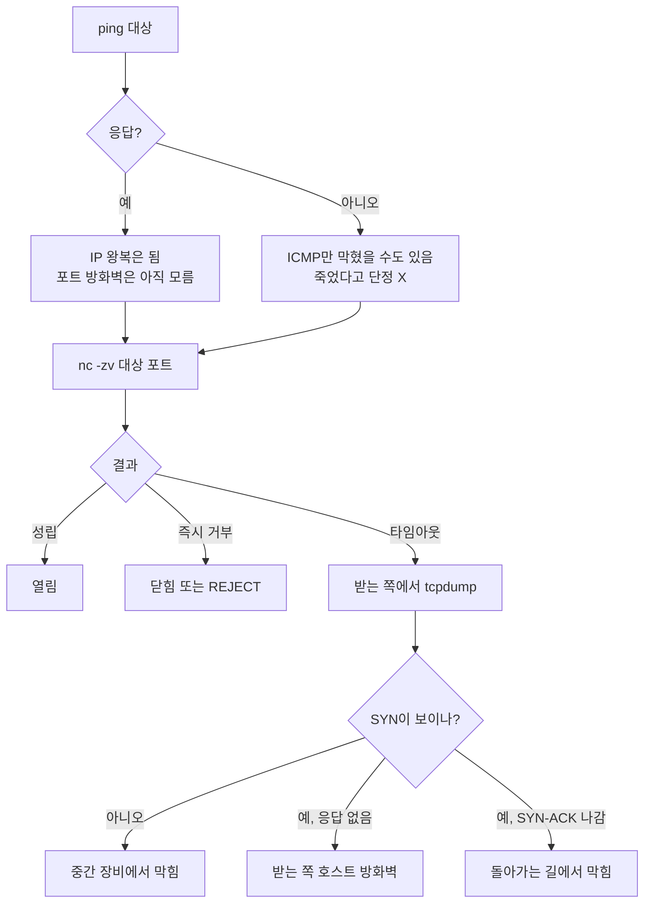

> 노트 보강 필요: 없음(약어·명령어·옵션 풀이가 하위 노트에 모두 있음).
> 발행 전 확인: "직접 해본 결과"가 비어 있음(`[직접 작성]`). tcpdump 3번 절의 `check` 문장은 직접 검증 전이라 발행 전에 확인하거나 빼야 함.

# 포트에 연결이 안 될 때 서비스 문제인지 방화벽 문제인지 가르는 법

## 요약
- 포트 상태는 열림·닫힘·필터됨 셋이다. 즉시 거부면 서비스 쪽, 타임아웃이면 방화벽 DROP 쪽을 먼저 의심한다.
- ping은 포트가 없는 ICMP(Internet Control Message Protocol)라서 포트 방화벽을 못 본다. `nc -zv`로 증상을 보고, 받는 쪽 `tcpdump`로 막힌 위치를 가른다.
- L4(Layer 4) 장비가 끼면 리스너 포트와 대상 포트, 두 구간을 따로 확인한다.

## 문제 상황
443 포트는 연결되는데 80이나 81 포트는 안 되는 식으로, L4 장비를 사이에 둔 서비스에서 포트마다 결과가 달랐다. 서비스가 죽은 건지, 방화벽이 막은 건지, L4 장비 설정인지 어디부터 봐야 할지 정리가 안 됐다. (회사 환경 정보는 일반화했다.)

## 원리

### 1. 포트 상태는 셋이다
"포트가 열렸나"의 답은 둘이 아니라 셋이다. **열림**(수신 중인 앱이 있음), **닫힘**(장비에 도달했지만 수신 앱이 없음), **필터됨**(방화벽이 막아서 판단 불가). 연결을 시도했을 때 어떤 반응이 오는지로 구분한다.

> 약어: TCP(Transmission Control Protocol) · RST(reset, 연결을 끊는 TCP 제어 비트) ([RFC 9293](https://www.rfc-editor.org/rfc/rfc9293)) · UDP(User Datagram Protocol) ([RFC 768](https://www.rfc-editor.org/rfc/rfc768)) · ICMP(Internet Control Message Protocol, 오류·제어 메시지) ([RFC 792](https://www.rfc-editor.org/rfc/rfc792)) · DROP·REJECT는 약어 아님(방화벽 규칙의 동작 이름)

| 상태 | 연결 시도 시 보이는 현상 | 뜻 | 근거 |
| --- | --- | --- | --- |
| 열림 | 연결이 성립한다 | 그 포트에서 앱이 수신 중 | "An application is actively accepting TCP connections, UDP datagrams or SCTP associations on this port." ([Nmap](https://nmap.org/man/man-port-scanning-basics.html)) |
| 닫힘 | 즉시 거부 응답이 온다 | 패킷은 도달했지만 수신 중인 앱이 없다. 서비스가 죽었거나 다른 포트에 떠 있다 | "A closed port is accessible (it receives and responds to Nmap probe packets)." ([Nmap](https://nmap.org/man/man-port-scanning-basics.html)) |
| 필터됨 (DROP) | 응답 없이 타임아웃 | 방화벽이 패킷을 버린다 | "packet filtering prevents its probes from reaching the port." ([Nmap](https://nmap.org/man/man-port-scanning-basics.html)) |
| 필터됨 (REJECT) | 즉시 오류 응답이 온다 | 방화벽이 막으면서 오류를 돌려준다. 기본은 ICMP port-unreachable | "it also sends back an error message to the host sending the packet that was blocked." ([iptables REJECT](https://rlworkman.net/howtos/iptables/chunkyhtml/x4571.html)) |

방화벽 REJECT를 `tcp-reset`으로 설정하면 TCP RST를 돌려준다. 겉보기에는 "닫힘"과 비슷해서, 즉시 거부만 보고 서비스 문제로 단정하면 안 된다.
> "The tcp-reset option will tell REJECT to send a TCP RST packet in reply to the sending host." ([iptables REJECT](https://rlworkman.net/howtos/iptables/chunkyhtml/x4571.html))

### 2. L4 장비가 끼면 확인 지점이 둘이 된다
L4(Layer 4) 장비(로드밸런서)는 OSI 7계층 중 4계층, 즉 전송 계층(TCP/UDP와 포트)에서 동작한다. 클라이언트가 붙는 **리스너 포트**와 실제 서버로 넘기는 **대상 포트**가 따로 있고, 헬스 체크를 통과한 서버로만 보낸다. 아래 인용은 대표적인 L4 로드밸런서인 AWS NLB(Network Load Balancer) 문서 기준이다.
> "A *listener* checks for connection requests from clients, using the protocol and port that you configure, and forwards requests to a target group." · "It monitors the health of its registered targets, and routes traffic only to the healthy targets." ([AWS: Network Load Balancer](https://docs.aws.amazon.com/elasticloadbalancing/latest/network/introduction.html))

그래서 443은 되는데 80/81은 안 되는 식의 차이가 보이면, 두 구간을 따로 확인한다.
1. 클라이언트 → L4 리스너 포트: 방화벽이 이 포트를 열었나
2. L4 → 서버의 대상 포트: 서버에서 그 포트로 앱이 떠 있나, 헬스 체크를 통과하나

### 3. 확인 도구: ping, nc -zv, tcpdump는 보는 층과 위치가 다르다
ping은 "IP로 상대에게 닿는가"(포트 없음), `nc -zv`는 "이 TCP 포트로 연결이 열리는가"(보내는 쪽에서 본 결과), tcpdump는 "패킷이 이 지점에 실제로 왔다 갔는가"(한 지점에서 관찰한 사실)를 알려 준다. 그래서 방화벽 확인은 ping 하나로 끝나지 않고, **nc로 증상을 보고 tcpdump로 막힌 위치를 가른다.**

> 약어: SYN(synchronize) · ACK(acknowledgment) · RST(reset) ([RFC 9293](https://www.rfc-editor.org/rfc/rfc9293)) · BPF(Berkeley Packet Filter)

| 도구 | 보내는 것 | 알 수 있는 것 | 알 수 없는 것 |
| --- | --- | --- | --- |
| `ping` | ICMP 에코 요청 | IP 수준에서 왕복이 되는가 | 특정 TCP 포트가 열렸는가. 응답이 없어도 "죽었다"고 단정 못 함 |
| `nc -zv` | 대상 포트로 TCP 연결 시도 | 열림 / 즉시 거부 / 타임아웃 (보내는 쪽 증상) | 패킷이 어디서 사라졌는가 |
| `tcpdump` | 아무것도 안 보냄(관찰만) | 이 인터페이스에 SYN이 왔는가, 응답이 나갔는가 | 이 지점 밖에서 일어난 일 |

**ping: ICMP 에코, 포트 개념이 없다**
- `ping`: 이름 유래는 소나(sonar) 음향. 약어 아님. 작성자 Mike Muuss: "I named it after the sound that a sonar makes" · "PING is not an acronym standing for Packet InterNet Grouper, it's a sonar analogy." ([The Story of the PING Program](https://wpollock.com/Networking/ping.html)) · man 페이지 NAME: "ping - send ICMP ECHO_REQUEST to network hosts" ([ping(8)](https://www.man7.org/linux/man-pages/man8/ping.8%40%40iputils.html))
- ICMP 에코 메시지 형식은 Type·Code·Checksum·Identifier·Sequence Number로 되어 있고 **포트 필드가 없다** ([RFC 792](https://www.rfc-editor.org/rfc/rfc792)). 그래서 ping 성공은 "그 포트의 방화벽 규칙이 열렸다"는 뜻이 아니다.
- 반대로 ping 무응답도 "장비가 죽었다"가 아니다. ICMP만 막는 곳이 많다.
> "many hosts and firewalls now block these packets, rather than responding as required by RFC 1122." · "ICMP-only scans are rarely reliable enough against unknown targets over the Internet." ([Nmap: Host Discovery Techniques](https://nmap.org/book/host-discovery-techniques.html))
- 예시: `ping -c 3 -W 2 <대상 IP>` → `-c` count, 요청 3번 보내고 끝 · `-W` 응답을 기다릴 시간(초) ([ping(8)](https://www.man7.org/linux/man-pages/man8/ping.8%40%40iputils.html))

**nc -zv: 실제 TCP 포트로 연결을 시도한다**
- `nc` = netcat. man 페이지 NAME: "nc - arbitrary TCP and UDP connections and listens" ([nc(1)](https://linux.die.net/man/1/nc))
- 예시: `nc -zv -w 3 <대상 IP> 443` → `-z` 데이터를 보내지 않고 수신 중인지만 확인 · `-v` verbose, 자세히 출력 · `-w` timeout(초) ([nc(1)](https://linux.die.net/man/1/nc))
- 결과 읽기는 위 1번 표 그대로다: 성립 = 열림 / 즉시 거부 = 닫힘(또는 방화벽 REJECT tcp-reset) / 타임아웃 = 방화벽 DROP 가능성. 막힌 쪽이 응답 없이 버리는 경우가 훨씬 흔하다.
> "filters that simply drop probes without responding are far more common." ([Nmap: Port Scanning Basics](https://nmap.org/man/man-port-scanning-basics.html))
- UDP는 nc로 판단하기 어렵다(`-u` UDP 사용).
> "UDP port scans will always succeed (i.e. report the port as open)" ([nc(1)](https://linux.die.net/man/1/nc))

**tcpdump: 한 지점에서 패킷을 관찰한다**
- `tcpdump`: 이름 유래 문서 근거 없음. man 페이지 NAME: "tcpdump - dump traffic on a network" ([tcpdump(8)](https://manpages.debian.org/unstable/tcpdump/tcpdump.8.en.html))
- 예시: `sudo tcpdump -i any -n 'tcp port 443 or icmp'` → `-i` interface, `any`는 모든 일반 인터페이스 · `-n` 주소·포트를 이름으로 바꾸지 않음 · 따옴표 안은 pcap 필터 표현식 ([tcpdump(8)](https://manpages.debian.org/unstable/tcpdump/tcpdump.8.en.html), [pcap-filter(7)](https://man.netbsd.org/pcap-filter.7)). 인터페이스에서 읽으려면 권한이 필요하다.
- 출력의 Flags로 handshake 단계를 본다: `[S]` SYN, `[S.]` SYN-ACK, `[R]` RST, `.` ACK.
> "Tcpflags are some combination of S (SYN), F (FIN), P (PSH), R (RST), U (URG), W (CWR), E (ECE)" · "or `.' (ACK)" ([tcpdump(8)](https://manpages.debian.org/unstable/tcpdump/tcpdump.8.en.html))
- 수신 패킷은 IP 처리 전에 복제되어 tcpdump로 간다. 그래서 서버에서 SYN이 보이면 "적어도 서버 NIC까지는 왔다"는 근거가 된다. (서버 자체 방화벽이 버리는 경우도 SYN은 보일 수 있다 — 원본 노트에서도 아직 `check` 상태인 부분이라 직접 확인이 필요하다.)
> "they are grabbed by tcpdump before IP processing" (netfilter 작성자 Rusty Russell, [LKML 2001](https://lkml.iu.edu/hypermail/linux/kernel/0110.3/1180.html))

## 해결과 선택지 비교
nc가 타임아웃일 때는 보내는 쪽에서 `nc -zv`, 받는 쪽에서 `tcpdump`를 동시에 켜고 결과를 짝 맞춘다. 아래는 위 근거들을 조합한 판단 표다.

| 받는 쪽 tcpdump | 해석 |
| --- | --- |
| SYN이 안 보임 | 중간 장비(방화벽·L4·라우팅)에서 막힘. 받는 쪽 문제가 아님 |
| SYN 보임, 응답 없음 | 받는 쪽 호스트 방화벽 DROP 가능성 |
| SYN 보임, `[R]` 나감 | 패킷은 도달, 그 포트에 수신 앱 없음(닫힘) |
| SYN 보임, `[S.]` 나감, 보내는 쪽은 타임아웃 | 돌아가는 길에서 막힘(응답 경로·상태 기반 방화벽 확인) |

상태 기반 방화벽은 연결의 양방향 패킷을 추적해서 응답을 통과시킨다. 가는 길과 오는 길이 다른 장비를 지나면 응답이 "모르는 연결"로 보일 수 있다.
> ESTABLISHED: "The packet is associated with a connection which has seen packets in both directions." ([iptables conntrack 모듈 man](https://googlers.googlesource.com/maze/iptables/+/next/extensions/libxt_conntrack.man))

## 직접 해본 결과
[직접 작성] 원본 노트의 확인 과제 결과가 아직 inbox에 들어오지 않았다. 아래를 직접 해 보고 결과를 회사 정보 없이 적는다(IP·호스트명은 `<호스트 IP>`로).
- 클라이언트: `nc -zv <L4 주소> 443`, `nc -zv <L4 주소> 80` → 성립 / 즉시 거부 / 타임아웃 (`nc` = netcat · `-z` 데이터 없이 수신 확인 · `-v` verbose)
- 서버: `ss -ltnp` → `ss`는 이름 유래 문서 근거 없음(소켓 통계를 보여 주는 도구) · `-l` listening · `-t` tcp · `-n` numeric · `-p` processes ([ss(8)](https://manpages.ubuntu.com/manpages/xenial/man8/ss.8.html))
- 서버 방화벽: `sudo iptables -L -n` 또는 `sudo firewall-cmd --list-all` → `-L` list, 규칙 나열 · `-n` numeric ([RHEL: iptables 나열 옵션](https://docs.redhat.com/en/documentation/red_hat_enterprise_linux/5/html/deployment_guide/s2-iptables-options-list))
- 받는 쪽 `sudo tcpdump -i any -n 'tcp port <포트>'`를 켜 둔 채 nc를 실행: SYN이 오는가, `[S.]`과 `[R]` 중 무엇이 나가는가

## 함정과 주의점
- 즉시 거부만 보고 서비스 문제로 단정하지 않는다. 방화벽 REJECT를 `tcp-reset`으로 두면 닫힘과 똑같이 보인다.
- ping 성공은 포트가 열렸다는 뜻이 아니고, ping 실패는 장비가 죽었다는 뜻이 아니다.
- L4 장비가 있으면 "포트가 안 된다"는 말이 리스너 포트인지 대상 포트인지부터 구분한다.
- UDP는 nc 결과로 판단하기 어렵다.

## 다음에 볼 개념
아직 노트가 아닌 씨앗이라 이름과 한 줄 설명만 적는다.
- ICMP — ping과 도달 불가 오류를 나르는 IP 계층 제어 메시지. 포트가 없음
- 포트 — 한 호스트 안에서 통신할 프로세스를 구분하는 16비트 번호
- L4 스위치 — IP·포트만 보고 요청을 여러 서버로 나누는 장비
- TCP 3-way handshake — SYN → SYN-ACK → ACK로 TCP 연결을 여는 절차
- 헬스 체크 — 뒤쪽 서버가 살아 있는지 주기적으로 확인해 죽은 서버를 빼는 기능
- TLS 종료 — HTTPS 암호화를 서버 대신 로드밸런서에서 푸는 구성
- SNAT와 DSR — 응답이 L4 장비를 거쳐 오는지(SNAT) 서버에서 바로 가는지(DSR)
- 상태 기반 방화벽 — 연결 상태를 추적해 응답만 통과시키는 방화벽
- pcap 필터 표현식 — tcpdump에 `tcp port 443` 같은 조건을 거는 문법

## 참고 자료
- [Nmap: Port Scanning Basics](https://nmap.org/man/man-port-scanning-basics.html)
- [Nmap: Host Discovery Techniques](https://nmap.org/book/host-discovery-techniques.html)
- [iptables REJECT](https://rlworkman.net/howtos/iptables/chunkyhtml/x4571.html)
- [AWS: Network Load Balancer](https://docs.aws.amazon.com/elasticloadbalancing/latest/network/introduction.html)
- [RFC 792 (ICMP)](https://www.rfc-editor.org/rfc/rfc792) · [RFC 9293 (TCP)](https://www.rfc-editor.org/rfc/rfc9293) · [RFC 768 (UDP)](https://www.rfc-editor.org/rfc/rfc768)
- [ping(8)](https://www.man7.org/linux/man-pages/man8/ping.8%40%40iputils.html) · [nc(1)](https://linux.die.net/man/1/nc) · [tcpdump(8)](https://manpages.debian.org/unstable/tcpdump/tcpdump.8.en.html) · [pcap-filter(7)](https://man.netbsd.org/pcap-filter.7) · [ss(8)](https://manpages.ubuntu.com/manpages/xenial/man8/ss.8.html)
- [The Story of the PING Program](https://wpollock.com/Networking/ping.html)
- [iptables conntrack 모듈 man](https://googlers.googlesource.com/maze/iptables/+/next/extensions/libxt_conntrack.man)

---
작성일: 2026-11-05 · 버전: 초안 · 수정 이력: 없음
