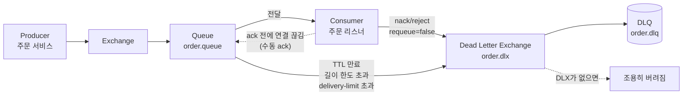

> 비교용 재작성본: `2026-11-05-rabbitmq-dlq-operations.md`와 사실·코드·출처는 같고 문장만 새 말투 규칙으로 다시 썼다. 마음에 드는 쪽 하나만 남긴다.
> 발행 전 확인: "직접 해본 결과"가 비어 있음(`[직접 작성]`). `rabbitmqctl set_policy` 명령은 문서를 직접 열어 확인하지 못했으니 [DLX 문서](https://rabbitmq.com/docs/dlx)의 예시와 맞는지 본다. 예제 기준 버전은 실제로 쓰는 버전(RabbitMQ 4.1.8, Spring Boot 3.5.16이 고르는 Spring AMQP 3.2.12)으로 바꿨다(2026-11-16). "문제 상황"의 첫 문단은 10월 23일 말로 복습 때 내 대답을 바탕으로 썼으니 실제 생각과 맞는지 본다.
> 2026-11-16 보강(실제 운영 구성을 기준으로 초안에 없던 것): ① quorum 큐 재전달 한도를 직접 4로 잡기, ② direct DLX와 dead-letter 라우팅 키, ③ DLQ 보관 기간(TTL 15일)과 큐 인자를 나중에 못 바꾸는 문제, ④ 수동 ack(`MANUAL`) 리스너가 예외 경로에서 멈추는 함정, ⑤ publisher confirms와 mandatory, ⑥ DLQ 경보와 처리 원칙. ④는 Spring AMQP 3.2.12 소스와 RabbitMQ 4.1 문서를 따라간 결과이고 실제 브로커에서 재현하지는 않았다. ⑥의 지표 이름 `rabbitmq_queue_messages_ready`는 RabbitMQ 문서에 per-object 지표 이름이 따로 나와 있지 않으니 실제 `/metrics/per-object` 출력에서 확인한다. 이 보강 내용은 아직 답 노트([[DLQ]] 등)에는 없다.

# RabbitMQ DLQ란? 메시지가 가는 4가지 경우와 운영에서 터지는 시나리오

## 요약
- DLQ(Dead Letter Queue)는 별도 종류의 큐가 아니라, 처리되지 못한 메시지가 DLX(Dead Letter Exchange)를 거쳐 모이는 일반 큐다.
- DLX가 없거나 이름이 틀리면 메시지는 오류 없이 조용히 사라진다. RabbitMQ 4.0부터 quorum 큐(메시지를 여러 서버에 복제해 두는 큐 종류)는 소비자에게 20번 넘게 다시 전달된 메시지를 DLX가 없으면 삭제한다.
- Spring AMQP의 `@RabbitListener`는 기본 설정 그대로 두면 예외가 나는 메시지를 무한히 재전달한다.
- 그렇다고 수동 ack(소비자 코드가 처리 완료를 직접 알리는 방식)로 바꾸면, 이번에는 예외 경로에서 응답을 빠뜨린 소비자가 RabbitMQ 4.1 기본값으로 최대 30분 동안 멈출 수 있다.
- 메시지는 생산자 쪽에서도 조용히 사라진다. 받아 줄 큐가 없는 메시지에도 브로커의 확인 응답(publisher confirm)은 성공으로 오기 때문에, 돌려받기 설정(mandatory)까지 켜야 알 수 있다.

## 문제 상황: DLQ만 있으면 메시지는 안전한 거 아닌가?
DLQ를 처음 접했을 때는 "처리가 안 된 메시지가 모이는 큐" 정도로만 알고 있었다. 그래서 소비자(메시지를 받아 처리하는 애플리케이션)가 처리 도중에 죽더라도 DLQ가 그 메시지를 지켜 줄 것이라고 생각했다. 하지만 공식 문서를 따라가 보니 이 생각은 틀렸다. 소비자가 죽었을 때 메시지를 지키는 것은 DLQ가 아니라 ack(소비자가 "처리를 끝냈다"고 알려 주는 확인 응답) 방식이었고, DLQ는 전혀 다른 경우에 쓰이는 장치였다.

그렇다면 메시지는 정확히 언제 DLQ로 가고, 설정을 잘못하면 운영에서 어떤 일이 생길까? 이번 포스팅에서는 이 두 가지를 RabbitMQ 기준으로 알아보자. 설명이 뜬구름이 되지 않도록 글 전체에서 주문 메시지를 처리하는 예시 하나를 계속 쓰겠다. 주문 메시지가 쌓이는 큐를 `order.queue`, 여기서 처리하지 못한 메시지를 받는 교환기를 `order.dlx`, 그 메시지가 최종적으로 모이는 큐를 `order.dlq`라고 부르자.

## 원리

### 1. DLQ는 왜 필요할까?
먼저 메시지 큐에 나오는 등장인물부터 짚고 가자. 메시지를 보내는 쪽을 생산자(Producer), 받아서 처리하는 쪽을 소비자(Consumer)라고 하고, 그 사이에서 메시지를 받아 보관했다가 전달해 주는 서버를 브로커(Broker)라고 한다. 이 글에서는 RabbitMQ가 브로커다. 브로커 안에는 교환기와 큐가 있다. 생산자는 큐에 직접 넣지 않고 교환기(Exchange)에 메시지를 보내는데, 교환기는 받은 메시지를 어느 큐로 보낼지 정해 주는 분배기라고 생각하면 된다. 이때 교환기와 큐를 이어 주는 연결을 바인딩(binding)이라고 하고, 교환기는 메시지에 붙어 있는 라우팅 키(routing key)라는 문자열을 보고 바인딩된 큐 중 어디로 보낼지 고른다. 큐(Queue)는 메시지를 순서대로 쌓아 두었다가 먼저 들어온 것부터 소비자에게 전달하는 저장소다 ([RabbitMQ: Queues](https://www.rabbitmq.com/docs/queues)). 우리 예시로 말하면 주문 서비스가 생산자이고, `order.queue`에서 주문을 꺼내 처리하는 리스너가 소비자다. 대부분의 메시지는 이렇게 전달되고 처리되면 끝나지만, 문제는 처리할 수 없는 메시지가 섞여 들어왔을 때다. 예를 들어 데이터 형식이 잘못돼서 소비자가 몇 번을 받아도 실패하는 메시지가 있다고 하자.

이때 큐가 이 메시지에 대해 할 수 있는 일은 원래 두 가지뿐이다. 하나는 큐에 다시 넣는 것인데, 어차피 또 실패할 메시지라서 큐와 소비자 사이를 끝없이 오가며 네트워크와 CPU만 쓰게 된다. 다른 하나는 버리는 것인데, 그러면 무엇이 왜 실패했는지 확인할 방법이 사라진다 ([RabbitMQ: Consumer Acknowledgements](https://www.rabbitmq.com/docs/confirms)). 계속 돌리자니 낭비이고 버리자니 유실인 셈이다. 그래서 이런 메시지를 원래 큐에서는 빼내되 버리지는 않고 따로 모아 두는 세 번째 선택지가 필요해졌고, 그 역할을 하는 것이 DLQ다.

### 2. DLQ는 특별한 큐가 아니다
그렇다면 DLQ는 어떻게 만들어질까? 사실 DLQ는 다른 큐와 똑같은 일반 큐이고, 달라지는 것은 메시지가 들어오는 경로뿐이다.

큐에는 DLX라는 교환기를 지정해 둘 수 있다. 이렇게 해 두면 그 큐에서 더 이상 정상적으로 처리될 수 없게 된 메시지, 즉 죽은 메시지(dead letter)가 버려지는 대신 DLX로 다시 보내지고, DLX에 바인딩해 둔 큐가 그 메시지를 받는다 ([RabbitMQ: Dead Letter Exchanges](https://rabbitmq.com/docs/dlx)). 이 마지막 큐를 DLQ라고 부르는 것이다. 따라서 DLQ를 쓴다는 말은 사실 "DLX를 지정하고 거기에 큐를 하나 묶어 둔다"는 뜻이라고 생각하면 된다.

말로만 들으면 감이 잘 안 오니 코드에서 DLX와 DLQ가 어디에 나타나는지 보자. 다음은 Spring 설정 클래스 안에 주문 예시의 큐 두 개와 교환기 하나를 선언한 코드다.

> 예제 기준: Spring AMQP 3.2(`QueueBuilder`), RabbitMQ 4.1, Spring Boot 3.5

```java
@Bean
Queue orderQueue() {                          // 원래 큐
    return QueueBuilder.durable("order.queue")  // durable: 브로커가 재시작해도 큐가 남는다
            .deadLetterExchange("order.dlx")  // ← 이 큐에서 죽은 메시지를 보낼 곳(DLX)을 지정
            .build();
}
@Bean
FanoutExchange orderDlx() {                   // ← DLX: 이름만 그렇게 부를 뿐 평범한 교환기
    return new FanoutExchange("order.dlx");
}
@Bean
Queue orderDlq() {                            // ← DLQ: 역시 평범한 큐
    return QueueBuilder.durable("order.dlq").build();
}
@Bean
Binding dlqBinding() {                        // ← DLX에 DLQ를 묶어야 메시지가 실제로 쌓인다
    return BindingBuilder.bind(orderDlq()).to(orderDlx());
}
```

이 코드에서 DLQ와 관련된 설정은 사실 `deadLetterExchange("order.dlx")` 한 줄뿐이다. 이 한 줄이 `order.queue`에게 "죽은 메시지는 버리지 말고 `order.dlx`로 보내라"고 알려 주는 것이고, 나머지 세 개는 평범한 교환기와 큐를 만들어 서로 묶은 것에 지나지 않는다 ([Spring AMQP: QueueBuilder](https://docs.spring.io/spring-amqp/api/org/springframework/amqp/core/QueueBuilder.html)). 교환기를 `FanoutExchange`로 만든 이유는 이 종류가 받은 메시지를 묶여 있는 모든 큐로 그대로 넘겨주기 때문에, 죽은 메시지가 어떤 라우팅 키를 달고 오든 가리지 않고 `order.dlq`에 쌓이게 하기 위해서다. 마지막의 바인딩을 빼먹으면 `order.dlx`까지는 메시지가 오지만 받아 줄 큐가 없어서 사라지므로 주의하자.

### 3. 메시지는 언제 DLQ로 갈까?
이제 처음 질문으로 돌아가서, 어떤 메시지가 죽은 메시지로 취급되는지 보자. RabbitMQ 문서 기준으로는 다음 네 가지 경우다.

1. 소비자가 메시지를 거절하면서 다시 큐에 넣지 말라고(`requeue=false`) 했을 때
2. 메시지 TTL(Time-To-Live), 즉 큐에 머물 수 있는 시간이 만료됐을 때
3. 큐 길이 한도를 넘었을 때
4. quorum 큐에서 같은 메시지를 소비자에게 다시 전달한 횟수가 한도(delivery-limit)를 넘었을 때

1번의 "거절"은 조금 더 설명이 필요하다. 소비자는 메시지를 받은 뒤 브로커에 세 가지 중 하나로 응답할 수 있다. 처리를 끝냈다는 ack, 처리하지 못했다는 nack(negative acknowledgement), 그리고 nack와 뜻은 같지만 한 번에 메시지 하나만 거절할 수 있는 reject다. RabbitMQ 명령 이름으로는 각각 `basic.ack`, `basic.nack`, `basic.reject`라고 부른다. nack나 reject를 보낼 때는 그 메시지를 큐에 다시 넣을지를 `requeue` 값으로 함께 알려 주는데, 이 값이 `false`일 때만 죽은 메시지가 된다 ([RabbitMQ: Consumer Acknowledgements](https://www.rabbitmq.com/docs/confirms)).

4번의 quorum 큐는 RabbitMQ의 큐 종류 중 하나로, 서버 한 대가 죽어도 메시지를 잃지 않도록 여러 서버에 복제해 두는 큐다. 기본 종류인 classic 큐에는 이 재전달 한도가 없다.

그리고 이 4번은 버전에 따라 동작이 달라지므로 주의해야 한다. RabbitMQ 4.0부터는 quorum 큐의 재전달 한도 기본값이 20으로 잡혀 있어서, 따로 설정하지 않아도 20번 넘게 재전달된 메시지는 죽은 메시지가 된다 ([RabbitMQ: Quorum Queues](https://www.rabbitmq.com/docs/4.0/quorum-queues)).

다음은 지금까지의 흐름을 주문 예시의 이름으로 그린 것이다. 위 코드에서 선언한 `order.queue`, `order.dlx`, `order.dlq`가 그림의 어디에 있는지 같이 보면 된다. 점선은 메시지가 DLQ로 가지 않는 두 경로인데, 바로 아래에서 하나씩 설명한다.



### 4. 그럼 소비자가 죽었을 때는 누가 메시지를 지킬까?
위 네 가지 경우를 다시 보면 "소비자가 처리 도중에 죽었을 때"는 어디에도 없다. 내가 처음에 잘못 알고 있던 부분이 바로 여기다. 이 경우를 책임지는 것은 앞에서 본 ack(acknowledgement)를 언제 보내느냐, 즉 ack 방식이다.

ack에는 자동과 수동이 있다. 자동 ack는 브로커가 메시지를 보내자마자 성공으로 처리하기 때문에, 소비자가 받은 직후에 죽으면 메시지는 그대로 사라지고 DLQ로도 가지 않는다. 반면 수동 ack에서는 소비자가 ack를 보내기 전에 연결이 끊기면 브로커가 그 메시지를 큐로 되돌려 다시 전달한다 ([RabbitMQ: Consumer Acknowledgements](https://www.rabbitmq.com/docs/confirms)). 따라서 소비자 장애에 대비하려면 DLQ가 아니라 수동 ack를 써야 한다. 위 그림에서 Consumer에서 Queue로 돌아가는 점선이 이 경로다.

## DLQ를 잘못 쓰면 운영에서 어떤 일이 생길까?
지금까지 DLQ가 어떤 구조이고 언제 쓰이는지 알아봤으니, 이제 운영에서 실제로 문제가 되는 상황을 보자. 무서운 점은 대부분 오류 없이 조용히 일어난다는 것이다.

가장 흔한 것은 DLX가 없거나 잘못 지정된 경우다. 소비자가 `requeue=false`로 거절했는데 DLX가 없으면 메시지는 그냥 버려진다 ([Consumer Acknowledgements](https://www.rabbitmq.com/docs/confirms)). DLX를 지정했더라도 이름에 오타가 있거나 나중에 그 교환기가 삭제됐다면 결과는 같다. 공식 문서도 이 부분을 분명하게 적어 두었다.
> "If it is missing then, the messages are silently dropped." ([RabbitMQ: Dead Letter Exchanges](https://rabbitmq.com/docs/dlx))

다음은 이 경우를 포함해서 문서에 나오는 시나리오를 표로 정리한 것이다.

| 상황                                    | 무슨 일이 생기나                                      | 출처                                                               |
| ------------------------------------- | ---------------------------------------------- | ---------------------------------------------------------------- |
| DLX 이름 오타, DLX 삭제                     | 죽은 메시지가 오류 없이 사라진다                             | [DLX](https://rabbitmq.com/docs/dlx)                             |
| DLX 없이 `requeue=false`로 거절            | 메시지가 그대로 버려진다                                  | [Confirms](https://www.rabbitmq.com/docs/confirms)               |
| 처리 못 하는 메시지를 `requeue=true`로 계속 돌려보냄  | 큐와 소비자 사이를 무한히 오가며 네트워크와 CPU를 쓴다               | [Confirms](https://www.rabbitmq.com/docs/confirms)               |
| RabbitMQ 4.0으로 올렸는데 quorum 큐에 DLX가 없음 | 재전달 20회를 넘은 메시지가 삭제된다                          | [Quorum Queues](https://www.rabbitmq.com/docs/4.0/quorum-queues) |
| 서버 여러 대를 묶은 클러스터에서 기본 방식으로 죽은 메시지를 DLX로 보냄 | DLX로 보낸 메시지가 DLQ에 잘 도착했는지 확인하는 절차가 없어 유실될 수 있다 | [DLX](https://rabbitmq.com/docs/dlx)                             |
| DLX가 다시 원래 큐로 돌아오는 순환 구성              | 순환 중 거절이 한 번도 없으면 RabbitMQ가 순환을 감지하고 메시지를 버린다  | [DLX](https://rabbitmq.com/docs/dlx)                             |

이 중 네 번째는 버전을 올리는 것만으로 생길 수 있어서 특히 조심해야 한다. 그래서 공식 문서는 모든 quorum 큐에 dead-letter 설정을 해 두기를 권장한다. 다섯 번째의 경우 quorum 큐는 at-least-once dead-lettering이라는 기능을 따로 지원한다. 죽은 메시지가 DLQ에 도착한 것이 확인될 때까지 원래 큐에서 지우지 않는 방식이므로, 클러스터 환경이라면 이 기능을 살펴보면 된다.

DLX를 지정하는 방법도 하나 알아 두자. 큐를 만들 때 인자(`x-dead-letter-exchange`)로 넣을 수도 있지만, 문서는 이 방식보다 RabbitMQ 정책(policy)으로 지정하기를 권장한다. 정책은 큐 이름 패턴을 정해 두면 거기에 맞는 큐들에 브로커가 설정을 일괄 적용해 주는 기능이다. 둘 다 있으면 큐 인자가 우선한다. 앞에서 본 `deadLetterExchange("order.dlx")`가 바로 큐 인자 방식이어서, 구조를 눈으로 보기에는 좋지만 운영에서는 코드를 다시 배포해야 DLX를 바꿀 수 있다는 단점이 있다. 다음은 같은 설정을 정책으로 지정하는 명령이다.

> 예제 기준: RabbitMQ 4.1의 `rabbitmqctl`

```bash
# 이름이 order.queue인 큐에 "죽은 메시지는 order.dlx로" 정책을 건다
rabbitmqctl set_policy order-dlx "^order\.queue$" '{"dead-letter-exchange":"order.dlx"}' --apply-to queues
```

`order-dlx`는 정책에 붙이는 이름이고, 그 뒤의 정규식은 정책을 적용할 큐 이름, 중괄호 안이 실제 설정이다. 이렇게 하면 코드에서는 `deadLetterExchange` 줄을 빼도 된다. 그리고 죽은 메시지에는 `x-death` 헤더가 붙어서 어느 큐에서 왜 죽었는지가 남으므로, DLQ에 쌓인 메시지를 볼 때 이 헤더부터 확인하면 된다 ([DLX](https://rabbitmq.com/docs/dlx)).

## Spring AMQP에서는 기본값이 무한 재전달이다
위 표의 세 번째 시나리오, 즉 처리하지 못하는 메시지가 계속 큐로 돌아가는 상황은 남의 이야기가 아니다. Spring에서 `@RabbitListener`를 아무 설정 없이 쓰면 이것이 기본 동작이기 때문이다. 다음 코드를 보자.

> 예제 기준: Spring AMQP 3.2(`@RabbitListener`), RabbitMQ 4.1, Spring Boot 3.5

```java
// application.yml — 예외 난 메시지를 큐로 되돌리지 않음 (DLX가 있으면 DLQ로, 없으면 버려짐)
// spring.rabbitmq.listener.simple.default-requeue-rejected: false

@RabbitListener(queues = "order.queue")  // ← ack 모드 기본값 AUTO: 정상 종료면 ack, 예외면 nack
public void handle(OrderMessage msg) {
    if (!msg.isValid()) {
        // ← 이 메시지만 requeue 없이 거절 → DLX가 있으면 DLQ, 없으면 버려짐
        throw new AmqpRejectAndDontRequeueException("검증 실패: " + msg.id());
    }
    orderService.process(msg);  // ← 일반 예외가 나면 기본값(requeue=true)이라 큐로 돌아가 다시 전달
}
```

이 리스너를 앞에서 선언한 큐들과 이어서 읽어 보자. 검증에 실패한 주문 메시지는 `AmqpRejectAndDontRequeueException` 때문에 다시 넣지 않는 조건으로 거절되고, `order.queue`에는 `order.dlx`가 지정되어 있으므로 버려지는 대신 `order.dlx`를 거쳐 `order.dlq`에 쌓인다. 나중에 `order.dlq`를 열어 보면 어떤 주문이 왜 실패했는지 확인할 수 있는 것이다.

여기서 먼저 헷갈리기 쉬운 것이 `AUTO`라는 이름이다. Spring의 `AUTO`는 앞에서 본 RabbitMQ의 자동 ack가 아니다. 리스너 메서드를 대신 실행해 주는 Spring의 리스너 컨테이너가, 메서드가 정상적으로 끝났으면 ack를, 예외가 났으면 nack를 브로커에 보내 주는 방식이고, RabbitMQ의 자동 ack에 해당하는 것은 Spring에서 `NONE`이다. Spring 문서에도 이 주의가 그대로 적혀 있다.
> "Do not confuse with RabbitMQ autoAck which is represented by NONE here." ([Spring AMQP: AcknowledgeMode](https://docs.spring.io/spring-amqp/api/org/springframework/amqp/core/AcknowledgeMode.html))

문제는 예외가 났을 때다. 리스너가 예외를 던진 메시지를 다시 큐에 넣을지 정하는 값이 `defaultRequeueRejected`인데, 이 값의 기본값이 `true`다 ([Spring AMQP 3.2: Container Attributes](https://docs.spring.io/spring-amqp/reference/3.2/amqp/containerAttributes.html)). 따라서 데이터 자체가 잘못돼서 몇 번을 다시 받아도 실패하는 메시지는 큐와 리스너 사이를 끝없이 오가게 된다.

막는 방법은 두 가지다. 설정에서 `default-requeue-rejected`를 `false`로 바꾸거나, 위 코드처럼 다시 받을 필요가 없는 메시지에 대해서만 `AmqpRejectAndDontRequeueException`을 던지면 된다 ([Spring Boot: AMQP](https://docs.spring.io/spring-boot/reference/messaging/amqp.html)). 어느 쪽이든 그 메시지는 `requeue=false`로 거절되므로 DLX가 있으면 DLQ로 가고 없으면 버려진다 ([Spring AMQP 3.2: Exception Handling](https://docs.spring.io/spring-amqp/reference/3.2/amqp/exception-handling.html)). 결국 이 설정은 DLX 설정과 짝으로 해 줘야 의미가 있다.

## 실제 운영에서는 어떻게 선언했을까?
지금까지는 구조를 보기 쉽게 classic 큐와 fanout 교환기로 설명했는데, 실제로 운영하는 서비스(RabbitMQ 4.1.8, Spring Boot 3.5.16)에서는 선언이 조금 다르다. 차이는 세 가지다. 원래 큐를 quorum 큐로 만들면서 재전달 한도를 기본값 20 대신 4로 직접 잡았고, DLX를 direct 교환기로 만들면서 죽은 메시지에 붙일 라우팅 키를 따로 정했고, DLQ에도 메시지 보관 기간을 걸었다. 다음은 이것을 주문 예시의 이름으로 다시 쓴 코드다.

> 예제 기준: Spring AMQP 3.2(`QueueBuilder`), RabbitMQ 4.1, Spring Boot 3.5

```java
@Bean
Queue orderQueue() {
    return QueueBuilder.durable("order.queue")
            .quorum()                              // ← quorum 큐로 선언
            .withArgument("x-delivery-limit", 4)   // ← 재전달 한도(delivery-limit): 기본 20 대신 4
            .deadLetterExchange("order.dlx")       // ← DLX
            .deadLetterRoutingKey("order.dead")    // ← dead-letter 라우팅 키: 죽은 메시지에 새로 붙일 키
            .build();
}
@Bean
DirectExchange orderDlx() { return new DirectExchange("order.dlx"); } // ← 키가 정확히 같은 큐에만 넘기는 교환기
@Bean
Queue orderDlq() {
    return QueueBuilder.durable("order.dlq").quorum()
            .ttl(15 * 24 * 60 * 60 * 1000)       // ← DLQ 보관 기간 15일(밀리초). 지나면 버려진다
            .build();
}
@Bean
Binding dlqBinding() {
    return BindingBuilder.bind(orderDlq()).to(orderDlx()).with("order.dead"); // ← 같은 키로 묶는다
}
```

이 코드에서 재전달 한도는 `withArgument("x-delivery-limit", 4)` 줄이다. `withArgument`는 큐 인자 이름과 값을 직접 넣는 메서드이고, 여기서는 재전달 한도 인자인 `x-delivery-limit`를 4로 넣었다. 이 인자는 quorum 큐에만 적용되므로 바로 위의 `quorum()`과 짝으로 써야 한다 ([Spring AMQP: QueueBuilder](https://docs.spring.io/spring-amqp/api/org/springframework/amqp/core/QueueBuilder.html)). 참고로 `QueueBuilder`에는 같은 일을 하는 `deliveryLimit(4)` 메서드도 있는데, 소스를 보면 이 메서드도 안에서 `withArgument("x-delivery-limit", limit)`를 부를 뿐이라 어느 쪽으로 써도 브로커에 들어가는 인자는 같다 ([Spring AMQP 3.2.12 소스: QueueBuilder](https://github.com/spring-projects/spring-amqp/blob/v3.2.12/spring-amqp/src/main/java/org/springframework/amqp/core/QueueBuilder.java)). 한도를 작게 잡으면 처리하지 못하는 주문 메시지가 `order.queue`와 소비자 사이를 그만큼 덜 오가고, 더 빨리 `order.dlx`를 거쳐 `order.dlq`로 넘어간다 ([RabbitMQ: Quorum Queues](https://www.rabbitmq.com/docs/4.0/quorum-queues)).

다음으로 볼 것은 DLX를 direct 교환기로 바꾼 부분이다. direct 교환기(direct exchange)는 메시지의 라우팅 키와 바인딩 키가 정확히 같은 큐에만 메시지를 넘겨주는 교환기다. 그래서 DLX를 direct로 만들면 죽은 메시지가 어떤 라우팅 키를 달고 DLX에 도착하는지가 중요해진다. RabbitMQ는 큐에 dead-letter 라우팅 키(`x-dead-letter-routing-key`)가 지정돼 있으면 그 키를 쓰고, 없으면 메시지가 처음 발행될 때 달고 있던 라우팅 키를 그대로 쓴다 ([RabbitMQ: Dead Letter Exchanges](https://rabbitmq.com/docs/dlx)). 예를 들어 주문 서비스가 `order.created`라는 키로 보낸 메시지가 죽었는데 `deadLetterRoutingKey` 줄을 빼먹었다면, 메시지는 `order.created`를 단 채로 `order.dlx`에 도착한다. 그런데 `order.dlq`는 `order.dead`로 묶여 있으므로 받아 줄 큐가 없고, 앞에서 본 바인딩 누락과 똑같이 오류 없이 사라진다. 따라서 direct DLX를 쓸 때는 `deadLetterRoutingKey`와 바인딩의 `with(...)`에 같은 키를 넣었는지 꼭 맞춰 보자.

마지막으로 `order.dlq`의 `ttl(...)`은 앞에서 본 메시지 TTL을 DLQ 자체에 건 것이다. DLQ는 보통 꺼내 가는 소비자가 없어서 그냥 두면 계속 쌓이기만 하는데, RabbitMQ는 디스크 남은 공간이 한도(`disk_free_limit`, 기본 50MB) 아래로 떨어지면 모든 생산자를 막아 버린다 ([RabbitMQ: Disk Alarms](https://www.rabbitmq.com/docs/disk-alarms)). 그래서 원인을 확인할 시간(여기서는 15일)만 남기고 그 뒤에는 지워지게 했다. `order.dlq`에는 DLX가 없으므로 만료된 메시지는 다른 곳으로 가지 않고 버려진다 ([RabbitMQ: TTL](https://www.rabbitmq.com/docs/ttl)).

그런데 이 선언에는 약점이 하나 있다. 앞에서 문서가 정책을 권장한다고 했는데, 여기서는 큐 인자로 선언했다는 점이다. 큐 인자 중에는 큐를 처음 만들 때 정해지면 그 큐가 없어질 때까지 바꿀 수 없는 것이 있고, 이미 있는 큐를 다른 인자로 다시 선언하면 브로커가 `PRECONDITION_FAILED`(406) 오류를 낸다 ([RabbitMQ: Queues](https://www.rabbitmq.com/docs/queues)). 예를 들어 운영 중에 DLQ 보관 기간을 15일에서 30일로 바꾸고 코드만 다시 배포하면, 애플리케이션이 `order.dlq`를 다시 선언하는 순간 이 오류가 난다. 정책은 언제든 바꿀 수 있으므로, 나중에 바꿀 가능성이 있는 값(재전달 한도, TTL, DLX)은 처음부터 정책으로 거는 편이 낫다.

## 수동 ack로 바꾸면 이번엔 소비자가 멈출 수 있다
앞에서 Spring의 기본 ack 모드인 `AUTO`가 예외 난 메시지를 무한히 돌려보낸다는 것을 봤다. 실제 운영에서는 이 모드 대신 수동 ack(Spring에서 `MANUAL`)를 쓰는데, `MANUAL`은 컨테이너가 아니라 리스너 코드가 직접 `basicAck`(처리 완료)나 `basicReject`(거절)를 불러야 하는 방식이다 ([Spring AMQP 3.2: Container Attributes](https://docs.spring.io/spring-amqp/reference/3.2/amqp/containerAttributes.html)). 처리 결과를 다음 단계로 넘긴 것이 확실해진 뒤에 ack하는 것처럼, 응답을 보내는 시점을 코드가 정할 수 있어서 쓴다. 다음은 수동 ack 리스너를 주문 예시로 쓴 것이다. 리스너 메서드는 메시지를 받은 `Channel`과, `@Header`로 꺼낸 delivery tag(채널 안에서 이 메시지를 가리키는 번호)를 인자로 받을 수 있다 ([Spring AMQP 3.2: Annotated Endpoint Method Signature](https://docs.spring.io/spring-amqp/reference/3.2/amqp/receiving-messages/async-annotation-driven/enable-signature.html)).

> 예제 기준: Spring AMQP 3.2(`@RabbitListener`, `Channel`), RabbitMQ 4.1, Spring Boot 3.5

```java
// application.yml
// spring.rabbitmq.listener.simple.acknowledge-mode: manual  ← 수동 ack
// spring.rabbitmq.listener.simple.prefetch: 1               ← ack 안 된 메시지는 소비자당 1개까지만

@RabbitListener(queues = "order.queue")
public void handle(OrderMessage msg, Channel channel,
                   @Header(AmqpHeaders.DELIVERY_TAG) long tag) throws IOException {
    try {
        orderService.process(msg);
        channel.basicAck(tag, false);     // ← 처리 끝: ack
    } catch (Exception e) {
        channel.basicReject(tag, false);  // ← requeue=false로 거절 → order.dlx → order.dlq
    }                                     //   이 catch가 없으면 예외 때 아무 응답도 가지 않는다
}
```

이 리스너에서 정상 처리된 주문 메시지는 `basicAck`로 끝나고, 처리 중 예외가 난 주문 메시지는 `catch`의 `basicReject(tag, false)`로 거절되어 `order.dlx`를 거쳐 `order.dlq`에 쌓인다. 문제는 이 `catch`를 빠뜨렸을 때다. `AUTO`에서는 예외가 나면 컨테이너가 대신 거절을 보내 줬지만, `MANUAL`에서는 리스너가 예외를 던져도 컨테이너가 거절을 보내지 않는다. Spring AMQP 3.2.12 소스의 `BlockingQueueConsumer.rollbackOnExceptionIfNecessary`를 보면 수동 모드일 때는 특정 거절 예외가 아니면 nack나 reject를 보내지 않도록 조건이 걸려 있다 ([Spring AMQP 3.2.12 소스](https://github.com/spring-projects/spring-amqp/blob/v3.2.12/spring-rabbit/src/main/java/org/springframework/amqp/rabbit/listener/BlockingQueueConsumer.java)). 그러면 그 주문 메시지는 ack도 거절도 안 된 상태(unacked)로 소비자에게 붙잡혀 있게 된다.

여기에 prefetch가 겹친다. prefetch는 한 채널에서 ack를 받지 않은 채 소비자에게 보내 둘 수 있는 메시지 수의 상한이고, 이 수에 닿으면 RabbitMQ는 하나라도 ack될 때까지 그 채널로 메시지를 더 보내지 않는다 ([RabbitMQ: Consumer Acknowledgements](https://www.rabbitmq.com/docs/confirms)). Spring의 기본 prefetch는 250인데 ([Spring AMQP 3.2: Container Attributes](https://docs.spring.io/spring-amqp/reference/3.2/amqp/containerAttributes.html)), 위 설정처럼 1로 두면 응답을 못 받은 메시지 하나가 그 소비자를 통째로 멈춰 세운다. 이 상태는 consumer timeout(소비자가 ack하지 않고 메시지를 붙잡고 있을 수 있는 최대 시간)이 지나야 풀린다. RabbitMQ 4.1 문서 기준 기본값은 30분이고, 시간이 지나면 브로커가 그 채널을 `PRECONDITION_FAILED`로 닫으면서 채널에 붙잡혀 있던 메시지를 모두 큐로 되돌린다 ([RabbitMQ 4.1: Consumers](https://www.rabbitmq.com/docs/4.1/consumers)). 결국 예외 한 번에 그 소비자가 최대 30분 동안 일을 하지 않는 셈이다. 소비자가 여러 개면 나머지가 일을 받아 가겠지만, 같은 예외가 소비자 수만큼 겹치면 큐 전체가 멈춘다.

참고로 이렇게 되돌아간 메시지가 quorum 큐의 재전달 횟수에 들어가는지는 버전마다 다르다. 최신(4.3) 문서는 `basic.reject`와 소비자 연결 끊김은 세고 `basic.nack`와 consumer timeout은 세지 않는다고 적고 있고 ([RabbitMQ: Quorum Queues](https://www.rabbitmq.com/docs/quorum-queues)), 4.1 문서에는 이 구분이 나와 있지 않다 ([RabbitMQ 4.1: Quorum Queues](https://www.rabbitmq.com/docs/4.1/quorum-queues)). 세지 않는 버전이라면 같은 메시지가 멈췄다 풀리기를 반복하면서도 DLQ로는 가지 않을 수 있다.

따라서 수동 ack를 쓸 때는 위 코드처럼 예외 경로까지 포함해 모든 길에서 `basicAck`나 `basicReject` 중 하나가 반드시 불리게 해야 한다. 다만 본문을 `OrderMessage`로 바꾸는 변환 단계에서 실패한 메시지는 리스너가 불리기 전이라 코드가 응답할 기회가 없는데, 이 경우는 Spring AMQP 2.1.9부터 수동 모드에서도 Spring이 requeue 없이 거절해 준다 ([Spring AMQP 3.2: Exception Handling](https://docs.spring.io/spring-amqp/reference/3.2/amqp/exception-handling.html)).

## 생산자 쪽에서도 메시지는 조용히 사라진다
지금까지는 소비자가 메시지를 받은 뒤의 이야기였는데, 메시지는 큐에 들어가기도 전에 사라질 수도 있다. 교환기가 받은 메시지를 넘겨줄 큐를 하나도 찾지 못하면(이런 메시지를 unroutable 메시지라고 한다) RabbitMQ는 기본적으로 그 메시지를 버리기 때문이다 ([RabbitMQ: Publishers](https://www.rabbitmq.com/docs/publishers)). 바인딩 키를 잘못 적었거나 큐가 아직 없을 때, 생산자는 이 사실을 모른 채 지나간다.

이것을 알아내려면 두 가지 장치를 함께 켜야 한다. 하나는 publisher confirms로, 브로커가 메시지를 안전하게 받았는지를 생산자에게 ack(받음)나 nack(못 받음)로 알려 주는 확인 응답이다. 다른 하나는 mandatory 플래그로, 메시지를 보낼 때 이 값을 켜 두면 받아 줄 큐가 없는 메시지를 버리지 않고 생산자에게 돌려준다(return). 둘 중 하나만으로는 부족한 이유는 RabbitMQ가 unroutable 메시지에도 "어느 큐로도 갈 수 없다는 것을 확인했다"는 뜻으로 confirm ack를 보내기 때문이다. mandatory를 켜 두면 돌려주는 응답이 이 ack보다 먼저 도착한다 ([RabbitMQ: Consumer Acknowledgements and Publisher Confirms](https://www.rabbitmq.com/docs/confirms)). 즉 ack만 보고 성공으로 처리하면 버려진 메시지도 성공으로 보인다. 다음 코드를 보자.

> 예제 기준: Spring AMQP 3.2(`RabbitTemplate`, `CorrelationData`), RabbitMQ 4.1, Spring Boot 3.5

```java
// application.yml
// spring.rabbitmq.publisher-confirm-type: correlated  ← publisher confirms를 메시지별로 받기
// spring.rabbitmq.publisher-returns: true             ← 돌려받은 메시지를 받을 수 있게
// spring.rabbitmq.template.mandatory: true            ← mandatory 플래그 켜기

CorrelationData cd = new CorrelationData(msg.id());  // 이 메시지의 확인 응답을 받을 객체
rabbitTemplate.convertAndSend("order.exchange", "order.created", msg, cd);
CorrelationData.Confirm confirm = cd.getFuture().get(10, TimeUnit.SECONDS);
if (!confirm.isAck()) throw new IllegalStateException("브로커가 받지 못함");      // ← nack
if (cd.getReturned() != null) throw new IllegalStateException("받아 줄 큐 없음"); // ← ack가 와도 돌려받았으면 실패
```

이 코드에서 publisher confirms를 켜는 것은 `publisher-confirm-type: correlated` 줄이고, mandatory는 `template.mandatory: true` 줄이다 ([Spring AMQP 3.2: RabbitTemplate](https://docs.spring.io/spring-amqp/reference/3.2/amqp/template.html)). 주문 메시지가 `order.exchange`에서 `order.created` 키로 `order.queue`에 들어가면 ack가 오고 끝난다. 반대로 바인딩이 틀려서 갈 곳이 없으면, 돌려받은 메시지가 `cd`에 먼저 담긴 뒤에 ack가 오므로 마지막 `if`에 걸린다. Spring은 ack를 알리기 전에 돌려받은 메시지를 먼저 채워 두는 것을 보장하므로, 이 순서로 검사하면 된다.

이 확인은 소비자가 처리 결과를 다른 큐로 다시 보낼 때도 그대로 쓸 수 있다. 앞 절의 수동 ack 리스너가 처리 결과를 다른 큐로 보낸다고 하자. 그러면 결과 메시지가 확인되고 돌려받지도 않았을 때만 원래 주문 메시지를 ack하고, 돌려받았다면 원래 메시지를 `basicReject(tag, false)`로 거절해 `order.dlq`에 남기면 된다. 이렇게 해야 결과는 사라졌는데 원래 주문 메시지까지 ack되어 둘 다 잃어버리는 일을 막을 수 있다. 확인 응답을 기다리다 시간이 지나 예외가 나는 경우도 있으니, 앞 절에서 본 것처럼 그 예외 역시 `catch`에서 거절로 이어지게 해야 한다.

## DLQ에 메시지가 쌓이면 어떻게 알 수 있을까?
DLX와 DLQ를 제대로 만들었어도 아무도 `order.dlq`를 보지 않으면, 메시지가 조용히 사라지는 것과 크게 다르지 않다. 게다가 앞에서 DLQ에 15일 보관 기간을 걸었으니 그 안에 알아채야 한다. 그래서 DLQ에 메시지가 하나라도 들어오면 경보가 울리게 했다. 이때 쓴 것이 Prometheus(지표를 주기적으로 모아 저장하고, 조건에 맞으면 경보를 내는 모니터링 도구)다. RabbitMQ의 Prometheus 플러그인은 기본 15692 포트로 지표를 내보내는데, 기본 경로 `/metrics`는 큐 전체를 합친 값만 주므로 큐별 값을 보려면 `/metrics/per-object`를 따로 수집해야 한다 ([RabbitMQ: Prometheus](https://www.rabbitmq.com/docs/prometheus)). 다음은 그렇게 모은 지표로 `order.dlq`에 꺼내 가길 기다리는 메시지가 1분 넘게 0보다 많으면 울리는 경보 규칙이다.

> 예제 기준: RabbitMQ 4.1 `rabbitmq_prometheus` 플러그인, Prometheus 경보 규칙 · 지표 이름은 `/metrics/per-object` 출력에서 확인 필요

```yaml
- alert: OrderDlqNotEmpty
  expr: max(rabbitmq_queue_messages_ready{queue="order.dlq"}) > 0  # ← DLQ에서 꺼내 가길 기다리는 메시지 수
  for: 1m                                                           # ← 1분 넘게 이어질 때만 울림
```

경보가 울렸을 때 지킬 원칙도 함께 정해 두었다. DLQ를 통째로 비우거나(purge) 메시지를 아무렇게나 원래 큐로 다시 보내지 않고, 먼저 앞에서 본 `x-death` 헤더로 어느 큐에서 왜 죽었는지를 보고 같은 시간대의 애플리케이션 로그에서 발행·처리 실패 기록을 찾는다. 원인과 재처리 방법이 정해진 뒤에만 관리 화면이나 정해진 도구로 처리하고, 그렇지 않은 메시지는 보관 기간이 지나 저절로 만료되게 둔다. DLQ에 메시지가 있다는 것은 그 원인이 아직 남아 있다는 뜻이므로, 원인을 고치기 전에 다시 넣으면 같은 메시지가 다시 DLQ로 돌아올 뿐이기 때문이다.

## 직접 해본 결과
[직접 작성] 아래를 내 환경에서 실행해 보고 결과를 회사 정보 없이 적는다.

> 예제 기준: RabbitMQ 4.1의 `rabbitmqctl`

 `rabbitmqctl`은 RabbitMQ 서버(노드)를 관리하는 명령줄 도구이고, `list_queues` 뒤에 붙는 단어들은 옵션이 아니라 보여 줄 열 이름이다 ([rabbitmqctl(8)](https://www.rabbitmq.com/docs/man/rabbitmqctl.8)).
- `rabbitmqctl version`: 4.0 이상인지 (이상이면 quorum 큐 재전달 한도 20이 적용된다)
- `rabbitmqctl list_policies`: `dead-letter-exchange`를 지정한 정책이 있는지
- `rabbitmqctl list_queues name type messages policy`: quorum 큐인데 DLX 정책이 없는 큐가 있는지 (열은 차례로 큐 이름, 큐 종류, 쌓인 메시지 수, 적용된 정책)
- Spring 설정에 `default-requeue-rejected`와 `acknowledge-mode`를 따로 지정했는지 (안 했으면 AUTO에 requeue=true)
- `rabbitmqctl list_queues name messages_ready messages_unacknowledged consumers`: 수동 ack 소비자가 멈춰 있지 않은지 (열은 차례로 큐 이름, 꺼내 가길 기다리는 메시지 수, ack를 기다리는 메시지 수, 소비자 수. ack를 기다리는 수가 소비자 수 × prefetch에 붙은 채 오래 줄지 않으면 의심한다)
- Spring 설정에 `publisher-confirm-type`, `publisher-returns`, `template.mandatory`가 켜져 있는지
- 받아 줄 큐가 없는 라우팅 키로 한 건을 일부러 보내 보고, confirm ack와 돌려받은 메시지가 둘 다 오는지
- direct DLX라면 큐의 dead-letter 라우팅 키와 DLQ 바인딩 키가 같은지 (`rabbitmqctl list_bindings`로 바인딩 키를 본다)

## 함정과 주의점
- DLQ는 소비자 장애 대비책이 아니다. 그 역할은 수동 ack가 한다.
- DLX를 만든 뒤에는 메시지가 실제로 DLQ에 쌓이는지 한 번 확인한다. 이름이 틀려도 오류가 나지 않기 때문이다.
- Spring의 `default-requeue-rejected`는 DLX 설정과 함께 바꾼다.
- direct DLX를 쓰면 dead-letter 라우팅 키와 DLQ 바인딩 키를 같게 맞춘다. 안 맞으면 DLX까지 와서 사라진다.
- 수동 ack(`MANUAL`)에서는 예외 경로까지 ack나 reject를 직접 보낸다. 빠뜨리면 무한 재전달 대신 소비자가 consumer timeout(4.1 기본 30분)까지 멈춘다.
- publisher confirms의 ack만 보고 성공으로 치지 않는다. mandatory로 돌려받은 메시지가 있는지도 같이 본다.
- 나중에 바꿀 수 있는 값(재전달 한도, TTL, DLX)은 큐 인자 대신 정책으로 건다. 큐 인자는 다른 값으로 다시 선언하면 오류가 난다.
- DLQ에도 보관 기간과 경보를 둔다. 아무도 보지 않는 DLQ는 디스크만 차지한다.

## 마무리
지금까지 DLQ가 DLX를 거쳐 메시지가 모이는 일반 큐라는 것, 메시지가 DLQ로 가는 네 가지 경우, 설정이 빠졌을 때 메시지가 조용히 사라지는 시나리오, 그리고 실제 운영에서 재전달 한도·dead-letter 라우팅 키·DLQ 보관 기간을 어떻게 잡았고 수동 ack와 publisher confirms에서 무엇을 조심해야 하는지를 알아보았다. DLQ의 구조 자체는 단순하다. 다만 DLX를 지정하지 않았거나 이름이 틀렸을 때는 처리하지 못한 메시지가 오류 하나 없이 사라진다는 점만은 꼭 기억해 두자. 다음에는 이 글에서 이름만 나온 개념들을 이어서 정리해 볼 생각이다.
- 재시도 큐 패턴: TTL 대기 큐와 DLX를 묶어 일정 시간 뒤에 다시 처리하는 구성
- quorum 큐: 여러 서버에 복제되는 큐가 내부에서 어떻게 동작하는지
- publisher confirms: 이 글에서는 확인 응답을 기다리기만 했는데, nack가 오거나 시간이 지났을 때 다시 보내는 방법

## 참고 자료
- [RabbitMQ: Queues](https://www.rabbitmq.com/docs/queues)
- [RabbitMQ: Dead Letter Exchanges](https://rabbitmq.com/docs/dlx)
- [RabbitMQ: Consumer Acknowledgements](https://www.rabbitmq.com/docs/confirms)
- [RabbitMQ: Quorum Queues (4.0)](https://www.rabbitmq.com/docs/4.0/quorum-queues) · [4.1](https://www.rabbitmq.com/docs/4.1/quorum-queues) · [최신(4.3 이후 재전달 횟수 기준)](https://www.rabbitmq.com/docs/quorum-queues)
- [RabbitMQ 4.1: Consumers (consumer timeout)](https://www.rabbitmq.com/docs/4.1/consumers)
- [RabbitMQ: Publishers](https://www.rabbitmq.com/docs/publishers)
- [RabbitMQ: Time-To-Live and Expiration](https://www.rabbitmq.com/docs/ttl)
- [RabbitMQ: Disk Alarms](https://www.rabbitmq.com/docs/disk-alarms)
- [RabbitMQ: Prometheus](https://www.rabbitmq.com/docs/prometheus)
- [Spring AMQP: QueueBuilder](https://docs.spring.io/spring-amqp/api/org/springframework/amqp/core/QueueBuilder.html)
- [rabbitmqctl(8)](https://www.rabbitmq.com/docs/man/rabbitmqctl.8)
- [Spring AMQP: AcknowledgeMode](https://docs.spring.io/spring-amqp/api/org/springframework/amqp/core/AcknowledgeMode.html) · [Container Attributes (3.2)](https://docs.spring.io/spring-amqp/reference/3.2/amqp/containerAttributes.html) · [Exception Handling (3.2)](https://docs.spring.io/spring-amqp/reference/3.2/amqp/exception-handling.html)
- [Spring AMQP 3.2: Annotated Endpoint Method Signature](https://docs.spring.io/spring-amqp/reference/3.2/amqp/receiving-messages/async-annotation-driven/enable-signature.html) · [RabbitTemplate (Correlated Publisher Confirms and Returns)](https://docs.spring.io/spring-amqp/reference/3.2/amqp/template.html)
- [Spring AMQP 3.2.12 소스: BlockingQueueConsumer](https://github.com/spring-projects/spring-amqp/blob/v3.2.12/spring-rabbit/src/main/java/org/springframework/amqp/rabbit/listener/BlockingQueueConsumer.java) · [QueueBuilder](https://github.com/spring-projects/spring-amqp/blob/v3.2.12/spring-amqp/src/main/java/org/springframework/amqp/core/QueueBuilder.java)
- [Spring Boot: AMQP](https://docs.spring.io/spring-boot/reference/messaging/amqp.html)

---
작성일: 2026-11-16 · 버전: 초안(재작성본) · 수정 이력: 2026-11-05 초안을 새 말투 규칙으로 다시 씀; 2026-11-16 실제 운영 구성(RabbitMQ 4.1.8, Spring Boot 3.5.16) 기준으로 운영 선언·수동 ack·publisher confirms·DLQ 경보 보강
