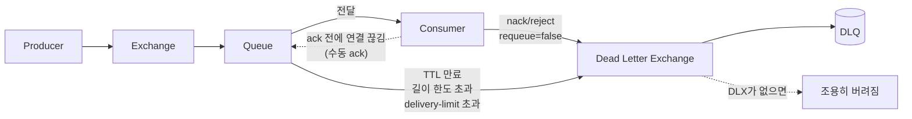

> 비교용 재작성본: `2026-11-05-rabbitmq-dlq-operations.md`와 사실·코드·출처는 같고 문장만 새 말투 규칙으로 다시 썼다. 마음에 드는 쪽 하나만 남긴다.
> 발행 전 확인: "직접 해본 결과"가 비어 있음(`[직접 작성]`). "문제 상황"의 첫 문단은 10월 23일 말로 복습 때 내 대답을 바탕으로 썼으니 실제 생각과 맞는지 본다.

# RabbitMQ DLQ란? 메시지가 가는 4가지 경우와 운영에서 터지는 시나리오

## 요약
- DLQ(Dead Letter Queue)는 별도 종류의 큐가 아니라, 처리되지 못한 메시지가 DLX(Dead Letter Exchange)를 거쳐 모이는 일반 큐다.
- DLX가 없거나 이름이 틀리면 메시지는 오류 없이 조용히 사라진다. RabbitMQ 4.0부터 quorum 큐는 재전달 20회를 넘은 메시지를 DLX가 없으면 삭제한다.
- Spring AMQP의 `@RabbitListener`는 기본 설정 그대로 두면 예외가 나는 메시지를 무한히 재전달한다.

## 문제 상황: DLQ만 있으면 메시지는 안전한 거 아닌가?
DLQ를 처음 접했을 때는 "처리가 안 된 메시지가 모이는 큐" 정도로만 알고 있었다. 그래서 소비자(메시지를 받아 처리하는 애플리케이션)가 처리 도중에 죽더라도 DLQ가 그 메시지를 지켜 줄 것이라고 생각했다. 하지만 공식 문서를 따라가 보니 이 생각은 틀렸다. 소비자가 죽었을 때 메시지를 지키는 것은 DLQ가 아니라 ack 방식이었고, DLQ는 전혀 다른 경우에 쓰이는 장치였다.

그렇다면 메시지는 정확히 언제 DLQ로 가고, 설정을 잘못하면 운영에서 어떤 일이 생길까? 이번 포스팅에서는 이 두 가지를 RabbitMQ 기준으로 알아보자.

## 원리

### 1. DLQ는 특별한 큐가 아니다
먼저 메시지 큐부터 짚고 가자. RabbitMQ의 큐는 메시지를 순서대로 쌓아 두었다가 먼저 들어온 것부터 소비자에게 전달하는 저장소다 ([RabbitMQ: Queues](https://www.rabbitmq.com/docs/queues)). DLQ도 이 점에서는 다른 큐와 똑같은 일반 큐인데, 달라지는 것은 메시지가 들어오는 경로다.

큐에는 DLX라는 교환기를 지정해 둘 수 있다. 이렇게 해 두면 그 큐에서 "죽은" 메시지가 버려지는 대신 DLX로 다시 발행되고, DLX에 바인딩해 둔 큐가 그 메시지를 받는다 ([RabbitMQ: Dead Letter Exchanges](https://rabbitmq.com/docs/dlx)). 이 마지막 큐를 DLQ라고 부르는 것이다. 따라서 DLQ를 쓴다는 말은 사실 "DLX를 지정하고 거기에 큐를 하나 묶어 둔다"는 뜻이라고 생각하면 된다.

### 2. 메시지는 언제 DLQ로 갈까?
이제 처음 질문으로 돌아가서, 어떤 메시지가 죽은 메시지로 취급되는지 보자. RabbitMQ 문서 기준으로는 다음 네 가지 경우다.

1. 소비자가 메시지를 거절하면서(`basic.reject` 또는 `basic.nack`) 다시 큐에 넣지 말라고(`requeue=false`) 했을 때
2. 메시지 TTL(Time-To-Live), 즉 큐에 머물 수 있는 시간이 만료됐을 때
3. 큐 길이 한도를 넘었을 때
4. quorum 큐에서 재전달 횟수 한도(delivery-limit)를 넘었을 때

이 중 4번은 버전에 따라 동작이 달라지므로 주의해야 한다. RabbitMQ 4.0부터는 quorum 큐의 재전달 한도 기본값이 20으로 잡혀 있어서, 따로 설정하지 않아도 20번 넘게 재전달된 메시지는 죽은 메시지가 된다 ([RabbitMQ: Quorum Queues](https://www.rabbitmq.com/docs/4.0/quorum-queues)).

다음은 지금까지의 흐름을 그림으로 나타낸 것이다. 점선은 메시지가 DLQ로 가지 않는 두 경로인데, 바로 아래에서 하나씩 설명한다.



### 3. 그럼 소비자가 죽었을 때는 누가 메시지를 지킬까?
위 네 가지 경우를 다시 보면 "소비자가 처리 도중에 죽었을 때"는 어디에도 없다. 내가 처음에 잘못 알고 있던 부분이 바로 여기다. 이 경우를 책임지는 것은 ack(acknowledgement), 즉 소비자가 "처리를 끝냈다"고 브로커에 알려 주는 확인 방식이다.

ack에는 자동과 수동이 있다. 자동 ack는 브로커가 메시지를 보내자마자 성공으로 처리하기 때문에, 소비자가 받은 직후에 죽으면 메시지는 그대로 사라지고 DLQ로도 가지 않는다. 반면 수동 ack에서는 소비자가 ack를 보내기 전에 연결이 끊기면 브로커가 그 메시지를 큐로 되돌려 다시 전달한다 ([RabbitMQ: Consumer Acknowledgements](https://www.rabbitmq.com/docs/confirms)). 따라서 소비자 장애에 대비하려면 DLQ가 아니라 수동 ack를 써야 한다. 위 그림에서 Consumer에서 Queue로 돌아가는 점선이 이 경로다.

## DLQ를 잘못 쓰면 운영에서 어떤 일이 생길까?
지금까지 DLQ가 어떤 구조이고 언제 쓰이는지 알아봤으니, 이제 운영에서 실제로 문제가 되는 상황을 보자. 무서운 점은 대부분 오류 없이 조용히 일어난다는 것이다.

가장 흔한 것은 DLX가 없거나 잘못 지정된 경우다. 소비자가 `requeue=false`로 거절했는데 DLX가 없으면 메시지는 그냥 버려진다 ([Consumer Acknowledgements](https://www.rabbitmq.com/docs/confirms)). DLX를 지정했더라도 이름에 오타가 있거나 나중에 그 교환기가 삭제됐다면 결과는 같다. 공식 문서도 이 부분을 분명하게 적어 두었다.
> "If it is missing then, the messages are silently dropped." ([RabbitMQ: Dead Letter Exchanges](https://rabbitmq.com/docs/dlx))

다음은 이 경우를 포함해서 문서에 나오는 시나리오를 표로 정리한 것이다.

| 상황 | 무슨 일이 생기나 | 출처 |
| --- | --- | --- |
| DLX 이름 오타, DLX 삭제 | 죽은 메시지가 오류 없이 사라진다 | [DLX](https://rabbitmq.com/docs/dlx) |
| DLX 없이 `requeue=false`로 거절 | 메시지가 그대로 버려진다 | [Confirms](https://www.rabbitmq.com/docs/confirms) |
| 처리 못 하는 메시지를 `requeue=true`로 계속 돌려보냄 | 큐와 소비자 사이를 무한히 오가며 네트워크와 CPU를 쓴다 | [Confirms](https://www.rabbitmq.com/docs/confirms) |
| RabbitMQ 4.0으로 올렸는데 quorum 큐에 DLX가 없음 | 재전달 20회를 넘은 메시지가 삭제된다 | [Quorum Queues](https://www.rabbitmq.com/docs/4.0/quorum-queues) |
| 클러스터에서 기본 dead-lettering 사용 | 다시 발행할 때 확인 절차(publisher confirm)가 없어 유실될 수 있다 | [DLX](https://rabbitmq.com/docs/dlx) |
| DLX가 다시 원래 큐로 돌아오는 순환 구성 | 순환 중 거절이 한 번도 없으면 RabbitMQ가 순환을 감지하고 메시지를 버린다 | [DLX](https://rabbitmq.com/docs/dlx) |

이 중 네 번째는 버전을 올리는 것만으로 생길 수 있어서 특히 조심해야 한다. 그래서 공식 문서는 모든 quorum 큐에 dead-letter 설정을 해 두기를 권장한다. 다섯 번째의 경우 quorum 큐는 유실을 막는 at-least-once dead-lettering을 따로 지원하므로, 클러스터 환경이라면 이 기능을 살펴보면 된다.

DLX를 지정하는 방법도 하나 알아 두자. 큐를 만들 때 인자(`x-dead-letter-exchange`)로 넣을 수도 있지만, 문서는 이 방식보다 RabbitMQ 정책(policy)으로 지정하기를 권장한다. 둘 다 있으면 큐 인자가 우선한다. 그리고 죽은 메시지에는 `x-death` 헤더가 붙어서 어느 큐에서 왜 죽었는지가 남으므로, DLQ에 쌓인 메시지를 볼 때 이 헤더부터 확인하면 된다 ([DLX](https://rabbitmq.com/docs/dlx)).

## Spring AMQP에서는 기본값이 무한 재전달이다
위 표의 세 번째 시나리오, 즉 처리하지 못하는 메시지가 계속 큐로 돌아가는 상황은 남의 이야기가 아니다. Spring에서 `@RabbitListener`를 아무 설정 없이 쓰면 이것이 기본 동작이기 때문이다. 다음 코드를 보자.

```java
// application.yml — 예외 난 메시지를 큐로 되돌리지 않음 (DLX가 있으면 DLQ로, 없으면 버려짐)
// spring.rabbitmq.listener.simple.default-requeue-rejected: false

@RabbitListener(queues = "order.queue")  // ← ack 모드 기본값 AUTO: 정상 종료면 ack, 예외면 nack
public void handle(OrderMessage msg) {
    if (!msg.isValid()) {
        // ← 이 메시지만 requeue 없이 거절 → DLX가 있으면 DLQ, 없으면 버려짐
        throw new AmqpRejectAndDontRequeueException("검증 실패: " + msg.id());
    }
    orderService.process(msg);  // ← 일반 예외가 나면 기본값(requeue=true)이라 큐로 돌아가 다시 전달
}
```

여기서 먼저 헷갈리기 쉬운 것이 `AUTO`라는 이름이다. Spring의 `AUTO`는 앞에서 본 RabbitMQ의 자동 ack가 아니다. 리스너 메서드가 정상적으로 끝났는지를 Spring 컨테이너가 보고 대신 ack나 nack를 보내 주는 방식이고, RabbitMQ의 자동 ack에 해당하는 것은 Spring에서 `NONE`이다. Spring 문서에도 이 주의가 그대로 적혀 있다.
> "Do not confuse with RabbitMQ autoAck which is represented by NONE here." ([Spring AMQP: AcknowledgeMode](https://docs.spring.io/spring-amqp/api/org/springframework/amqp/core/AcknowledgeMode.html))

문제는 예외가 났을 때다. 리스너가 예외를 던진 메시지를 다시 큐에 넣을지 정하는 값이 `defaultRequeueRejected`인데, 이 값의 기본값이 `true`다 ([Spring AMQP: Container Attributes](https://docs.spring.io/spring-amqp/reference/4.0/amqp/containerAttributes.html)). 따라서 데이터 자체가 잘못돼서 몇 번을 다시 받아도 실패하는 메시지는 큐와 리스너 사이를 끝없이 오가게 된다.

막는 방법은 두 가지다. 설정에서 `default-requeue-rejected`를 `false`로 바꾸거나, 위 코드처럼 다시 받을 필요가 없는 메시지에 대해서만 `AmqpRejectAndDontRequeueException`을 던지면 된다 ([Spring Boot: AMQP](https://docs.spring.io/spring-boot/reference/messaging/amqp.html)). 어느 쪽이든 그 메시지는 `requeue=false`로 거절되므로 DLX가 있으면 DLQ로 가고 없으면 버려진다 ([Spring AMQP: Exception Handling](https://docs.spring.io/spring-amqp/reference/amqp/exception-handling.html)). 결국 이 설정은 DLX 설정과 짝으로 해 줘야 의미가 있다.

## 직접 해본 결과
[직접 작성] 아래를 내 환경에서 실행해 보고 결과를 회사 정보 없이 적는다. `rabbitmqctl`은 RabbitMQ 노드를 관리하는 명령줄 도구이고, `list_queues` 뒤에 붙는 단어들은 옵션이 아니라 보여 줄 열 이름이다 ([rabbitmqctl(8)](https://www.rabbitmq.com/docs/man/rabbitmqctl.8)).
- `rabbitmqctl version`: 4.0 이상인지 (이상이면 quorum 큐 재전달 한도 20이 적용된다)
- `rabbitmqctl list_policies`: `dead-letter-exchange`를 지정한 정책이 있는지
- `rabbitmqctl list_queues name type messages policy`: quorum 큐인데 DLX 정책이 없는 큐가 있는지 (열은 차례로 큐 이름, 큐 종류, 쌓인 메시지 수, 적용된 정책)
- Spring 설정에 `default-requeue-rejected`와 `acknowledge-mode`를 따로 지정했는지 (안 했으면 AUTO에 requeue=true)

## 함정과 주의점
- DLQ는 소비자 장애 대비책이 아니다. 그 역할은 수동 ack가 한다.
- DLX를 만든 뒤에는 메시지가 실제로 DLQ에 쌓이는지 한 번 확인한다. 이름이 틀려도 오류가 나지 않기 때문이다.
- Spring의 `default-requeue-rejected`는 DLX 설정과 함께 바꾼다.

## 마무리
지금까지 DLQ가 DLX를 거쳐 메시지가 모이는 일반 큐라는 것, 메시지가 DLQ로 가는 네 가지 경우, 그리고 설정이 빠졌을 때 메시지가 조용히 사라지는 시나리오를 알아보았다. 정리하면서 느낀 것은 DLQ 자체보다 DLQ가 없을 때가 더 위험하다는 점이다. 다음에는 이 글에서 이름만 나온 개념들을 이어서 정리해 볼 생각이다.
- 재시도 큐 패턴: TTL 대기 큐와 DLX를 묶어 일정 시간 뒤에 다시 처리하는 구성
- quorum 큐: 여러 노드에 복제되는 내구성 큐
- publisher confirms: 브로커가 메시지를 안전하게 받았다고 생산자에게 알려 주는 확인

## 참고 자료
- [RabbitMQ: Queues](https://www.rabbitmq.com/docs/queues)
- [RabbitMQ: Dead Letter Exchanges](https://rabbitmq.com/docs/dlx)
- [RabbitMQ: Consumer Acknowledgements](https://www.rabbitmq.com/docs/confirms)
- [RabbitMQ: Quorum Queues (4.0)](https://www.rabbitmq.com/docs/4.0/quorum-queues)
- [rabbitmqctl(8)](https://www.rabbitmq.com/docs/man/rabbitmqctl.8)
- [Spring AMQP: AcknowledgeMode](https://docs.spring.io/spring-amqp/api/org/springframework/amqp/core/AcknowledgeMode.html) · [Container Attributes](https://docs.spring.io/spring-amqp/reference/4.0/amqp/containerAttributes.html) · [Exception Handling](https://docs.spring.io/spring-amqp/reference/amqp/exception-handling.html)
- [Spring Boot: AMQP](https://docs.spring.io/spring-boot/reference/messaging/amqp.html)

---
작성일: 2026-11-16 · 버전: 초안(재작성본) · 수정 이력: 2026-11-05 초안을 새 말투 규칙으로 다시 씀
