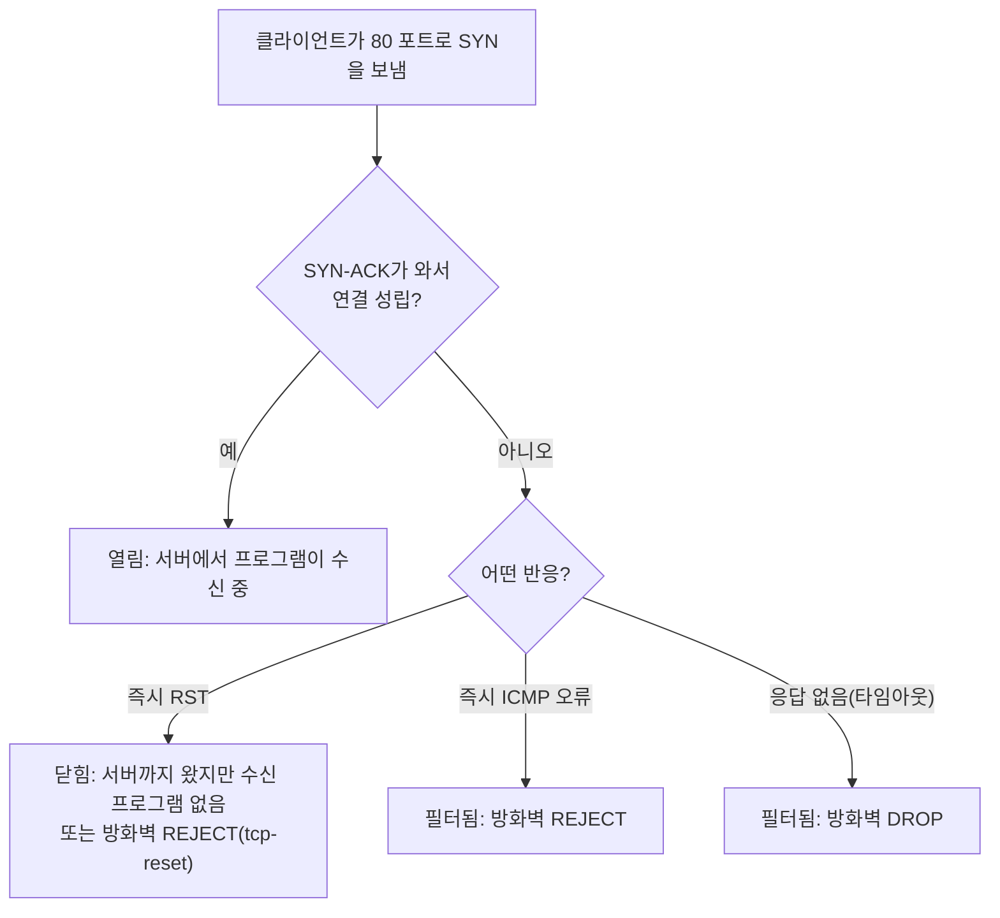

> 비교용 재작성본: `2026-11-05-port-firewall-vs-service.md`와 사실·출처는 같고 문장을 새 말투 규칙으로 다시 썼다. 마음에 드는 쪽 하나만 남긴다.
> 발행 전 확인: ① "직접 해본 결과"가 비어 있음(`[직접 작성]`). ② 예제 기준 버전을 실제로 쓰는 OS와 도구 버전으로 채운다(`ping -V`, `tcpdump --version`, `iptables --version`). nc는 배포판마다 구현이 달라 옵션이 다를 수 있다. ③ 원래 메모의 "81 포트"가 80과 어떤 관계였는지(리스너 포트인지 서버의 대상 포트인지) 몰라서, 글에서는 443과 80만 예시로 썼다. ④ "받는 쪽 방화벽이 DROP해도 tcpdump에는 SYN이 보인다"는 내용은 아직 직접 확인 전이다. ⑤ `iptables -A … -j DROP/REJECT` 규칙 예제는 원래 노트에 없던 것을 이번에 추가했다(노트의 "보강 제안"에 기록함). 문법을 [iptables REJECT 문서](https://rlworkman.net/howtos/iptables/chunkyhtml/x4571.html)와 한 번 대조한다.

# 포트에 연결이 안 될 때 서비스 문제인지 방화벽 문제인지 가르는 법

## 요약
- 포트(한 서버 안에서 어느 프로그램과 통신할지 구분하는 번호)에 연결을 시도하면 결과는 열림·닫힘·필터됨 셋 중 하나다. 즉시 거부되면 서비스 쪽을, 응답 없이 타임아웃이 나면 방화벽 쪽을 먼저 의심한다.
- ping은 포트 개념이 없는 신호를 쓰기 때문에 포트별 방화벽 규칙을 확인하지 못한다. 포트 확인은 `nc -zv`로 하고, 어디서 막혔는지는 받는 쪽 `tcpdump`로 가른다.
- 중간에 L4 장비(로드밸런서)가 있으면 "클라이언트 → L4 장비"와 "L4 장비 → 서버" 두 구간을 따로 확인한다.

## 문제 상황: ping으로 방화벽을 확인하면 되는 거 아닌가?
L4 장비를 앞에 둔 서비스에서 443 포트로는 연결이 되는데 80이나 81 포트로는 연결이 안 되는 일이 있었다. 서비스가 죽은 건지, 방화벽이 막은 건지, 아니면 L4 장비 설정 문제인지 어디부터 봐야 할지 정리가 되지 않았다. 게다가 장비 사이의 방화벽을 확인할 때 ping을 쓰는 경우를 봤는데, 같은 일을 하는 데 `tcpdump`나 `nc -zv`를 쓰기도 해서 이 도구들이 무엇이 다른지도 궁금해졌다.

그래서 이번 포스팅에서는 연결이 안 될 때 문제가 서비스 쪽인지 방화벽 쪽인지를 가르는 기준과, 그 기준을 확인하는 도구 세 가지를 알아보자. 설명이 막연해지지 않도록 글 전체에서 예시 하나를 계속 쓰겠다. 클라이언트가 L4 장비(`<L4 주소>`)를 거쳐 웹 서버(`<서버 IP>`)에 붙는 구성이고, 443 포트는 연결되는데 80 포트는 연결되지 않는 상황이다. (회사 환경 정보는 일반화했다.)

## 원리

### 1. 왜 "연결 안 됨"을 더 잘게 나눠야 할까?
"80 포트에 연결이 안 된다"는 말만으로는 누가 무엇을 고쳐야 하는지 알 수 없다. 웹 서버 프로그램이 꺼져 있다면 서비스를 다시 띄워야 하고, 방화벽이 막고 있다면 방화벽 규칙을 열어야 하는데, 두 경우 모두 클라이언트 입장에서는 똑같이 "연결 실패"로 보이기 때문이다. 여기서 방화벽은 정해진 규칙에 따라 오가는 패킷(네트워크로 주고받는 데이터 조각)을 통과시키거나 막는 장치나 프로그램을 말한다.

다행히 연결을 시도했을 때 상대가 어떤 반응을 보이는지를 보면 두 경우를 어느 정도 구분할 수 있다. 이 반응을 읽으려면 TCP 연결이 어떻게 시작되는지부터 알아야 하니 그것부터 보자.

### 2. TCP 연결은 세 번 주고받으며 시작된다
웹 서비스는 대부분 TCP(Transmission Control Protocol)로 통신한다. TCP는 데이터를 보내기 전에 먼저 연결을 맺는 전송 방식인데, 이 연결은 세 번의 신호로 열린다. 클라이언트가 "연결하자"는 SYN을 보내면, 서버가 "좋다"는 뜻의 SYN-ACK를 돌려주고, 클라이언트가 다시 확인하는 ACK를 보내면 연결이 성립한다. 이 과정을 3-way handshake라고 부른다. 그리고 서버가 연결을 받을 수 없을 때는 SYN-ACK 대신 RST(reset), 즉 "거부한다"는 신호를 돌려준다 ([RFC 9293](https://www.rfc-editor.org/rfc/rfc9293)).

결국 클라이언트가 SYN을 보낸 뒤에 무엇이 돌아오는지, 혹은 아무것도 돌아오지 않는지가 바로 다음에 볼 포트 상태를 가르는 기준이 된다.

### 3. 포트 상태는 열림·닫힘·필터됨 셋이다
"포트가 열렸나?"라는 질문의 답은 예·아니오 둘이 아니라 셋이다. 포트 스캐너 Nmap의 문서가 이 셋을 정리해 두었는데, 우리 예시로 옮기면 다음과 같다 ([Nmap: Port Scanning Basics](https://nmap.org/man/man-port-scanning-basics.html)).

먼저 **열림**은 SYN을 보내자 SYN-ACK가 와서 연결이 성립한 경우다. 443 포트에서 웹 서버 프로그램이 연결을 기다리고(수신하고) 있다는 뜻이다. 다음으로 **닫힘**은 SYN을 보내자마자 RST가 돌아오는 경우인데, 이건 패킷이 서버까지는 도착했지만 80 포트에서 기다리는 프로그램이 없다는 뜻이다. 프로그램이 죽었거나 다른 포트에 떠 있는 것이다. 마지막으로 **필터됨**은 방화벽이 중간에 막아서 열렸는지 닫혔는지 판단할 수 없는 경우다.

필터됨은 방화벽이 패킷을 어떻게 막느냐에 따라 다시 둘로 나뉜다. 방화벽 규칙에서 패킷을 막는 동작에는 DROP과 REJECT가 있다. DROP은 패킷을 아무 응답 없이 버리는 것이라 클라이언트는 응답을 기다리다 타임아웃이 난다. 반면 REJECT는 막으면서 보낸 쪽에 오류를 돌려주는데, 기본으로는 ICMP라는 오류 메시지("이 포트에 도달할 수 없음")를 보낸다 ([iptables REJECT](https://rlworkman.net/howtos/iptables/chunkyhtml/x4571.html)). ICMP(Internet Control Message Protocol)는 네트워크에서 오류나 제어 정보를 알려 주는 메시지 형식인데, 뒤에서 볼 ping도 이 ICMP를 쓴다.

다음은 지금까지의 내용을 클라이언트가 볼 수 있는 반응 순서대로 그린 것이다.



그림에서 "닫힘" 칸에 방화벽 REJECT가 같이 들어가 있는 것이 이 글에서 가장 헷갈리기 쉬운 부분이다. REJECT는 ICMP 오류 대신 TCP의 RST를 돌려주도록 설정할 수도 있는데(`tcp-reset` 옵션), 그러면 클라이언트 입장에서는 서버가 RST를 보낸 "닫힘"과 겉모습이 똑같아진다 ([iptables REJECT](https://rlworkman.net/howtos/iptables/chunkyhtml/x4571.html)). 따라서 즉시 거부만 보고 "서비스가 죽었다"고 단정해서는 안 된다.

말로만 들으면 DROP과 REJECT가 어디에 적히는지 감이 잘 안 오니, 리눅스 방화벽 규칙을 다루는 명령인 `iptables`로 80 포트를 막는 규칙을 보자.

> 예제 기준: Linux `iptables` · 버전 확인 필요

```bash
# 80 포트로 들어오는 TCP 패킷을 응답 없이 버린다 → 클라이언트는 타임아웃
sudo iptables -A INPUT -p tcp --dport 80 -j DROP

# 80 포트로 들어오는 TCP 패킷을 막으면서 RST를 돌려준다 → 클라이언트는 "닫힘"과 똑같이 즉시 거부
sudo iptables -A INPUT -p tcp --dport 80 -j REJECT --reject-with tcp-reset
```

이 명령에서 `-A INPUT`은 서버로 들어오는 패킷에 적용할 규칙을 끝에 추가한다는 뜻이고, `-p tcp --dport 80`은 목적지 포트가 80인 TCP 패킷만 고른다는 뜻이다. 우리가 살펴본 DROP과 REJECT는 맨 뒤의 `-j`(이 패킷을 어떻게 처리할지) 자리에 들어간다. 둘 중 무엇이 실제로 쓰이는지는 문서가 분명하게 말해 주는데, 응답 없이 버리는 쪽이 훨씬 흔하다.
> "filters that simply drop probes without responding are far more common." ([Nmap: Port Scanning Basics](https://nmap.org/man/man-port-scanning-basics.html))

그래서 실무에서는 "타임아웃이면 방화벽을 먼저 의심한다"가 좋은 출발점이 된다.

### 4. L4 장비가 끼면 확인할 곳이 둘이 된다
그런데 우리 예시에서는 클라이언트와 웹 서버 사이에 L4 장비가 하나 더 있다. L4(Layer 4) 장비는 로드밸런서, 즉 들어오는 요청을 여러 서버로 나눠 주는 장비인데, 네트워크 계층 중 4계층(전송 계층)에서 일한다. 쉽게 말하면 패킷의 내용은 보지 않고 프로토콜(TCP·UDP)과 포트 번호만 보고 어느 서버로 보낼지 정하는 장비다.

이 장비에는 포트가 두 종류 있다. 클라이언트가 붙는 L4 장비 쪽 포트를 **리스너 포트**, L4 장비가 요청을 넘겨주는 실제 서버 쪽 포트를 **대상 포트**라고 한다. 그리고 L4 장비는 서버들이 살아 있는지 주기적으로 확인하는 헬스 체크를 해서, 통과한 서버로만 요청을 보낸다. 대표적인 L4 로드밸런서인 AWS NLB(Network Load Balancer) 문서가 이 구조를 그대로 설명하고 있다 ([AWS: Network Load Balancer](https://docs.aws.amazon.com/elasticloadbalancing/latest/network/introduction.html)).

따라서 443은 되는데 80은 안 되는 식의 차이가 보이면, 문제가 어느 구간에서 생겼는지부터 나눠야 한다. 다음 그림처럼 구간마다 앞에서 본 열림·닫힘·필터됨 판단을 따로 하면 된다.


구간 1에서 막혔다면 클라이언트와 L4 장비 사이의 방화벽을 봐야 하고, 구간 2에서 막혔다면 웹 서버의 대상 포트에 프로그램이 떠 있는지, 그리고 그 서버가 헬스 체크를 통과하고 있는지를 봐야 한다.

## 확인 도구: ping, nc, tcpdump는 무엇이 다를까?
지금까지 판단 기준을 알아봤으니, 이제 그 기준을 실제로 확인하는 도구를 보자. 처음에 궁금했던 ping과 `nc -zv`, `tcpdump`의 차이는 한 줄로 정리하면 "보는 층과 보는 위치가 다르다"는 것이다. 다음 표가 세 도구를 나란히 놓은 것이다.

| 도구 | 보내는 것 | 알 수 있는 것 | 알 수 없는 것 |
| --- | --- | --- | --- |
| `ping` | ICMP 에코 요청 | 상대 서버까지 IP 수준에서 왕복이 되는가 | 특정 TCP 포트가 열렸는가 |
| `nc -zv` | 대상 포트로 TCP 연결 시도 | 열림 / 즉시 거부 / 타임아웃 (보내는 쪽에서 본 결과) | 패킷이 어디서 사라졌는가 |
| `tcpdump` | 아무것도 안 보냄(관찰만) | 이 지점에 SYN이 왔는가, 응답이 나갔는가 | 이 지점 밖에서 일어난 일 |

### ping은 왜 포트 방화벽을 확인하지 못할까?
ping은 상대에게 ICMP 에코 요청을 보내고 에코 응답이 돌아오는지를 본다 ([ping(8)](https://www.man7.org/linux/man-pages/man8/ping.8%40%40iputils.html)). 참고로 ping이라는 이름은 무엇의 약자가 아니라, 만든 사람이 잠수함 소나(sonar)가 내는 "핑" 소리에서 따왔다고 직접 밝혔다 ([The Story of the PING Program](https://wpollock.com/Networking/ping.html)).

문제는 이 ICMP 에코 메시지에 포트를 적는 칸 자체가 없다는 점이다 ([RFC 792](https://www.rfc-editor.org/rfc/rfc792)). 따라서 ping이 성공해도 "80 포트 방화벽 규칙이 열려 있다"는 뜻이 되지 않는다. 반대로 ping에 응답이 없다고 해서 서버가 죽었다고 볼 수도 없는데, 많은 서버와 방화벽이 ICMP만 따로 막아 두기 때문이다 ([Nmap: Host Discovery Techniques](https://nmap.org/book/host-discovery-techniques.html)). 결국 ping은 "IP로 저기까지 닿기는 하는가"를 볼 때만 쓰고, 포트 확인에는 다른 도구가 필요하다.

> 예제 기준: Linux, iputils `ping` · 버전 확인 필요

```bash
ping -c 3 -W 2 <서버 IP>
```

`-c 3`은 요청을 세 번만 보내고 끝내라는 뜻이고, `-W 2`는 응답을 2초까지만 기다리라는 뜻이다.

### nc -zv로 실제 포트에 연결해 본다
그래서 포트를 확인할 때는 `nc`(netcat)를 쓴다. nc는 TCP나 UDP로 원하는 곳에 연결하거나 연결을 기다리는 범용 도구인데 ([nc(1)](https://linux.die.net/man/1/nc)), ping과 달리 실제로 그 포트에 TCP 연결을 시도하기 때문에 앞에서 본 열림·닫힘·필터됨을 직접 확인할 수 있다.

> 예제 기준: Linux, netcat(`nc`) · 버전 확인 필요 (배포판마다 nc 구현이 달라 옵션이 다를 수 있다)

```bash
nc -zv -w 3 <L4 주소> 443   # 예시에서는 연결 성립 → 열림
nc -zv -w 3 <L4 주소> 80    # 즉시 거부인가, 타임아웃인가?
```

`-z`는 데이터를 보내지 않고 그 포트에서 누군가 기다리고 있는지만 확인하라는 옵션이고, `-v`는 결과를 자세히 출력하라는 옵션, `-w 3`은 3초 동안 응답이 없으면 포기하라는 옵션이다. 결과는 앞의 그림대로 읽으면 된다. 연결이 성립하면 열림, 즉시 거부되면 닫힘(또는 REJECT tcp-reset), 3초가 지나도록 응답이 없으면 DROP일 가능성이 높다. 다만 UDP 포트는 nc로 판단하기 어렵다. UDP는 연결을 맺는 절차가 없어서 nc로 확인하면 항상 열렸다고 나오기 때문이다 ([nc(1)](https://linux.die.net/man/1/nc)).

### 타임아웃이면 tcpdump로 막힌 위치를 가른다
하지만 nc가 타임아웃을 보여 줘도, 그 SYN이 중간 장비에서 사라졌는지 웹 서버까지 갔다가 버려졌는지는 알 수 없다. 이걸 가르는 도구가 `tcpdump`다. tcpdump는 아무것도 보내지 않고, 서버의 네트워크 인터페이스(서버가 네트워크에 연결된 지점, 랜카드라고 생각하면 된다)를 지나가는 패킷을 그대로 보여 준다 ([tcpdump(8)](https://manpages.debian.org/unstable/tcpdump/tcpdump.8.en.html)).

> 예제 기준: Linux `tcpdump` · 버전 확인 필요

```bash
# 웹 서버에서 실행: 80 포트로 오가는 TCP 패킷만 본다
sudo tcpdump -i any -n 'tcp port 80'
```

`-i any`는 모든 네트워크 인터페이스를 보라는 뜻이고, `-n`은 IP와 포트를 이름으로 바꾸지 말고 숫자 그대로 보여 달라는 뜻이다. 따옴표 안의 `tcp port 80`은 볼 패킷을 고르는 조건인데, 이 문법을 pcap 필터 표현식이라고 부른다 ([pcap-filter(7)](https://man.netbsd.org/pcap-filter.7)). 인터페이스를 직접 읽어야 하므로 보통 관리자 권한(`sudo`)이 필요하다.

출력에서는 각 줄의 `Flags [...]` 부분을 보면 된다. `[S]`는 SYN, `[S.]`는 SYN-ACK, `[R]`은 RST, `.`은 ACK다 ([tcpdump(8)](https://manpages.debian.org/unstable/tcpdump/tcpdump.8.en.html)). 그리고 중요한 점이 하나 있는데, 들어오는 패킷은 방화벽 규칙이 적용되기 전에 tcpdump로 복사된다 (리눅스 방화벽을 만든 Rusty Russell의 설명, [LKML 2001](https://lkml.iu.edu/hypermail/linux/kernel/0110.3/1180.html)). 그래서 웹 서버에서 `[S]`가 보이면 적어도 SYN은 웹 서버까지 왔다는 근거가 되고, 웹 서버 자체 방화벽이 그 SYN을 버리는 경우에도 SYN은 보일 수 있다.

## 해결: nc와 tcpdump를 같이 켜고 결과를 맞춰 본다
이제 도구를 조합해 보자. 클라이언트에서 `nc -zv <L4 주소> 80`이 타임아웃이 났다면, 웹 서버에서 tcpdump를 켜 둔 채로 클라이언트에서 nc를 다시 실행하고 두 결과를 짝지어 읽으면 된다. 다음은 웹 서버의 tcpdump에 보이는 모양별로 어디를 의심해야 하는지 정리한 것이다.

| 웹 서버 tcpdump에 보이는 것 | 해석 |
| --- | --- |
| `[S]`가 안 보임 | 중간(방화벽, L4 장비, 경로)에서 막힘. 웹 서버 문제가 아니다 |
| `[S]`는 보이는데 응답이 안 나감 | 웹 서버 자체 방화벽이 DROP하고 있을 가능성 |
| `[S]`가 보이고 `[R]`이 나감 | 패킷은 도착했지만 80 포트에 수신 프로그램이 없음(닫힘) |
| `[S]`가 보이고 `[S.]`도 나갔는데 클라이언트는 타임아웃 | 돌아가는 길에서 막힘 |

마지막 줄은 조금 더 설명이 필요하다. 요즘 방화벽은 대부분 상태 기반 방화벽인데, 이건 연결마다 오간 패킷을 기억해 두었다가 이미 시작된 연결의 응답만 통과시키는 방화벽이다 ([iptables conntrack 모듈 man](https://googlers.googlesource.com/maze/iptables/+/next/extensions/libxt_conntrack.man)). 그런데 가는 패킷과 돌아오는 패킷이 서로 다른 장비를 지나가면, 돌아오는 쪽 장비는 이 연결의 시작(SYN)을 본 적이 없으니 SYN-ACK를 "모르는 연결"로 여기고 막을 수 있다. 그래서 웹 서버가 `[S.]`를 분명히 보냈는데 클라이언트가 받지 못했다면, 응답이 지나가는 경로와 그 경로의 방화벽을 확인해야 한다.

## 직접 해본 결과
[직접 작성] 아래를 실제 환경에서 해 보고, 결과를 회사 정보 없이 적는다(IP·호스트명은 `<호스트 IP>`처럼 바꾼다).

> 예제 기준: Linux, netcat(`nc`), `ss`, `iptables`/`firewalld`, `tcpdump` · 버전 확인 필요

- 클라이언트: `nc -zv <L4 주소> 443`, `nc -zv <L4 주소> 80`의 결과가 성립 / 즉시 거부 / 타임아웃 중 무엇인지
- 웹 서버: `ss -ltnp`로 어느 포트에 프로그램이 떠 있는지 (`ss`는 소켓 상태를 보여 주는 도구 · `-l` 연결을 기다리는 소켓만 · `-t` TCP만 · `-n` 포트를 숫자로 · `-p` 그 소켓을 쓰는 프로세스까지, [ss(8)](https://manpages.ubuntu.com/manpages/xenial/man8/ss.8.html))
- 웹 서버 방화벽: `sudo iptables -L -n` 또는 `sudo firewall-cmd --list-all`로 80 포트에 DROP·REJECT 규칙이 있는지 (`-L` 규칙 목록 · `-n` 숫자로 표시, [RHEL: iptables 나열 옵션](https://docs.redhat.com/en/documentation/red_hat_enterprise_linux/5/html/deployment_guide/s2-iptables-options-list) · `--list-all` 현재 영역의 규칙 전부, [firewall-cmd(1)](https://www.mankier.com/1/firewall-cmd))
- 웹 서버에서 `sudo tcpdump -i any -n 'tcp port 80'`을 켜 둔 채 클라이언트에서 nc를 실행했을 때 `[S]`가 보이는지, `[S.]`와 `[R]` 중 무엇이 나가는지

## 함정과 주의점
- 즉시 거부라고 서비스 문제로 단정하지 않는다. REJECT를 `tcp-reset`으로 두면 닫힘과 똑같이 보인다.
- ping 성공은 포트가 열렸다는 뜻이 아니고, ping 실패는 서버가 죽었다는 뜻이 아니다.
- L4 장비가 있으면 "포트가 안 된다"는 말이 리스너 포트 얘기인지 대상 포트 얘기인지부터 확인한다.
- UDP 포트는 nc 결과로 판단하지 않는다.

## 마무리
지금까지 포트 연결 결과가 열림·닫힘·필터됨 셋으로 나뉘고 그 반응으로 서비스 문제와 방화벽 문제를 가를 수 있다는 것, L4 장비가 끼면 확인할 구간이 둘이 된다는 것, 그리고 ping·nc·tcpdump가 각각 무엇을 보여 주고 어떻게 함께 쓰는지를 알아보았다. 한 가지만 기억한다면, ping은 포트를 보지 못하므로 포트 문제는 nc로 증상을 보고 tcpdump로 위치를 가른다는 점이다. 다음에는 이 글에서 이름만 나온 개념들을 이어서 정리해 볼 생각이다.
- 헬스 체크: L4 장비가 서버를 언제 빼고 다시 넣는지
- SNAT와 DSR: 웹 서버의 응답이 L4 장비를 거쳐 돌아오는지, 클라이언트로 바로 가는지
- 상태 기반 방화벽: 연결 상태를 어떻게 추적하고, 경로가 엇갈리면 왜 응답을 막는지

## 참고 자료
- [Nmap: Port Scanning Basics](https://nmap.org/man/man-port-scanning-basics.html)
- [Nmap: Host Discovery Techniques](https://nmap.org/book/host-discovery-techniques.html)
- [iptables REJECT](https://rlworkman.net/howtos/iptables/chunkyhtml/x4571.html)
- [AWS: Network Load Balancer](https://docs.aws.amazon.com/elasticloadbalancing/latest/network/introduction.html)
- [RFC 792 (ICMP)](https://www.rfc-editor.org/rfc/rfc792) · [RFC 9293 (TCP)](https://www.rfc-editor.org/rfc/rfc9293)
- [ping(8)](https://www.man7.org/linux/man-pages/man8/ping.8%40%40iputils.html) · [nc(1)](https://linux.die.net/man/1/nc) · [tcpdump(8)](https://manpages.debian.org/unstable/tcpdump/tcpdump.8.en.html) · [pcap-filter(7)](https://man.netbsd.org/pcap-filter.7) · [ss(8)](https://manpages.ubuntu.com/manpages/xenial/man8/ss.8.html) · [firewall-cmd(1)](https://www.mankier.com/1/firewall-cmd)
- [RHEL: iptables 나열 옵션](https://docs.redhat.com/en/documentation/red_hat_enterprise_linux/5/html/deployment_guide/s2-iptables-options-list)
- [The Story of the PING Program](https://wpollock.com/Networking/ping.html)
- [iptables conntrack 모듈 man](https://googlers.googlesource.com/maze/iptables/+/next/extensions/libxt_conntrack.man)
- [LKML 2001: tcpdump와 netfilter 처리 순서](https://lkml.iu.edu/hypermail/linux/kernel/0110.3/1180.html)

---
작성일: 2026-11-17 · 버전: 초안(재작성본) · 수정 이력: 2026-11-05 초안을 새 말투 규칙으로 다시 씀
