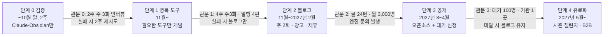

> **2026-11-01 변경**: 복습은 Spaced Repetition 대신 볼트 전용 플러그인 `til-review`(빈칸 입력 + 다음 복습일 직접 선택)로, 상태 흐름은 `draft → (reviewed) → blog → drafted → published`로 바꿨다. 아래 본문과 다르면 `CLAUDE.md`와 `docs/볼트 폴더 운영 가이드.md`가 기준이다.

> Claude Docs 원본을 마크다운으로 옮긴 사본이다. 원본이 바뀌면 이 파일은 자동으로 갱신되지 않는다.

# TIL 엔진 중심 학습 시스템 & 사이드 수익화 로드맵

2026-10-23 · @th

## 목표와 원칙

**업무 중 배운 걸 한 번 던지면 복습 카드, 다이어그램이 들어간 기술 블로그 글, 지식 맵이 함께 나오는 개발자용 "TIL 엔진"을 만들고, 그 엔진을 블로그 → 오픈소스 → 시즌 챌린지·교육 B2B 순으로 수익화한다.** 이 문서는 [개발 학습 기록 엔진 기획서 (B안)](https://claude.ai/artifact/L6NCf9d2dKdb7Xjfdwnhn2)을 기준으로 Claude 세팅과 수익화 단계를 하나의 실행 순서로 합친 것이다. 개발 외 주제는 별도 탭에서 다룬다.

개발 외 주제의 발행·복습 프로세스: [[TIL 엔진 로드맵 - 개발 외 주제 블로그|개발 외 주제 블로그]]

**차별점: 입력이 아니라 발행과 지속을 돕는다.** 블로그 습관이 끊기는 지점은 "적기"보다 "초안을 발행하기"와 "보상 없는 초반 몇 달 버티기"다. 키워드 한 줄 입력은 시작일 뿐이고, 발행 기준 낮추기, 내 말투로 쓴 초안, 지식 맵 기반 독려가 핵심 기능이다.

**6개월 목표**

- 본인이 주 3회 이상 실제로 사용 (가장 중요한 지표)
- 블로그 글 40편 이상, 월 방문자 3,000명
- 습관 지표 3개를 단계 0부터 기록: 기록 → 발행 전환율, 기록부터 발행까지 일수, 주간 유지율
- 외부 사용자 대기 신청 100명 이상이면 제품화 진입
- 추가 운영 비용 월 3만 원 한도 (기존 Claude 구독료 제외). 한도에 맞춰 처리 방식을 바꾼다

**원칙**

- **입력은 "대답"이면 된다**: 키워드 한 줄이나 Claude 인터뷰에 대충 대답하면, 정리는 Claude가 한다.
- **원본은 내가 소유**: 원본은 비공개 GitHub 저장소 til-vault 하나(Obsidian 볼트 = 마크다운 + Git)다. 개인 기기와 Claude(대화·Claude Code·예약 작업)는 모두 이 저장소를 clone해서 같은 볼트로 작업한다. Claude는 대화가 끝나면 잊고, 기억은 볼트가 맡는다.
- **사람이 검수한 것만 나간다**: `status: reviewed` 전에는 아무것도 발행하지 않는다.
- **회사 정보는 두 층으로 막는다**: 회사 PC 내용을 개인 PC로 옮기지 않고 집에서 일반화해 다시 쓴다. `sensitivity: internal`은 발행 금지, 금칙어 검사 통과 필수.
- **필요할 때만 개발한다**: Claude가 판단할 일(정리·연결·초안)은 Claude에게, 매번 정확해야 할 일(금칙어·문법 검사·그래프 계산)은 병목이 보일 때 코드로 만든다.
- **양이 아니라 이해와 공개를 보상한다**: 독려 장치는 글 개수가 아니라 개념 해금, 약점 공략, 발행에 점수를 준다.
- **관문을 못 넘으면 멈춘다**: 어느 단계에서 멈춰도 도구, 글, 습관은 남는다.

## 로드맵 한눈에 보기


*관문 네 개를 넘을 때만 다음 단계로 간다.*

기획서의 4단계 앞에 Claude만으로 흐름을 확인하는 단계 0을 둔다. 일정은 퇴근 후 주 5~8시간 투입을 가정한 추정치다.

## 시스템 구조와 역할 분담

**나는 던지고 검수만, 정리·연결·카드·초안·독려는 Claude(예약 작업 포함), 보관과 복습 일정은 Obsidian, 변경 이력은 Git이 맡는다.** 예약 작업은 볼트에 직접 쓰되, 쓸 수 있는 범위를 규칙으로 좁혀 Obsidian과 충돌하지 않게 한다.

| 역할 | 맡는 일 | 도구 |
| --- | --- | --- |
| 나 | 키워드 던지기, 인터뷰 대답, 검수, 경험담 직접 쓰기 | 개인 PC, 폰 |
| Claude (대화) | 인터뷰, 즉석 정리, 블로그 초안 | Claude 앱, Claude Code |
| Claude (예약 작업) | 주말 inbox 정리, 주간 퀘스트·리포트, 말투 가이드 갱신, 보스 개념 표시 → 볼트에 커밋 | 클라우드 예약 작업 + 비공개 GitHub |
| Obsidian | 노트 편집, 복습 카드 일정, 지식 지도·스킬 트리·퀘스트 보드 보기 | 기본 기능 + 플러그인 3개 (아래) |
| Git | 원본 보관, 되돌리기, 모든 기기·Claude 세션 사이 동기화 (동기화 수단은 Git 하나) | 비공개 GitHub, Obsidian Git |
| 블로그 | 발행 | Astro 정적 사이트 + GitHub Pages |

### Obsidian 구성

| 구분 | 이름 | 쓰는 곳 |
| --- | --- | --- |
| 기본 기능 | 그래프 뷰 + 색상 그룹 | 지식 지도. 검색 쿼리로 상태별 색을 입혀 안 간 영역(`draft`)은 회색, 정리됨(`reviewed`)은 색, 발행(`published`)은 강조, `#boss`는 빨강 |
| 기본 기능 | Bases | 퀘스트 보드, 보스 목록, 글감 창고, 지표 표. 속성 기반 표와 필터 (Dataview 대신) |
| 기본 기능 | Canvas | 시즌 회고용 지도 (선택) |
| 플러그인 | Spaced Repetition | 복습 카드와 일정 (복습 일정은 여기서만 관리) |
| 플러그인 | Obsidian Git | 주기적 커밋과 pull. 예약 작업이 쓴 변경을 받아옴 |
| 플러그인 | Breadcrumbs | `prerequisite` 같은 타입 있는 관계를 트리로 보여줌 → 스킬 트리 |

Bases로 안 되는 복잡한 질의가 생길 때만 Dataview를 추가한다. Breadcrumbs 최신 버전은 Obsidian 1.13 이상이 필요하다.

### 지식 지도의 범위

**지도는 "모든 지식"이 아니라 "내가 발을 들인 곳에서 한 걸음"까지만 그린다.** 회색은 모르는 지식이 아니라 적어 두고 아직 정리하지 않은 것이다.

| 상태 | 의미 | 그래프 색 |
| --- | --- | --- |
| 링크만 있음 (파일 없음) | 안개. 정리 중 언급만 된 바로 옆 개념 (그래프 뷰 "존재하는 파일만" 필터를 끄면 보임) | 흐린 점 (기본) |
| `unexplored` | 이번 시즌 목표 영역의 씨앗 | 연한 회색 |
| `draft` | 적었지만 미검수 | 회색 |
| `reviewed` | 정리 완료 | 색 |
| `published` | 글로 공개 | 강조색 |
| `#boss` | 자꾸 틀리는 개념 | 빨강 |

- **시즌 지도**: 시즌(8주)마다 업무와 겹치는 영역 1~2개(예: RabbitMQ 운영, PostgreSQL 고가용성)를 고르면, Claude가 공식 문서 목차를 기준으로 개념 15~30개를 `unexplored` 빈 노트로 깐다. 요청할 때만 심는다.
- **상한**: 영역당 30개, 전체 `unexplored` 100개. 한 시즌 동안 활동이 없는 씨앗은 시즌 회고 때 `archive/`로 옮긴다.
- **보는 방법**: 평소에는 로컬 그래프(현재 노트 기준 1~2단계)와 영역 필터(`tag:#rabbitmq` 등). 전체 그래프는 시즌 회고 때만 본다.
- **진행률**: 전체 지식 대비가 아니라 "이번 시즌 씨앗 중 색이 된 비율"로 표시한다.

### 볼트 구조

```
vault/
├── CLAUDE.md          ← 정리·인터뷰·예약 작업 쓰기 규칙
├── index.md           ← 개념 목록과 한 줄 요약 (토큰 절약용)
├── style-guide.md     ← 말투 가이드 (처음엔 예시 글 2편, 이후 발행본에서 매달 자동 갱신)
├── 00-inbox/          ← 날것의 메모, 인터뷰 결과
├── 10-concepts/       ← 개념 노트 (개념 1개 = 노트 1개, 시즌 씨앗 포함)
├── 20-posts/
│   ├── drafts/        ← 블로그 초안
│   └── published/     ← 발행본 (말투 학습 데이터, 발행 스크립트가 Astro로 복사)
├── 30-ideas/          ← 글감 창고 (항상 5개 이상 유지)
├── 90-daily/          ← 데일리 노트, 주간 퀘스트, 주간 리포트
├── dashboards/        ← .base 파일 (퀘스트, 보스, 시즌 진행률, 지표)
├── archive/           ← 4주 지난 미정리 메모, 활동 없는 씨앗 (검색은 됨)
└── life/              ← 개발 외 주제 (별도 탭 참고)
```

### 여러 기기에서 같은 볼트

**원본은 비공개 GitHub 저장소 ****[THproger13/til-vault](https://github.com/THproger13/til-vault)**** (****`main`**** 브랜치) 하나다. 어느 기기든 clone해서 쓰고, Claude는 특정 PC가 아니라 이 저장소로 접근하므로 PC가 꺼져 있어도 작업이 돈다.** 규칙 원문은 볼트의 `CLAUDE.md` "어느 기기에서든 같은 볼트" 섹션에 있다.

| 누가 | 접근 방법 | 동기화 |
| --- | --- | --- |
| 맥북 (개인) | `~/Documents/til-vault` + Obsidian Git | 앱 열 때 pull, 10분마다 커밋·푸시·pull |
| 다른 개인 PC | clone 후 Obsidian으로 열기 | 맥북과 같음 (플러그인·설정이 저장소에 포함) |
| Claude 대화·Claude Code | GitHub 저장소를 세션에 붙여 clone | pull → 작업 → `[claude]` 커밋 → push |
| Claude 예약 작업 | 클라우드에서 저장소 clone | 위와 같음, 충돌 시 쓰지 않고 리포트 |

- 동기화 수단은 Git 하나. Obsidian Sync, iCloud, OneDrive, Dropbox 폴더 안에 볼트를 두지 않는다.
- `.gitattributes`로 줄바꿈을 LF로 고정하고, 한글 파일명은 NFC로 맞춘다. 파일 이름에 윈도우에서 못 쓰는 문자를 쓰지 않는다.
- 기기별 화면 상태(`.obsidian/workspace*.json`)만 제외하고 플러그인·설정은 동기화한다.
- 같은 노트에서 충돌이 나면 사람 쪽 변경을 남긴다.

**새 기기 추가 (기기마다 1회, 10분)**

1. Git 설치 (윈도우: Git for Windows, 줄바꿈 옵션 "Checkout as-is, commit as-is")
2. OneDrive 동기화 폴더가 아닌 곳에 clone (예: `C:\til-vault`), `git config core.quotepath false`, `git config core.autocrlf false`
3. Obsidian → "Open folder as vault" → "플러그인 신뢰"
4. 첫 push 때 GitHub 로그인 한 번 (맥은 `gh auth login`, 윈도우는 Git Credential Manager)

미정: 회사 업무용 PC를 이 볼트를 쓰는 기기에 넣을지. 넣으면 "회사 PC에는 아무것도 적지 않음" 원칙과 부딪히므로, 정한 뒤 원칙과 쓰기 범위를 함께 고친다.

### 노트 형식

```markdown
---
title: RabbitMQ prefetch
tags: [rabbitmq, messaging, flashcards]
status: draft          # unexplored → draft → reviewed → published
sensitivity: public    # public | internal (internal은 발행 금지)
post_format: none      # none(기본, 복습·지도용) | short | long — 글 후보로 뽑힐 때만 바뀜
cards: true            # 외울 가치가 없는 단순 사실은 false
prerequisite: ["[[메시지 큐]]", "[[RabbitMQ ack 모드]]"]
part_of: ["[[RabbitMQ 메시지 흐름]]"]   # 다이어그램은 이 부모 노트에 둠
compared_with: []
captured_at: 2026-10-20  # 습관 지표 계산용
published_at:            # 발행 스크립트가 채움
generated_at: 2026-10-24
---

## 원본 메모
(내가 쓴 대답 그대로, 수정 금지. 블로그 경험 문단의 뼈대)

## 다이어그램
(부모 노트 또는 글 후보 노트에만 Mermaid 필수)

## 복습 카드
prefetch 값이 너무 크면 생기는 문제는?::한 컨슈머에 메시지가 몰려 부하가 쏠린다
```

### CLAUDE.md 핵심 규칙

- 매번 `CLAUDE.md`, `index.md`부터 읽고, 볼트 전체를 읽지 않는다. inbox와 필요한 노트만 연다.
- 관계는 YAML 속성에만 쓰고 링크는 따옴표로 감싼다. 본문의 `::`는 복습 카드 전용이다.
- 복습 카드는 추가만 한다. 기존 카드 줄과 `<!--SR:...-->` 주석은 절대 고치지 않는다. 확신이 낮은 카드에는 `#check` 태그를 달아 검수 때 먼저 보게 한다.
- 다이어그램은 개념마다가 아니라 `part_of` 부모 노트에 하나씩 만든다. 글 후보로 뽑힌 노트는 개별 다이어그램 필수.
- 한 번에 inbox 최대 10개만 정리한다. 4주 지나도 정리 안 된 메모는 `archive/`로 옮긴다.
- "원본 메모"는 보존하고, 원문에 없는 내용은 지어내지 않는다. 파일 이름 변경·이동은 제안만 한다(`archive/` 이동은 예외). `.obsidian/`은 건드리지 않는다.
- **예약 작업의 쓰기 범위**: 새 파일 생성, `unexplored`·`draft` 노트 수정, `90-daily/`·`dashboards/`·`style-guide.md`·`index.md` 갱신, `#boss`·`#check` 태그, `archive/` 이동만 허용. `reviewed`·`published` 노트는 본문을 고치지 않고 맨 끝 "보강 제안" 섹션에만 쓴다.
- **충돌 방지**: 예약 작업은 내가 편집하지 않는 새벽 시간에 돌고, 시작 전 최신 상태를 받아오며, 커밋 메시지는 `[claude]`로 시작한다. 충돌이 나면 쓰지 않고 리포트에 남긴다. Obsidian Git은 앱을 열 때와 일정 간격으로 pull한다.

## Claude 세팅

**정리와 독려를 Claude 구독 안의 대화와 예약 작업으로 처리해 추가 비용을 0원에 가깝게 두고, 구독 한도에 걸릴 때만 단계별로 외부 API를 쓴다.** 스킬은 claude.ai와 Claude Code에 각각 설치한다.

**메모리와 프로젝트**

- 메모리에 설명 선호 저장: "개념 설명은 동작 원리 → 실무 장애 시나리오 → 연결 개념 순서로"
- 프로젝트 2개: **TIL 엔진** (인터뷰·정리·블로그, 지침에 익명화 원칙) / **사이드 & 커리어** (수익화 판단, 이직 준비)

**스킬 → 개인 플러그인 ****`til-kit`**

| 스킬 | 하는 일 | 사용 위치 |
| --- | --- | --- |
| `til-interview` | "오늘 뭐 배웠어?"로 시작해 고정 질문 3개(무엇이 막혔나 / 어떻게 풀었나 / 다음에 또 쓸 개념은?), 3일 공백 후에는 질문 1개짜리 30초 버전 → `00-inbox/`. 대답이 그대로 블로그 경험 문단의 뼈대가 됨 | claude.ai (폰 음성 포함) |
| `inbox-organize` | inbox 최대 10개를 개념 단위로 쪼개 `10-concepts/` 생성, 관계 속성, 부모 노트 다이어그램, 카드 3~5장(확신 낮으면 `#check`), `status: draft` | 예약 작업, Claude Code |
| `blog-pick` | 글 후보 선정 4단계 (단계 2 참고): 그래프 신호 → 직접 겪은 이야기 → 상위 5개만 웹 검색으로 한국어 글 빈틈 확인 → Search Console 실적 반영. 묶으면 글이 되는 노트 묶음도 제안 | 예약 작업 |
| `til-to-blog` | 글 후보 → 기술 블로그 템플릿(단계 2)대로 초안. 원본 메모를 경험 문단 뼈대로 쓰고, `style-guide.md`와 최근 발행본 2편을 먼저 읽음 | Claude Code |
| `style-learn` | `20-posts/published/` 최근 10편에서 문장 길이, 어미, 자주 쓰는 표현, 글 구조를 뽑아 `style-guide.md` 갱신. 발행본이 10편 미만이면 직접 고른 예시 글 2편과 섞음 | 예약 작업 (매달) |
| `quest-master` | 주간 퀘스트, 주간 리포트, 보스 표시, 습관 지표, 4주 지난 inbox 보관, 시즌 씨앗 정리 (독려 설계는 운영 리듬 섹션) | 예약 작업 |
| `seed-map` | 시즌 영역 하나에 대해 공식 문서 목차 기준으로 `unexplored` 노트 15~30개 생성 (상한 준수) | Claude Code (요청할 때만) |
| `publish-guard` | 금칙어, `internal` 차단, Mermaid 문법, 템플릿 필수 항목 확인 | Claude Code |

말투 학습은 **발행본이 곧 학습 데이터**다. 초안을 내가 고쳐서 발행하면 그 발행본이 다음 달 `style-guide.md`에 반영되므로, 따로 수정 기록을 남길 필요가 없다.

**예약 작업 (볼트에 커밋)**

| 언제 | 작업 |
| --- | --- |
| 토요일 04:41 | `inbox-organize`로 inbox 최대 10개 정리, 4주 지난 메모 보관 → 아침에 `#check` 카드만 검수 |
| 월요일 05:37 | 이번 주 퀘스트 생성, `blog-pick`으로 글 후보 2개와 노트 묶음 제안, 글감 창고 5개 유지 |
| 일요일 20:41 | 주간 리포트 (퀘스트 결과, 발행 수, 해금 개념, 시즌 진행률, 습관 지표, 다음 주 글감 3개) |
| 매달 1일 05:43 | `style-learn`, 보스 갱신, Search Console 노출·클릭 기록, 월 비용 기록 요청 |

시각은 한국 시간이고, 네 작업 모두 등록돼 있다(클라우드 실행, 자동 승인). 각 작업은 저장소의 `main`을 clone해 볼트의 스킬 절차를 따른다.

**비용 정책 (추가 비용 월 3만 원 한도)**

| 월 누적 추가 비용 | 처리 방식 |
| --- | --- |
| 기본 (API 0원) | 모든 정리·초안·예약 작업을 Claude 구독 안에서 처리 |
| 구독 한도에 자주 걸림 | 개념 추출·카드 생성 같은 단순 단계만 저가 API로 이전 |
| 1.5만 원 초과 | 블로그 초안도 저가 모델로, 고급 모델은 긴 글에만 |
| 2.5만 원 초과 | 자동 API 호출 중지, 남은 달은 Claude 구독 안에서 수동 처리 |

도메인 비용(월 약 1,500원)도 한도에 포함한다. 로컬 LLM은 남는 기기가 있을 때 비용을 줄이는 선택지일 뿐 필수가 아니다. 클라우드 GPU 서버를 직접 빌려 운영하지 않는다.

## 단계 0. Claude로 2주 검증 (10월 말까지)

**코드 없이 Claude 앱, Claude Code, 예약 작업, Obsidian 기본 기능만으로 "던지기 → 정리 → 검수 → 복습 → 발행"이 굴러가는지, 독려 장치가 실제로 효과가 있는지 확인한다.**

**1주차: 세팅**

- [ ] 사내 겸업·외부 기고 규정 확인 (블로그 시작 전 필수)
- [x] 개인 PC에 볼트 생성, 폴더 구조와 `CLAUDE.md`, `index.md` 작성, 비공개 GitHub 연결
- [x] 플러그인 3개 설치 (Spaced Repetition, Obsidian Git, Breadcrumbs), Bases 켜기
- [ ] 그래프 뷰 색상 그룹을 지도 범위 표대로 설정, "존재하는 파일만" 필터 끄기
- [x] Breadcrumbs 관계 필드에 `prerequisite`, `part_of` 등록 → 스킬 트리 확인
- [ ] 첫 시즌 영역 1개 정하고 `seed-map`으로 씨앗 심기 (예: RabbitMQ 운영)
- [x] `dashboards/`에 Bases 파일 4개: 이번 주 퀘스트, 보스 목록, 시즌 진행률, 습관 지표
- [ ] `style-guide.md`용 예시 글 2편 고르기 (내가 좋아하는 기술 블로그 문체)
- [x] `til-interview`, `inbox-organize`, `quest-master` 스킬 작성·설치, 예약 작업 4개 등록

**2주차: 루프 가동**

- [ ] 퇴근 후 인터뷰 2~3분, 주 3회 이상
- [ ] 토요일 아침 검수 5분 (정리는 새벽 예약 작업이 끝내 둠)
- [ ] 최근 다룬 주제(RabbitMQ, vLLM, PostgreSQL 복제, Redis 이벤트 루프 등)로 개념 노트 10개 이상
- [ ] 짧은 글 1편 발행 (블로그 셋업 포함)

**관문 0**: 2주간 인터뷰 주 3회 이상, 토요일 검수 2회, 짧은 글 1편 발행. 지도·퀘스트 보드를 본 날과 안 본 날의 기록 빈도도 함께 메모해 둔다. 못 넘으면 입력 방식(키워드 한 줄, 주간 몰아치기)을 바꿔 2주 재시도.

## 단계 1. 병목 도구만 만들기 (2026년 11월~)

**개인 용도로는 전체 엔진 개발이 필수가 아니다. 단계 0~1을 돌리며 실수나 시간 낭비가 반복되는 지점만 작은 도구로 만든다.** 전체 CLI 파이프라인은 관문 2에서 "그 도구 나도 쓰고 싶다"는 문의가 왔을 때 단계 3에서 만든다.

| 이런 증상이 보이면 | 만들 것 | 크기 |
| --- | --- | --- |
| **발행 2편째부터 볼트 → 블로그 옮기기가 귀찮다 (거의 확실히 첫 번째로 옴)** | 발행 스크립트: `published/` 글을 Astro로 복사하며 `[[위키링크]]` 변환, Mermaid 렌더링 설정, 원본 개념 노트의 `status`·`published_at` 갱신 | 1일 |
| Claude가 금칙어나 `internal` 노트를 가끔 놓친다 | 발행 전 금칙어·민감도 검사 (발행 스크립트에 포함) | 반나절 |
| Mermaid가 자주 깨져 검수 시간이 길다 | `mermaid-cli` 문법 검사 + 실패 목록 | 반나절 |
| 노트 50개 이상에서 약점 역추적·글 없는 허브 개념 계산이 부정확하다 | 속성을 읽어 그래프 지표를 뽑는 스크립트 (학습 순서, 약점 전파, 중심성, 고립 개념, 시즌 진행률) | 1~2일 |
| 습관 지표를 Claude가 매번 다르게 센다 | `captured_at`·`published_at`으로 지표를 계산하는 스크립트 | 반나절 |
| Claude 구독 한도에 자주 걸린다 | Spring AI로 단계별 저가 API 호출 (비용 정책에 맞춰 모델 전환) | 1~2주 |

**관문 1**: 4주간 주 3회 이상 사용, 발행 4편 이상. 못 넘으면 도구를 더 만들지 않고 블로그 발행만 유지한다.

포트폴리오 목적으로 Spring AI 파이프라인을 먼저 만들고 싶다면 가능하다. 다만 "필요해서"가 아니라 "학습 목적"으로 표시하고, 그 기간에도 주 1편 발행은 지킨다. 그래프 경험은 그래프 DB 운영이 아니라 추천·탐지 규칙에 쓰고, 알고리즘 실험만 로컬 Neo4j에서 한다.

## 단계 2. 기술 블로그 검증과 첫 수익 (2026년 11월~2027년 2월)

**좋은 기술 블로그의 공통 구조를 템플릿으로 고정하고, 짧은 글을 기본으로 주 2회 발행해 광고·제휴 수익과 엔진 수요를 확인한다.** 글 하나에 1시간 이내가 목표다.

**기술 블로그 템플릿 (****`til-to-blog`****가 이 순서로 초안을 쓴다)**

1. **검색 의도가 드러나는 제목**: 문제나 키워드 중심 ("RabbitMQ 컨슈머 한 대에만 메시지가 몰릴 때")
2. **요약 3줄**: 결론부터
3. **문제 상황**: 재현 가능한 맥락, 사용 버전, 증상 (회사 정보는 일반화)
4. **원리와 도표 (필수)**: 왜 그런 일이 생기는지 Mermaid 그림과 함께
5. **해결과 선택지 비교**: 대안별 장단점과 트레이드오프
6. **직접 해본 결과**: 수치나 로그 형태 (직접 쓰는 부분)
7. **함정과 주의점**
8. **참고 자료**: 공식 문서 우선
9. **작성일과 버전, 수정 이력**

**짧은 글 최소 기준** (애드센스 저품질 판정 방지): 도표 1개, 직접 쓴 경험 문단 1개 이상, 공식 출처 1개. 이 셋을 못 채우면 발행하지 않고 다음 짧은 글과 묶는다. 짧은 글 3~4편이 쌓이면 긴 글로 합친다.

**경험 문단 쓰는 법**: 템플릿 6번 "직접 해본 결과"는 Claude가 원본 메모(인터뷰 대답)를 뼈대로 초안을 깔고, 나는 다듬기만 한다. 경험은 겪은 날 밤 인터뷰에서 이미 기록되므로 열흘 뒤 기억을 되살릴 필요가 없다.

**글 후보 선정 (****`blog-pick`****, 매주 월요일)**

1. **그래프 신호로 1차 후보 5개**: 연결이 많은 개념, 보스였다가 해제된 개념, 묶으면 긴 글이 되는 노트 3~4개
2. **직접 겪은 이야기가 있는지**: 원본 메모에 실제 상황이 있는 것 우선
3. **상위 5개만 웹 검색**: 이미 한국어 글이 충분한 주제는 뒤로. Claude는 실제 검색량을 모르므로 "빈틈" 추정까지만 한다
4. **발행 후 실제 데이터로 보정**: Search Console 노출·클릭을 월간 리포트에 넣어 어떤 유형이 실제로 검색되는지 반영. 몇 달 쌓이면 이 신호가 가장 정확하다

뽑힌 노트만 `post_format`이 `short`나 `long`으로 바뀐다. 나머지는 복습·지도용으로 남고, 그게 정상이다.

**발행 체크리스트** (열린 수정 대신 이것만 하면 발행)

- [ ] 실제 상황 2문단 직접 쓰기
- [ ] 도표가 맞는지 확인
- [ ] `publish-guard` 통과

**콘텐츠**: 시리즈 "망분리 환경 백엔드 운영기" (RabbitMQ, PostgreSQL 복제, vLLM 온프레미스, 망분리 모니터링)와 "TIL 엔진 만들기" (단계 3 오픈소스의 유입 채널). Google Search Console과 네이버 서치어드바이저에 등록한다.

**수익 장치 (금액은 기획서 추정치)**

| 수익원 | 시작 조건 | 기대치 |
| --- | --- | --- |
| 애드센스 | 글 20편 이상 | 월 방문 3,000명 기준 월 몇천~1만 원대 |
| 도서·강의 제휴 | 월 방문 5,000명 이상 | 광고와 비슷하거나 더 큼 |

제휴 링크가 있는 글에는 대가를 받는다는 문구를 표시한다 (공정위 추천·보증 지침).

**관문 2**: 글 24편, 월 방문 3,000명, 엔진 자체에 대한 문의 발생. 개발 외 주제 블로그는 관문 1 통과 후 별도 탭 기준으로 진행한다.

## 단계 3~4. 공개, 유료화, 확장

**개인 구독만으로는 약하다. 습관 도구는 실패한 사람이 해지하고 성공한 사람은 도구 없이도 쓰게 되기 때문이다. 그래서 돈은 "도구"가 아니라 "완주"에 받는다: 시즌 챌린지와 교육 기관 B2B가 주력, 개인 구독은 보조.** 6개월 사용 기록과 발행 글 자체가 가장 강한 마케팅 근거다.

**단계 3. 공개 (2027년 3~4월)**

- [ ] 단계 1에서 만든 도구 + CLI 파이프라인 + `til-kit` 플러그인 + 예시 볼트(익명화)를 오픈소스로 공개, 후원 링크
- [ ] "TIL 엔진 만들기" 시리즈 끝에 6개월 습관 지표 공개 → 대기 신청 페이지로 연결
- [ ] 부트캠프·교육 기관 운영자 2~3명 인터뷰 (TIL 확인에 드는 손, 수강생 동기부여 고민)
- [ ] 이력서·포트폴리오 반영 (프로덕트 엔지니어 방향)

**관문 3**: 대기 신청 100명 또는 기관 1곳의 시범 도입 의사. 둘 다 미달이면 블로그와 오픈소스만 유지한다.

**단계 4. 유료화 (2027년 5월~)**

| 상품 | 내용 | 돈을 내는 이유 |
| --- | --- | --- |
| 시즌 챌린지 (주력) | 8주 시즌을 기수로 운영, 참가비 또는 보증금. 지식 맵 기반 게임 요소 + 소그룹 | 완주 경험 |
| 교육 기관 B2B (주력) | 부트캠프·교육 기관용. 기수별 진행 현황, 수강생 TIL 확인 화면, 시즌 순위 | 운영 부담 감소, 수강생 동기부여 |
| 개인 구독 (보조) | 클라우드 버전, 월 5,000원대 | 설치 없이 사용 |

제품의 게임 요소는 단계 0에서 검증한 것만 옮긴다: 스킬 트리(`prerequisite` 해금), 지식 지도(안 간 영역 밝히기), 보스(약점 개념), 주간 퀘스트, 8주 시즌. 기술 구성은 기획서 그대로 Spring Boot API, PostgreSQL(`nodes`·`edges` + 재귀 CTE), FSRS, Vue 3, Redis 큐이며, LLM은 사용자 본인 키나 로컬 모델로 서버 비용이 쌓이지 않게 한다.

**사람 손이 드는 부분**: 시즌 챌린지는 모집, 보증금 관리, 독려에 손이 많이 간다. 첫 시즌은 10명 이하로 시작하고, 운영 부담을 기록해 다음 시즌 규모를 정한다. 교육 기관 B2B는 현 직장(LMS)과 영역이 겹칠 수 있으니 겸업 규정 확인 범위를 사업 영역까지 넓힌다.

**보류**: 폐쇄망 기업용 지식 그래프·코드 인텔리전스, 애플워치 앱, 게임형 소개팅 앱. 분기마다 재평가만 한다.

## 운영 리듬, 독려, 리스크

**내가 쓰는 시간은 하루 2~3분 대답, 토요일 아침 검수 5분, 글 한 편당 1시간 이내다.** 독려는 하루 단위가 아니라 주 단위로 걸고, 놓쳐도 복구할 수 있게 만든다. 하루 스트릭은 한 번 끊기면 포기 계기가 되기 때문이다.

| 주기 | 할 일 | 누가 |
| --- | --- | --- |
| 회사에서 | 머릿속에 키워드만 (회사 PC에는 아무것도 적지 않음) | 나 |
| 퇴근 후 | `til-interview` 2~3분 또는 키워드 한 줄 | 나 (폰 리마인더) |
| 매일 | 복습 카드 | Obsidian SR |
| 월요일 새벽 | 주간 퀘스트 생성 | 예약 작업 |
| 토요일 새벽 → 아침 | inbox 정리 → 검수 5분 | 예약 작업 → 나 |
| 주 2회 | 후보 확인 → 초안 → 체크리스트 → 발행 (기본 1편, 보너스 1편) | 나 + Claude Code |
| 일요일 저녁 | 주간 리포트 | 예약 작업 |
| 매달 1일 | 말투 가이드 갱신, 보스 갱신, 비용 기록 | 예약 작업 |

### 독려 설계

| 장치 | 동작 | 보상하는 행동 |
| --- | --- | --- |
| 주간 퀘스트 3개 | 기본 "대답 3회 · 카드 검수 1회 · 발행 1편", 보너스 "발행 1편 더 또는 보스 1개 공략" | 루프 한 바퀴 |
| 주 단위 연속 기록 | 퀘스트 3개 중 2개 이상이면 그 주 성공. 8주 시즌마다 휴식권 2장 | 지속 |
| 스킬 트리 | 선행 개념이 `reviewed`가 되면 다음 개념 해금 (Breadcrumbs 트리 + Bases 표) | 이해의 깊이 |
| 지식 지도 | 그래프 뷰에서 회색(`draft`)이 색으로 바뀌어 가는 것을 봄. 진행률은 이번 시즌 씨앗 기준 | 새 영역 정리 |
| 보스 | 복습 간격이 계속 짧아지는 카드의 개념에 `#boss`. 선행 개념 노트를 채우고 카드를 맞히면 해제 | 약점 보강 |
| 공백 복구 | 3일 동안 기록이 없으면 질문 1개짜리 30초 인터뷰, 밀린 주에는 "이번 주 1편만" 모드 | 재시작 |
| 시즌 회고 | 8주마다 지도 변화와 지표를 정리한 회고 글 1편 → 그 자체가 블로그 글 | 공개 |

주간 리포트에는 퀘스트 결과, 발행 수, 해금 개념, 습관 지표 3개, 다음 주 글감 3개를 넣는다. 돈이 들어오기 전 초반 몇 달의 보상은 이 리포트와 지도 변화가 맡는다.

### 쌓임 관리: 다 처리하지 않아도 되는 구조

**적는 속도(주 10개 안팎)가 발행 속도(주 1~2편)보다 빠른 건 정상이다. 쌓인 노트가 할 일 목록처럼 보이는 순간 포기 이유가 되므로, 처음부터 "다 글로 만들지 않는" 구조로 둔다.** 6개월 40편은 주 1.5편이면 충분하다.

| 노트의 운명 | 예상 비율 | 하는 일 |
| --- | --- | --- |
| 복습만 | 대부분 | 카드로 외우고 끝 |
| 지도만 | 일부 | 참고용으로 연결만 (`cards: false`) |
| 글 후보 | 4개 중 1개 정도 | `blog-pick`이 뽑을 때만 |

- **쌓인 양을 보여주지 않는다**: 대시보드에 "미발행 노트 수" 같은 숫자를 두지 않는다. 퀘스트와 리포트는 이번 주 할 것만 보여준다.
- **처리량 상한**: 토요일 정리는 최대 10개. 4주 지난 미정리 메모는 자동 보관. 카드는 노트당 3~5장, 외울 가치가 있는 개념만.
- **묶어서 발행**: 비슷한 노트 3~4개를 긴 글 하나로. 같은 발행 횟수로 더 많은 노트를 소화한다.
- **파산 선언**: inbox 50개 초과 또는 2주 이상 공백이면 전부 `archive/`로 보내고 0에서 다시 시작한다. 실패가 아니라 정해진 절차다.
- **성공 기준**: "쌓인 걸 다 처리했나"가 아니라 "이번 주 루프가 한 바퀴 돌았나"(대답 → 정리 → 복습 → 발행 1편). 전환율이 낮아도 주간 유지율이 유지되면 엔진은 제대로 작동하는 것이다. 전환율을 억지로 올리면 저품질 글이 늘어난다.

### 리스크

| 리스크 | 대응 |
| --- | --- |
| 만들다 지쳐서 중단 | 개발은 병목 도구만, 기능보다 발행 우선, 개발 외 주제는 관문 1 이후 |
| 독려가 양을 부추겨 글 품질 하락 | 점수는 해금·약점·발행에만, 짧은 글 최소 기준 적용 |
| AI 대량 생산 글로 판정, 애드센스 거절 | 글마다 직접 쓴 경험 문단 필수, 템플릿의 "직접 해본 결과" 칸은 Claude가 채우지 않음 |
| 회사 정보 유출 | `public`/`internal` 분리, 금칙어 검사, 사람 검수, 예시 코드는 새로 작성 |
| 예약 작업과 내 편집 충돌 | 쓰기 범위 제한, 새벽 실행, 충돌 시 쓰지 않고 리포트 |
| 카드·그림 오류 | 원문 외 금지, 검수, Mermaid 검사 |
| 비용 초과 | 비용 정책 표 단계별 전환, 2.5만 원 초과 시 자동 호출 중지 |
| 겸업 규정, 교육 B2B 이해충돌 | 단계 0 전 규정 확인, B2B 전에 사업 영역까지 확인 |

**하지 않을 것**

- 복습 일정을 SR 플러그인과 Claude 두 곳에서 관리하기
- 플러그인을 3개 넘게 늘리며 꾸미기 (Bases로 안 될 때만 Dataview)
- 관문 2 전에 서버, DB, 로그인 붙이기
- 하루 단위 스트릭이나 글 개수 점수
- 회사 코드·로그·데이터를 Claude, 볼트, 블로그에 넣기

**출처**: [개발 학습 기록 엔진 기획서 (B안)](https://claude.ai/artifact/L6NCf9d2dKdb7Xjfdwnhn2), [Obsidian 기본 플러그인 목록](https://obsidian.md/help/Plugins/Core+plugins), [Breadcrumbs](https://github.com/michaelpporter/breadcrumbs)
