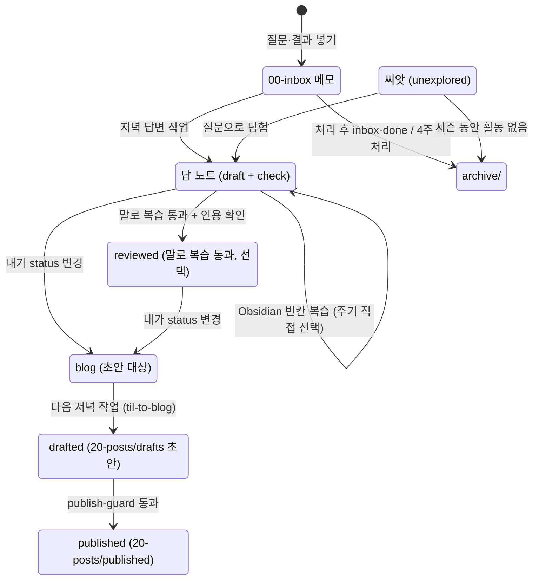

# 볼트 폴더 운영 가이드

**내가 직접 만드는 건 `00-inbox` 메모와 금칙 목록뿐이다.** 나머지 폴더는 예약 작업과 요청 시 실행하는 스킬이 만들고, 나는 Obsidian 빈칸 복습, 초안 대상 고르기(`status: blog`), 발행 확인만 한다. 말로 복습은 원할 때만.

상태 표시:
- **운영 중**: 지금 동작한다.
- **적용 예정**: 아직 안 바꿨다. 치환 스크립트가 여기에 남아 있다. (저녁 답변 작업, 말로 복습, 토요일 작업 축소, inbox 템플릿 변경, 하루 기록 알림은 2026-10-29부터 운영 중)
- **2주차**: 1주 써 본 뒤 바꾼다.

> **2026-11-04 변경 (토큰 절약)**: 예약 작업 모델을 Opus에서 Sonnet·Haiku로 나눴고, 토요일 inbox 정리는 주말 답변 작업(토요일 회차)에, 월요일 주간 퀘스트는 일요일 주간 리포트 작업에 합쳤다. 저녁 답변 작업은 할 일부터 확인하고, 질문당 출처 검색을 공식 문서 2개로 제한한다. 자세한 내용은 맨 아래 "예약 작업 구성과 토큰 절약".

설계 원문은 Claude Docs의 "[TIL 엔진 파이프라인 보완 설계](https://claude.ai/artifact/YVeS4sWwPFnn4NLA5QB9xJ)"이고, 이 파일은 볼트용 정리본이다.

## 노트 한 개의 흐름

## 폴더별 생성 주기와 방식

| 폴더                           | 들어가는 것                                            | 누가                                 | 언제                                    | 방식 · 파일 이름                                                                                                              | 다음 단계                                | 상태                           |
| ---------------------------- | ------------------------------------------------- | ---------------------------------- | ------------------------------------- | ----------------------------------------------------------------------------------------------------------------------- | ------------------------------------ | ---------------------------- |
| `00-inbox/`                  | 질문(+상황 한 줄, 선택), 키워드, 확인 과제 결과 `결과: …`            | 나                                  | 아무 때나                                 | Obsidian에서 새 메모, `YYYY-MM-DD-키워드.md`. 업무용 PC는 커밋 직전 치환 스크립트가 IP·호스트명 등을 `<호스트 IP>` 같은 자리표시어로 바꾼다                        | 저녁 답변 작업이 처리 → `archive/inbox-done/` | 메모·질문형 템플릿: 운영 중 / 치환: 적용 예정 |
| `10-concepts/` 답 노트          | 개념 1개 = 노트 1개                                     | 저녁 답변 작업 (`evening-answer`)        | 평일 18:07 · 주말 14:07, inbox에 질문이 있을 때만 | 공식 문서 근거 인용(질문당 검색·페이지 읽기 최대 2개, 부모·연관 노트에 있는 출처는 재사용), 선행 개념 답, 다음에 볼 개념, 다이어그램, 확인 과제, 핵심 카드 2장, `review_load`. `status: draft` + `check`                        | 빈칸 복습                                | 운영 중                         |
| `10-concepts/` 빈칸 복습 | 카드 줄 끝 `<!--til:...-->`, 속성 `review_count`·`accuracy`·`last_reviewed`·`next_review` | 나 (`til-review` 플러그인) | 아무 때나. 상태 표시줄 "복습 N장" / 뇌 아이콘 | 빈칸 입력 → 채점 → 다음 복습일 1·3·7·14·30일 또는 직접. 말로 복습(`voice-review`)은 원할 때만, 통과하면 `reviewed` | `status: blog`로 바꾸면 초안 | 운영 중 (2026-11-01~) |
| `10-concepts/` 묶음 노트         | 같은 부모 아래 하위 개념 2개 이상                              | 주말 답변 작업 (토요일 회차, `inbox-organize`) | 토 14:07, 답변 뒤 inbox에 메모가 남았을 때 | `note_type: hub`, 개요 + 하위 개념 지도, 카드 없음, 복습 제외                                                                           | `status: blog`로 바꾸면 주제별 긴 글 1편            | 운영 중                         |
| `10-concepts/` 씨앗            | 시즌 영역의 개념 자리 (`unexplored`)                       | Claude (`seed-map`)                | 요청할 때만 ("시즌 지도 만들어줘")                 | 공식 문서 목차 기준 15~30개. 영역당 30개, 전체 100개 상한                                                                                 | 질문으로 탐험 / 8주 활동 없으면 archive          | 운영 중                         |
| `10-concepts/` 연관 씨앗         | 답 노트·허브가 링크한 개념 (`unexplored`, `note_type: seed`) | 저녁 답변·주말 답변(토요일 정리)             | 링크할 때 자동                              | 한 줄 설명 + 공식 문서 링크 필수. 빈 링크로 두지 않음                                                                                       | 질문하면 그 파일이 답 노트로 자람                  | 운영 중                         |
| `20-posts/drafts/` | 블로그 초안 | 저녁 답변 작업 (`til-to-blog`) | 평일 18:07 · 주말 14:07, `status: blog` 노트가 있을 때 (한 번에 2개) | 내가 `blog`로 바꾼 노트만, `public`만. 묶음 노트를 `blog`로 바꾸면 하위 답 노트 전부를 긴 글 한 편으로 묶음(씨앗 제외, 2026-11-05~). `YYYY-MM-DD-slug.md`. 원본 노트는 `status: drafted`. 경험 문단은 원본 메모·확인 과제 결과로, 없으면 `[직접 작성]` | `publish-guard` | 운영 중 |
| `20-posts/published/`        | 발행본                                               | Claude (`publish-guard`) + 내 확인    | "발행 검사해줘" 통과 시                        | 초안을 옮기고 `published_at` 기록. 원본 노트 `status: published`는 확인 후                                                              | 매달 말투 학습 데이터                         | 운영 중                         |
| `30-ideas/`                  | 글감 창고                                             | Claude (`blog-pick`)               | 일 20:41 (다음 주 퀘스트와 함께)               | 5개 미만이면 남은 후보로 채운다                                                                                                      | 글 후보                                 | 운영 중                         |
| `90-daily/`                  | 주간 퀘스트, 주간 리포트, 월간 기록                             | 예약 작업                              | 일 20:41 (이번 주 리포트 + 다음 주 퀘스트) / 매달 1일 05:43 | `YYYY-Www-report.md`(이번 주), `YYYY-Www-quest.md`(다음 주), `YYYY-MM-monthly.md`                                                         | 내가 읽기                                | 운영 중 (퀘스트 기준 변경은 2주차)        |
| `archive/`                   | 처리한 inbox 메모, 4주 지난 미처리 메모, 활동 없는 씨앗, 파산 선언 시 전부  | 예약 작업                              | 처리 직후 / 매달 1일 / 시즌 회고 / 승인 시          | 옮기기만 하고 지우지 않는다                                                                                                         | -                                    | 운영 중                         |
| `dashboards/`                | Bases 표 6개 (`.base`). `TIL 현황.base`는 사이드바 고정용                              | Claude (초기 세팅)                     | 거의 안 바뀜                               | 필터만 고친다. "복습 대기" 표는 1주 뒤 검토                                                                                             | -                                    | 운영 중                         |
| `templates/`                 | 개념·inbox·글·퀘스트·리포트 템플릿                            | Claude                             | 설계가 바뀔 때만                             | inbox 템플릿 질문 형식 (운영 중), 씨앗 템플릿 `seed.md`, 블로그 템플릿 두 갈래 (2주차)                                                            | -                                    | 운영 중                         |
| `config/`                    | `forbidden-words.txt`                             | 나 (종류별 섹션 틀은 Claude)               | 새 금칙어가 생길 때                           | IP 대역, 호스트명, 고객사, 내부 시스템 섹션                                                                                             | 치환 스크립트·발행 검사가 읽음                    | 틀: 적용 예정                     |
| `docs/`                      | 설계 문서 사본, 사용량 시트, 이 가이드                           | Claude                             | 요청 시, 설계가 바뀔 때                        | Claude Docs 원본이 바뀌어도 자동 반영되지 않는다                                                                                        | -                                    | 운영 중                         |
| `life/`                      | 개발 외 주제                                           | 나 + Claude                         | 관문 1 통과 후 시작                          | `channel: life`, 개발 지도와 분리                                                                                              | -                                    | 비활성                          |

볼트 맨 위 파일과 숨김 폴더:

| 위치 | 언제 바뀌나 | 누가 |
| --- | --- | --- |
| `CLAUDE.md` | 설계가 바뀔 때 | Claude (요청 시) |
| `index.md` | 노트를 만들거나 한 줄 요약이 바뀔 때마다 | 노트를 만든 쪽 (예약 작업, Claude) |
| `style-guide.md` | 예시 글 2편은 내가 한 번, 자동 추출 섹션은 매달 1일 | 나 / `style-learn` |
| `.claude/skills/` | 설계가 바뀔 때 | Claude (요청 시) |
| `.githooks/` | 치환 스크립트 (적용 예정). 기기마다 `git config core.hooksPath .githooks` 한 번 | Claude / 나 |
| `.obsidian/` | Obsidian이 관리. 빈칸 복습 플러그인 `plugins/til-review/`, Extended Graph 설정은 요청 시 Claude가 고침. 옛 SR 플러그인 `data.json`은 동기화 제외 | Obsidian (Claude는 요청 시만) |

## 주기별 일정

| 주기 | 시각 (한국) | 무엇 | 쓰는 곳 | 상태 |
| --- | --- | --- | --- | --- |
| 수시 | - | 질문, 키워드, 확인 과제 결과 넣기 | `00-inbox/` | 운영 중 |
| 매일 | 17:27 | 하루 기록 알림: 그날 inbox가 비어 있으면 씨앗 하나를 질문거리로 붙여 알림 (읽기 전용, Haiku) | - | 운영 중 |
| 평일 | 18:07 | 저녁 답변 작업 (Sonnet): 얕은 clone → ls·grep으로 할 일 확인(inbox도 blog 노트도 없으면 규칙 파일을 읽기 전에 종료) → 2차 금칙 검사 → 답 노트 → `status: blog` 노트 초안(최대 2개) → 커밋 → 알림 | `10-concepts/`, `archive/inbox-done/`, `20-posts/drafts/` | 운영 중 |
| 주말 | 14:07 | 저녁 답변 작업 (같은 내용). 토요일에는 이어서 남은 메모 정리(`inbox-organize`: 묶음 노트 판단, 보관) | 위와 같음 + `archive/` | 운영 중 (토요일 정리 합침: 2026-11-04~) |
| 매일 | - | 빈칸 복습 (`til-review`, 상태 표시줄 "복습 N장") | 카드 줄 끝 `<!--til:...-->`, 노트 속성 | 운영 중 |
| 원할 때 | - | 말로 복습 ("말로 복습하자", 선택) | `10-concepts/` | 운영 중 |
| ~~토~~ | ~~04:41~~ | ~~정리 작업~~ → 주말 답변 작업 토요일 회차로 합침 | - | 일시정지 (2026-11-04~) |
| 일 | 20:41 | 이번 주 리포트 + 다음 주 퀘스트·글 후보 (`blog-pick`) + 수요 리서치 (`demand-research`) (Haiku) | `90-daily/`, `30-ideas/`, `40-demand/` | 운영 중 (월요일 퀘스트 합침: 2026-11-04~) |
| ~~월~~ | ~~05:37~~ | ~~주간 퀘스트~~ → 일요일 작업으로 합침 | - | 일시정지 (2026-11-04~) |
| 매달 1일 | 05:43 | 말투 가이드, 보스 태그, 4주 지난 메모 보관, 월간 기록 (Sonnet) | `style-guide.md`, `10-concepts/`, `archive/`, `90-daily/` | 운영 중 |
| 8주 | - | 시즌 회고 (활동 없는 씨앗 보관, 회고 글 1편) | `archive/`, `20-posts/` | 운영 중 |
| 요청 시 | - | `seed-map`, `blog-pick`, `til-to-blog`, `publish-guard` | 각 폴더 | 운영 중 |

## 내가 하는 일만 모아 보기

- **수시**: inbox에 질문을 넣는다. 상황 한 줄은 선택이다. 확인 과제를 실행했으면 결과 한 줄을 넣는다.
- **매일**: 상태 표시줄 "복습 N장"이나 뇌 아이콘으로 빈칸 복습을 하고, 카드마다 다음 복습일을 고른다.
- **글로 쓸 노트가 생기면**: 그 노트의 `status`를 `blog`로 바꾼다(속성 또는 명령 "이 노트를 블로그 초안 대상으로"). 다음 저녁 작업이 초안을 만든다. 일요일 밤에 만들어지는 이번 주 퀘스트 파일의 글 후보를 참고해도 된다.
- **원할 때**: 대화에서 "말로 복습하자". 통과하면 `reviewed`.
- **발행 전**: 경험 문단을 다듬고 "발행 검사해줘"를 요청한다.
- **월요일에 한 번**: `40-demand/`의 이번 주 수요 리서치를 보고, 실험할 아이디어가 있으면 그 노트의 `status`를 `testing`으로 바꾼다. 실험은 한 번에 하나, 2주 뒤 성공·접기를 정한다.
- **기기를 바꾸기 전**: Obsidian Git으로 push한다. 같은 노트를 두 기기에서 동시에 고치지 않는다. 빈칸 복습 중에는 그 노트를 편집하지 않는다.

## 예약 작업 구성과 토큰 절약 (2026-11-04~)

**할 일이 없는 날은 거의 토큰을 쓰지 않고, 무거운 모델은 답과 초안을 쓰는 작업에만 쓴다.** 예약 작업은 7개에서 5개가 됐고, 실행 횟수는 주 17회에서 15회로 줄었다.

| 작업 | 시각 (한국) | 모델 | 바뀐 점 |
| --- | --- | --- | --- |
| 하루 기록 알림 | 매일 17:27 | Haiku | 모델만 변경 |
| 저녁 답변 (평일) | 평일 18:07 | Sonnet | 할 일 먼저 확인, 얕은 clone, 출처 검색 한도 |
| 저녁 답변 (주말, 토요일 inbox 정리 포함) | 토·일 14:07 | Sonnet | 위와 같음 + 토요일 회차에 `inbox-organize` |
| 일요일 주간 리포트 + 다음 주 퀘스트 + 수요 리서치 | 일 20:41 | Haiku | 월요일 퀘스트 작업을 합침, 수요 리서치 단계 추가(2026-11-14~) |
| 월초 갱신 | 매달 1일 05:43 | Sonnet | 모델만 변경 |
| ~~토요일 inbox 정리~~ | ~~토 04:41~~ | - | 일시정지 (지우지 않음) |
| ~~월요일 주간 퀘스트~~ | ~~월 05:37~~ | - | 일시정지 (지우지 않음) |

**절약 규칙**

- **할 일부터 확인**: 저녁 답변 작업은 clone 직후 `00-inbox/`(`.gitkeep` 제외)와 `status: blog` 노트를 ls·grep으로만 확인한다. 둘 다 없으면 `CLAUDE.md`·`index.md`·스킬 파일을 읽기 전에 "답할 질문 없음"으로 끝낸다.
- **얕은 clone**: 저녁 답변은 `--depth 1`, 커밋 이력이 필요한 알림·주간 리포트는 `--depth 50`. 저녁 답변에서 push가 거부되면 `git fetch --unshallow` 후 pull --rebase 한다.
- **출처 검색 한도**: 질문 하나당 웹 검색·페이지 읽기는 공식 문서 기준 최대 2개. 부모·연관 노트에 이미 있는 출처로 확인되는 내용은 다시 검색하지 않는다. 출처로 확인하지 못한 내용은 쓰지 않는 규칙은 그대로다. 이 한도는 예약 작업 지시에 들어 있고, 스킬 파일(`evening-answer`)과 다르면 예약 작업 지시를 따른다.
- **모델 분담**: 답 노트·블로그 초안·말투 학습은 Sonnet, 확인·알림·리포트·퀘스트는 Haiku. 일요일 리포트 품질이 떨어지면 그 작업만 Sonnet으로 올린다.
- **새 작업은 기존 작업에 얹는다**: 뉴스레터처럼 주 1회 산출물을 추가할 때는 새 예약 작업을 만들지 않고 일요일 작업에 단계를 더한다.

