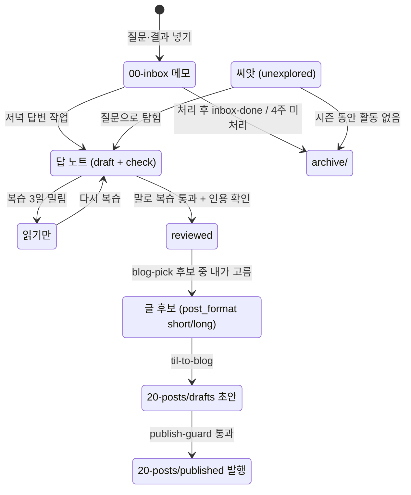

# 볼트 폴더 운영 가이드

**내가 직접 만드는 건 `00-inbox` 메모와 금칙 목록뿐이다.** 나머지 폴더는 예약 작업과 요청 시 실행하는 스킬이 만들고, 나는 말로 복습·글 고르기·발행 확인만 한다.

상태 표시:
- **운영 중**: 지금 동작한다.
- **적용 예정**: 보완 설계 1주차에 바꾼다. 저녁 답변 작업, 치환 스크립트, 토요일 작업 축소, inbox 템플릿 변경이 여기에 속한다.
- **2주차**: 1주 써 본 뒤 바꾼다.

설계 원문은 Claude Docs의 "[TIL 엔진 파이프라인 보완 설계](https://claude.ai/artifact/YVeS4sWwPFnn4NLA5QB9xJ)"이고, 이 파일은 볼트용 정리본이다.

## 노트 한 개의 흐름

## 폴더별 생성 주기와 방식

| 폴더 | 들어가는 것 | 누가 | 언제 | 방식 · 파일 이름 | 다음 단계 | 상태 |
| --- | --- | --- | --- | --- | --- | --- |
| `00-inbox/` | 질문(+상황 한 줄, 선택), 키워드, 확인 과제 결과 `결과: …` | 나 | 아무 때나 | Obsidian에서 새 메모, `YYYY-MM-DD-키워드.md`. 업무용 PC는 커밋 직전 치환 스크립트가 IP·호스트명 등을 `<호스트 IP>` 같은 자리표시어로 바꾼다 | 저녁 답변 작업이 처리 → `archive/inbox-done/` | 메모: 운영 중 / 치환·템플릿: 적용 예정 |
| `10-concepts/` 답 노트 | 개념 1개 = 노트 1개 | 저녁 답변 작업 (지금은 토요일 정리 작업이나 대화) | 평일 18:07 · 주말 14:07, inbox에 질문이 있을 때만 | 공식 문서 근거 인용, 선행 개념 답, 다음에 볼 개념, 다이어그램, 확인 과제, 핵심 카드 2장, `review_load`. `status: draft` + `check` | 말로 복습 | 적용 예정 |
| `10-concepts/` 복습 기록 · 추가 카드 | 말로 복습 결과 | 나 + Claude (저녁 세션) | 알림 받은 뒤, 하루 10점까지 | 틀리거나 헷갈린 지점 카드 추가 (노트당 최대 5장). 통과 + 인용 확인이면 `reviewed`. 3일 밀리면 읽기만 | 글 후보 | 적용 예정 |
| `10-concepts/` 묶음 노트 | 같은 부모 아래 하위 개념 2개 이상 | 토요일 정리 작업 | 토 04:41 | `note_type: hub`, 개요 + 하위 개념 지도, 카드 없음, 복습 제외 | 긴 글 묶음 후보의 허브 | 적용 예정 |
| `10-concepts/` 씨앗 | 시즌 영역의 개념 자리 (`unexplored`) | Claude (`seed-map`) | 요청할 때만 ("시즌 지도 만들어줘") | 공식 문서 목차 기준 15~30개. 영역당 30개, 전체 100개 상한 | 질문으로 탐험 / 8주 활동 없으면 archive | 운영 중 |
| `20-posts/drafts/` | 블로그 초안 | Claude (`til-to-blog`) | "블로그 초안 써줘" 요청 시 | 내가 고른 노트만 (`reviewed`, `public`, `post_format` short/long). `YYYY-MM-DD-slug.md`. 경험 문단은 원본 메모·확인 과제 결과로, 없으면 `[직접 작성]` | `publish-guard` | 운영 중 (탐구형 템플릿은 2주차) |
| `20-posts/published/` | 발행본 | Claude (`publish-guard`) + 내 확인 | "발행 검사해줘" 통과 시 | 초안을 옮기고 `published_at` 기록. 원본 노트 `status: published`는 확인 후 | 매달 말투 학습 데이터 | 운영 중 |
| `30-ideas/` | 글감 창고 | Claude (`blog-pick`) | 월 05:37 | 5개 미만이면 남은 후보로 채운다 | 글 후보 | 운영 중 |
| `90-daily/` | 주간 퀘스트, 주간 리포트, 월간 기록 | 예약 작업 | 월 05:37 / 일 20:41 / 매달 1일 05:43 | `YYYY-Www-quest.md`, `YYYY-Www-report.md`, `YYYY-MM-monthly.md` | 내가 읽기 | 운영 중 (퀘스트 기준 변경은 2주차) |
| `archive/` | 처리한 inbox 메모, 4주 지난 미처리 메모, 활동 없는 씨앗, 파산 선언 시 전부 | 예약 작업 | 처리 직후 / 매달 1일 / 시즌 회고 / 승인 시 | 옮기기만 하고 지우지 않는다 | - | 운영 중 |
| `dashboards/` | Bases 표 5개 (`.base`) | Claude (초기 세팅) | 거의 안 바뀜 | 필터만 고친다. "복습 대기" 표는 1주 뒤 검토 | - | 운영 중 |
| `templates/` | 개념·inbox·글·퀘스트·리포트 템플릿 | Claude | 설계가 바뀔 때만 | inbox 템플릿을 질문 형식으로 (적용 예정), 블로그 템플릿 두 갈래 (2주차) | - | 변경 예정 |
| `config/` | `forbidden-words.txt` | 나 (종류별 섹션 틀은 Claude) | 새 금칙어가 생길 때 | IP 대역, 호스트명, 고객사, 내부 시스템 섹션 | 치환 스크립트·발행 검사가 읽음 | 틀: 적용 예정 |
| `docs/` | 설계 문서 사본, 사용량 시트, 이 가이드 | Claude | 요청 시, 설계가 바뀔 때 | Claude Docs 원본이 바뀌어도 자동 반영되지 않는다 | - | 운영 중 |
| `life/` | 개발 외 주제 | 나 + Claude | 관문 1 통과 후 시작 | `channel: life`, 개발 지도와 분리 | - | 비활성 |

볼트 맨 위 파일과 숨김 폴더:

| 위치 | 언제 바뀌나 | 누가 |
| --- | --- | --- |
| `CLAUDE.md` | 설계가 바뀔 때 | Claude (요청 시) |
| `index.md` | 노트를 만들거나 한 줄 요약이 바뀔 때마다 | 노트를 만든 쪽 (예약 작업, Claude) |
| `style-guide.md` | 예시 글 2편은 내가 한 번, 자동 추출 섹션은 매달 1일 | 나 / `style-learn` |
| `.claude/skills/` | 설계가 바뀔 때 | Claude (요청 시) |
| `.githooks/` | 치환 스크립트 (적용 예정). 기기마다 `git config core.hooksPath .githooks` 한 번 | Claude / 나 |
| `.obsidian/` | Obsidian이 관리. SR 플러그인 `data.json`은 동기화 제외 | Obsidian (Claude는 건드리지 않음) |

## 주기별 일정

| 주기 | 시각 (한국) | 무엇 | 쓰는 곳 | 상태 |
| --- | --- | --- | --- | --- |
| 수시 | - | 질문, 키워드, 확인 과제 결과 넣기 | `00-inbox/` | 운영 중 |
| 평일 | 18:07 | 저녁 답변 작업 (Sonnet): 2차 금칙 검사 → 답 노트 → 커밋 → 알림. inbox가 비면 바로 종료 | `10-concepts/`, `archive/inbox-done/` | 적용 예정 |
| 주말 | 14:07 | 저녁 답변 작업 (같은 내용) | 위와 같음 | 적용 예정 |
| 알림 후 | - | 말로 복습 (하루 10점까지) | `10-concepts/` | 적용 예정 |
| 매일 | - | 복습 카드 (Obsidian SR) | 노트 안 SR 주석 | 운영 중 |
| 토 | 04:41 | 정리 작업. 지금은 inbox 정리, 적용 후에는 묶음 노트 판단·읽기만 정리·보관만 | `10-concepts/`, `archive/` | 축소 예정 |
| 일 | 20:41 | 주간 리포트 | `90-daily/` | 운영 중 |
| 월 | 05:37 | 주간 퀘스트 + 글 후보 (`blog-pick`) | `90-daily/`, `30-ideas/` | 운영 중 |
| 매달 1일 | 05:43 | 말투 가이드, 보스 태그, 4주 지난 메모 보관, 월간 기록 | `style-guide.md`, `10-concepts/`, `archive/`, `90-daily/` | 운영 중 |
| 8주 | - | 시즌 회고 (활동 없는 씨앗 보관, 회고 글 1편) | `archive/`, `20-posts/` | 운영 중 |
| 요청 시 | - | `seed-map`, `blog-pick`, `til-to-blog`, `publish-guard` | 각 폴더 | 운영 중 |

## 내가 하는 일만 모아 보기

- **수시**: inbox에 질문을 넣는다. 상황 한 줄은 선택이다. 확인 과제를 실행했으면 결과 한 줄을 넣는다.
- **저녁 알림 후**: 그 세션에서 말로 복습을 하고, 출처 인용문을 훑어본다.
- **매일**: SR 카드를 복습한다.
- **월요일**: 퀘스트 파일의 글 후보 중 하나를 고른다. 그다음 "블로그 초안 써줘"를 요청한다.
- **발행 전**: 경험 문단을 다듬고 "발행 검사해줘"를 요청한다.
- **기기를 바꾸기 전**: Obsidian Git으로 push한다. 같은 노트를 두 기기에서 동시에 고치지 않는다. 말로 복습 중에는 그 노트를 편집하지 않는다.
