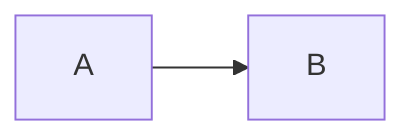

---
title:
status: draft
source_notes: []
post_format: short
created_at:
published_at:
version_info:
---

# (검색 의도가 드러나는 제목)

## 요약
- 
- 
- 

## 문제 상황
(재현 가능한 맥락, 사용 버전, 증상. 회사 정보는 일반화)

## 원리
(먼저 이 개념이 왜 필요한지 한 문단: 없으면 생기는 문제, 어떤 특성 때문인지. 그다음 왜 그런 일이 생기는지)

> 예제 기준: (코드·설정·명령어 예제마다 바로 위에. 소프트웨어 이름 버전)

## 해결과 선택지 비교

## 직접 해본 결과
(원본 메모를 뼈대로. 내가 직접 다듬는 부분)

## 함정과 주의점

## 참고 자료
- 

---
작성일: · 버전: · 수정 이력:
